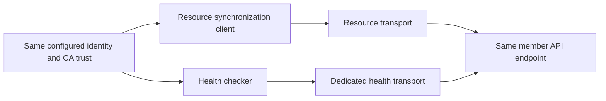

# Isolate Slow Clusterpedia Health Checks with Standalone TCP

Author: [nawazdhandala](https://www.github.com/nawazdhandala)

Tags: Kubernetes, Multi-Cluster, Troubleshooting

Description: Diagnose health-check contention and test Clusterpedia's standalone TCP option without confusing transport isolation with a fix for API failures.

A PediaCluster becomes unhealthy while its synchronization manager starts a large number of resource watches. The member API responds normally from another client, but health requests from the manager time out during the burst. Shared transport contention is one possible explanation.

Clusterpedia provides `HealthCheckerWithStandaloneTCP` to separate the health client's transport from other member traffic. It is a targeted option, not a general cure for unhealthy clusters. This walkthrough uses **Clusterpedia v0.9.0**, **client-go0.31.2**, and **Helm chart2.7.0**. Local checks cover transport behavior and chart rendering; no live Clusterpedia latency improvement is claimed.

## Establish what the health check actually does

The v0.9.0 monitor sends a readiness request to `/readyz` with a five-second context timeout. It falls back to `/healthz` only when `/readyz` returns NotFound. An authorization failure or timeout is not a reason to silently try the fallback. These details come from the [tagged monitor implementation](https://github.com/clusterpedia-io/clusterpedia/blob/v0.9.0/pkg/synchromanager/clustersynchro/cluster_monitor.go).

Read the observed condition before changing transport configuration:

```bash
kubectl --context HOST_CONTEXT get pediacluster MEMBER_NAME -o json \
  | jq '.status.conditions[]? | select(.type == "ClusterHealthy")'
```

Replace the hosting context and imported member name. Inspect the message as well as the status and reason. In this release, `ClusterNotReachable` can accompany different request errors, including authentication or authorization failures; it is not a precise diagnosis of a TCP outage.

| Evidence | Investigate first |
| --- | --- |
| Unknown CA, certificate name, or expiry error | Member trust and certificate configuration |
| Unauthorized or Forbidden response | Import credential and health-endpoint permissions |
| DNS or connection refusal | Endpoint, routing, and service availability |
| Readiness failure across independent clients | Member API readiness and load |
| Failures concentrated around manager synchronization bursts | Transport contention as one hypothesis |

A condition's transition time is not a per-request latency sample. Collect timing and relevant manager logs for the incident window rather than using that timestamp as a health-check stopwatch.

## Understand the isolation boundary

The [official feature page](https://clusterpedia.io/docs/features/health-checker-with-standalone-tcp/) describes the problem as health checks sharing connections with synchronization traffic. Client-go can reuse cached transport state for equivalent configurations.

With the gate enabled, the [v0.9.0 cluster constructor](https://github.com/clusterpedia-io/clusterpedia/blob/v0.9.0/pkg/synchromanager/clustersynchro/cluster_synchro.go) copies the member configuration and assigns a separate dial function to the health checker. The copied configuration retains its authentication and certificate settings.



This does not add a separate member port, bypass TLS verification, or turn readiness into a bare socket-open test. It remains an HTTP readiness request to the configured API endpoint. It also does not isolate the member API's CPU, load balancer, network route, or authorization policy.

The custom dialer uses thirty-second dial/keepalive settings, but that does not replace the monitor's five-second request context. Do not interpret the dialer value as a thirty-second health-check timeout.

## Compare an independent readiness request carefully

If you have an approved diagnostic kubeconfig using the same import identity and trust settings, a read-only probe can help separate persistent endpoint failure from a manager-specific timing issue:

```bash
kubectl --kubeconfig /protected/path/member-reader.kubeconfig \
  --request-timeout=5s get --raw='/readyz'
```

The expected successful response is typically a short readiness result. Preserve errors; do not disable certificate verification to turn a failed test into a successful one. The kubeconfig must be self-contained and usable from the diagnostic environment.

A successful workstation request is useful but incomplete evidence. Its route, DNS, proxy, and transport state may differ from those of the synchronization manager. If possible, repeat from an approved diagnostic environment with equivalent network access. Do not copy credentials into a public shell history or print a full PediaCluster specification just to obtain them.

Correlate the result with manager startup or re-list activity and member-side request observations. A separate connection cannot make an overloaded API server respond faster simply by avoiding a shared client transport.

## Enable the gate in a controlled pilot

The [v0.9.0 feature definitions](https://github.com/clusterpedia-io/clusterpedia/blob/v0.9.0/pkg/synchromanager/features/features.go) mark this gate alpha and disabled by default. For chart2.7.0, use:

```yaml
clustersynchroManager:
  featureGates:
    HealthCheckerWithStandaloneTCP: true
```

Save it as `health-transport.yaml`. With Helm3.17.3 and the verified chart archive, render against your complete reviewed values:

```bash
helm template clusterpedia ./clusterpedia-2.7.0.tgz \
  --namespace clusterpedia-system \
  -f reviewed-installation-values.yaml -f health-transport.yaml \
  > rendered.yaml
```

Inspect the synchronization-manager Deployment's command for the exact gate. Keep rendered output protected because installation values may contain credentials. Rendering verifies configuration output; it does not test the running request path.

This is a manager-level gate, not a field that enables isolation for only one PediaCluster. Use a staging instance or a deliberately limited manager deployment for the pilot. If your single manager serves the whole fleet, assess that full scope before rolling it out.

## Rehearse the traffic pattern that caused the incident

Record a baseline with the gate disabled, then repeat a comparable controlled synchronization startup with it enabled. Measure health-request failures and timing, manager resource use, member API latency, and resource synchronization progress.

Also inspect connection usage at the manager, proxies, and member endpoint. The feature documentation illustrates an additional connection per member, but the actual connection count depends on client behavior, topology, retries, and protocols. Use that example for capacity planning, not as an exact fleet-wide socket guarantee.

For this article's local test, two equivalent client-go configurations reused one connection to an owned synthetic TLS server. Adding the separate dialer opened another connection while preserving CA verification and a synthetic authentication header. The server used a controlled HTTP transport fixture, not a Kubernetes API or a congested production network. The test demonstrates separation, not performance improvement.

## Decide from observed behavior

Keep the setting when the reproduced health-check failures improve without unacceptable connection or resource cost. Continue monitoring actual resource synchronization; a healthy readiness result does not prove that every resource watch is authorized or current.

If the failure remains, return to the error message and broader evidence. Look for API overload, authentication refresh problems, proxy behavior, DNS, and route differences. Do not keep adding timeouts or toggles to conceal a failing readiness endpoint.

Rollback means restoring the previous manager configuration and performing the corresponding controlled rollout. Verify the running process configuration and repeat the same observations. The useful outcome is a demonstrated improvement for a specific contention problem, with the member's real readiness and security checks intact.
