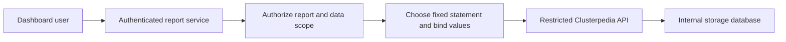

# Use Clusterpedia SQL Filters Without Exposing Arbitrary Statements

Author: [nawazdhandala](https://www.github.com/nawazdhandala)

Tags: Kubernetes, Multi-Cluster, Security

Description: Keep Clusterpedia SQL filters behind fixed application queries, bind values separately, and test the boundary that feature gates alone cannot enforce.

A fleet dashboard needs a filter that ordinary Clusterpedia selectors cannot express. Passing a SQL condition through its search API looks convenient. The dangerous step is letting a dashboard visitor decide what that condition contains.

This guide uses **Clusterpedia v0.9.0** and **Helm chart2.7.0** to explain the boundary. SQL is the database query language; parameter binding supplies a value separately from the statement that interprets it. Binding is useful, but it cannot protect a statement that the caller already controls.

## First decide whether SQL is necessary

Clusterpedia already supports cluster, namespace, name, time, label, and field filtering. Use those interfaces when they express your requirement. They avoid coupling application queries to storage columns and database-specific JSON syntax. See the [official search reference](https://clusterpedia.io/docs/usage/search/).

The small example below searches for an exact resource name. Ordinary name filtering would be preferable for that requirement. Its purpose is to make statement ownership and parameter order easy to inspect before adapting the pattern to an approved, genuinely SQL-dependent report.

Treat any more complex expression as maintained application code. Review its execution cost and behavior against the database backend you actually run. A query that is syntactically valid can still scan a large table or expose data outside the intended report.

## Understand both gates before enabling either

The [v0.9.0 feature definitions](https://github.com/clusterpedia-io/clusterpedia/blob/v0.9.0/pkg/storage/internalstorage/features.go) default both SQL gates to false. The [request-processing implementation](https://github.com/clusterpedia-io/clusterpedia/blob/v0.9.0/pkg/storage/internalstorage/util.go) makes these distinctions:

| Configuration | SQL-filter behavior |
| --- | --- |
| Both gates false | SQL-specific parameters do not add a condition |
| `AllowRawSQLQuery=true` | Accepts `whereSQL`, or prefers a supplied `whereSQLStatement` |
| Only `AllowParameterizedSQLQuery=true` | Accepts `whereSQLStatement` and its parameter fields; ignores legacy `whereSQL` |

The parameterized path accepts a statement even without parameters. It does not require an approved template, verify the caller's intended data scope, or convert arbitrary SQL into safe SQL.

This also affects migration testing: an ignored legacy parameter can produce a successful but less-filtered response. A successful HTTP status is therefore insufficient evidence that the intended restriction ran.

## Put statement ownership in a trusted service

For an application-facing search, use a narrow service that authorizes the user and selects a fixed report. It must construct a fresh backend request instead of forwarding arbitrary query parameters.



The service should reject unknown request fields. Do not accept a SQL expression, column name, sort expression, or backend URL from the browser. Keep Clusterpedia credentials on the server and restrict who can reach and authenticate to the SQL-enabled API.

This design is incomplete if the same untrusted users can bypass the report service and call that API directly. Assess their existing aggregated-API access as well as direct network access. Kubernetes authorization on a resource request is not an allowlist of SQL statement text. If that bypass cannot be prevented, leave these gates disabled for the shared instance and use ordinary searches or a separately controlled reporting system.

## Render the narrower configuration

For a restricted pilot, save this chart fragment as `sql-filter-values.yaml`:

```yaml
apiserver:
  featureGates:
    AllowRawSQLQuery: false
    AllowParameterizedSQLQuery: true
```

Use Helm3.17.3 with the verified chart archive and your complete installation settings:

```bash
helm template clusterpedia ./clusterpedia-2.7.0.tgz \
  --namespace clusterpedia-system \
  -f reviewed-installation-values.yaml -f sql-filter-values.yaml \
  > rendered.yaml
```

Inspect the API-server Deployment command for both values. Protect the rendered file because other installation settings may contain credentials. This verifies generated manifests, not authorization, query execution, or the running process configuration. The [tagged chart template](https://github.com/clusterpedia-io/clusterpedia-helm/blob/clusterpedia-2.7.0/charts/clusterpedia/templates/apiserver-deployment.yaml) shows where API-server feature gates are applied.

Apply changes through your normal reviewed deployment process only after the service boundary exists. Do not expose the endpoint first and plan to add authorization later.

## Construct a fixed backend request

This Python3 example builds a relative API path; it does not send a request or provide an authentication server. Replace the fixed cluster and namespace with reviewed configuration belonging to the report. In a multi-tenant service, derive permitted scope from the authenticated identity, not a browser-supplied cluster string.

```python
from urllib.parse import urlencode


def build_report_path(resource_name):
    if not isinstance(resource_name, str) or not 1 <= len(resource_name) <= 253:
        raise ValueError("Provide a nonempty resource name of at most 253 characters")

    query = [
        ("clusters", "member-a"),
        ("namespaces", "payments"),
        ("limit", "20"),
        ("withContinue", "false"),
        ("whereSQLStatement", "name = ?"),
        ("whereSQLParam", resource_name),
    ]
    return "/apis/clusterpedia.io/v1beta1/resources/api/v1/pods?" + urlencode(query)


if __name__ == "__main__":
    print(build_report_path("checkout-worker"))
```

The output contains an encoded statement and a separate value. The `?` belongs to the statement; do not substitute the resource name into that string. URL encoding preserves the request representation. It is not the protection against SQL injection: keeping data separate from statement syntax is the relevant protection.

For multiple scalar arguments, repeat `whereSQLParam` in placeholder order. The implementation also supports `whereSQLJSONParams`, a base64-encoded JSON array, for other argument forms. Avoid mixing the two representations: nonempty JSON parameters take precedence in this release.

[GORM's security guidance](https://gorm.io/docs/security.html), relevant because Clusterpedia uses GORM to construct database queries, distinguishes bound arguments from caller-built SQL strings. It also warns that logged SQL is not necessarily escaped exactly like the executed query. Do not copy a logged query into a database console as proof of safe execution.

## Test results, rejection, and bypass paths

Use a disposable dataset with known matching and nonmatching rows. Verify that the fixed report returns only its expected cluster, namespace, and name. Test empty values, oversized values, unknown fields, and an ordinary punctuation-bearing string as data. Inspect statement text and arguments separately.

Test authorization independently: another user's scope must remain inaccessible, and an untrusted caller must not reach the underlying SQL-enabled endpoint. Those checks require your deployed identity and network configuration; a helper unit test cannot establish them.

During migration, send a legacy `whereSQL` request in staging and compare the actual result set. With only the parameterized gate enabled, that legacy condition is ignored. Update old callers before removing their gate; otherwise a narrow-looking request can unexpectedly return broader results.

Bound the report's page size, request rate, and allowed operations. Twenty returned rows do not guarantee a cheap database query. Observe query duration and database load using representative data before publishing a costly report.

The local checks for this article cover the exact URL-building helper, fixed statement/value separation, input bounds, and Helm output. They do not establish production authorization or database performance. Keep both gates disabled when those operational controls cannot be demonstrated.
