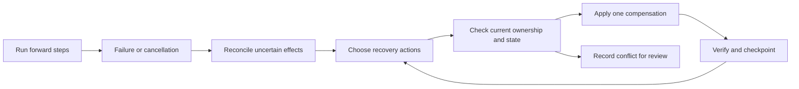

# Recover Partial Cloud Workflows with Compensating Actions

Author: [nawazdhandala](https://www.github.com/nawazdhandala)

Tags: Cloud Automation, AWS, Reliability

Description: Design compensating actions that undo only your workflow's effects, preserve concurrent changes, and leave a durable record when recovery needs help.

Consider a workflow that reserves a preview name, creates infrastructure, and publishes a route. The route step fails. There is no database transaction that automatically removes the infrastructure and releases the reservation across all those systems.

You need a recovery plan for the effects that actually happened. That plan may delete a newly created resource, release a reservation, or preserve data for investigation. It should not blindly restore an old snapshot of the world.

A compensating action is a new operation that offsets a previous action according to business rules. It may restore usability without restoring every byte of the original state. Microsoft describes why concurrent changes matter in its [compensating transaction pattern](https://learn.microsoft.com/en-us/azure/architecture/patterns/compensating-transaction).

## Write the recovery plan beside the forward plan

Before implementing the happy path, classify each step:

| Forward action | Possible compensation | Condition before compensation |
| --- | --- | --- |
| Reserve a preview identifier | Release this run's reservation | Owner and reservation version still match |
| Create an isolated compute resource | Delete the recorded resource | Created by this run, no retained data or new consumers |
| Attach to a shared service | Remove this run's attachment | Attachment identity and current ownership match |
| Publish an application route | Restore or remove the owned route | Current route still matches the expected post-change state |
| Accept application writes | Recover through a data-specific procedure | Data owner approves consistency and retention plan |

“Created by this run” is different from “returned by this run.” A create-or-get helper may return an existing shared resource. Record whether the workflow created, adopted, or merely referenced it.

Also decide whether forward recovery is preferable. If infrastructure is healthy and only a permission needed for routing is missing, repairing the permission and completing deployment may be safer than removing everything.

## Keep a journal of known effects

Store an operation ID, request revision, step state, physical resource ID, ownership evidence, and compensation status in durable storage. For a change to an existing object, capture the relevant before-value and the version or identity of the state produced by your change.

Useful step states include `planned`, `submitted`, `confirmed`, `compensating`, `compensated`, and `needs-review`. A submitted request with a lost response is not the same as a confirmed failure. Reconcile it with the provider before deciding which compensation exists.



A saga is a sequence of local operations coordinated with compensating actions. It does not provide the isolation of one database transaction. AWS emphasizes idempotency and concurrent-change concerns in its [saga orchestration guidance](https://docs.aws.amazon.com/prescriptive-guidance/latest/cloud-design-patterns/saga-orchestration.html).

## Make compensation conditional at the write

Reading ownership and then issuing an unconditional delete leaves a race: another actor can change ownership between those calls. Use a provider's conditional write when available. If an external API has no suitable condition, serialize changes through an enforceable ownership mechanism or leave the conflict for review; a fresh read alone is not atomic protection.

Here is a narrowly scoped example for a DynamoDB reservation table. The table has one string partition key, `environment_id`, and no sort key. Each item contains a string `operation_id` and numeric `version`.

The workflow must use unique operation IDs and must not recreate an old owner/version combination. All reservation writers must follow the same conditional-update rules. This example assumes a single-Region table, and the coordinator must already have stopped forward work and confirmed that cloud resources and routes no longer require the reservation.

The helper uses Python 3.11 and Boto3 **1.40.76**, matching the locally tested SDK. Calling it with a real authorized DynamoDB client performs a real conditional deletion of one reservation item. It does not delete any cloud infrastructure.

```python
from botocore.exceptions import ClientError


def release_reservation(client, table, environment_id, operation_id, version):
    if type(version) is not int or version < 1:
        raise ValueError('Expected a positive reservation version')
    try:
        client.delete_item(
            TableName=table,
            Key={'environment_id': {'S': environment_id}},
            ConditionExpression='#owner = :owner AND #version = :version',
            ExpressionAttributeNames={
                '#owner': 'operation_id', '#version': 'version',
            },
            ExpressionAttributeValues={
                ':owner': {'S': operation_id},
                ':version': {'N': str(version)},
            },
        )
        return 'released'
    except ClientError as error:
        if error.response['Error']['Code'] != 'ConditionalCheckFailedException':
            raise
    response = client.get_item(
        TableName=table,
        Key={'environment_id': {'S': environment_id}},
        ConsistentRead=True,
    )
    if 'Item' not in response:
        return 'already-absent'
    return 'review-current-reservation'
```

Supply the actual table name and the environment ID, operation ID, and version from the confirmed forward-step journal. DynamoDB evaluates the condition as part of the delete. If another operation owns the item or the version changed, the deletion is rejected. See [DeleteItem](https://docs.aws.amazon.com/amazondynamodb/latest/APIReference/API_DeleteItem.html) and [conditional expressions](https://docs.aws.amazon.com/amazondynamodb/latest/developerguide/Expressions.ConditionExpressions.html).

After a condition failure, the helper checks the table directly with a strongly consistent read. An absent item means this reservation is currently absent, so repeating an already-successful release does not require another mutation. A present item returns `review-current-reservation`; it never triggers an unconditional second delete.

The read is evidence about that moment, not a lock on future writes. DynamoDB documents that distinction in its [read-consistency guidance](https://docs.aws.amazon.com/amazondynamodb/latest/developerguide/HowItWorks.ReadConsistency.html). A new reservation appearing later belongs to a new lifecycle and must not be removed as part of this old run.

This helper does not prove cloud teardown completed. Releasing the reservation too early could allow reuse while old infrastructure still serves traffic. Keep that ordering requirement in the coordinator and acceptance tests.

## Compensate in the order the current system requires

Reverse order is a useful starting point, but dependencies and data safety determine the real sequence. Withdraw public routing before removing the serving resource. Confirm that ongoing writes stopped before deleting storage. Release the name only after old consumers can no longer use it.

Some changes cannot be cleanly undone. A notification cannot be unread. A database schema migration may need a forward repair. A resource used by another system after creation may no longer be safe to remove. Record these outcomes as explicit exceptions rather than claiming that rollback restored the original state.

Checkpoint each compensation after verifying its effect. If the worker crashes after the effect but before the checkpoint, the next attempt must reconcile and safely recognize completion. Never assume that compensation calls cannot fail.

## Separate error handling from recovery policy

Workflow engines can route errors, but they do not invent the correct undo operation. In Step Functions, `Retry` repeats a state and `Catch` selects a fallback path. A retry around a non-idempotent forward operation can repeat its effect; a generic catch must not erase evidence of which steps completed. See [Step Functions error handling](https://docs.aws.amazon.com/step-functions/latest/dg/concepts-error-handling.html).

Keep the original failure and subsequent compensation failures in separate fields. For example, “route publication denied” explains why recovery started, while “reservation ownership changed” explains why one recovery action stopped. Both matter to the operator.

Use bounded retries for genuinely transient errors. Permission failures, changed ownership, and incompatible current state need correction or review. Do not convert them into a successful compensated status simply to make the workflow green.

## Prove recovery under interruption

Test failure after every confirmed forward effect and after every compensation effect. Include lost responses, duplicate compensation attempts, changed ownership, and a provider operation that completes after the coordinator times out.

Local tests for the helper covered successful release, already-absent state, a replacement reservation, permission denial, and invalid version inputs using stubbed SDK responses. They do not simulate DynamoDB concurrency or cloud teardown.

For staging acceptance, verify that a newer owner's reservation survives, retained data remains accessible, repeated recovery is harmless, and unresolved effects remain visible with an owner. A useful final status says what was completed, what was compensated, and what still needs attention. That is more accurate than an unconditional “rolled back” message.
