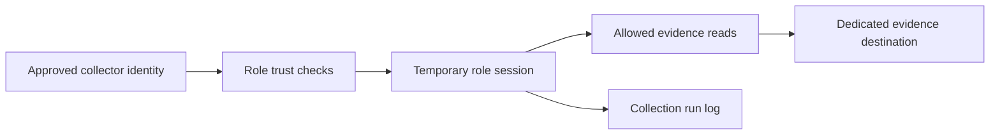

# Run Compliance Connectors with Least Privilege

Author: [nawazdhandala](https://www.github.com/nawazdhandala)

Tags: Compliance, Security, AWS

Description: Give evidence collectors narrowly scoped read access, separate collection from remediation, rotate credentials without silent gaps, and retain useful collection logs.

An evidence connector needs enough access to observe a system. It should not automatically inherit the ability to change that system. A convenient administrator token can make onboarding easy while giving a compromised collector access far beyond its purpose.

Least privilege starts with an explicit collection contract: which records, from which accounts, through which APIs, for which controls. Translate that contract into permissions, then test both successful collection and the boundaries that should remain closed.

The AWS example below reads evaluation results for one known Config rule. It is intentionally narrower than a general compliance platform connector. Policy JSON was parsed locally and the CLI command was checked without an AWS request; no live authorization test was performed.

## Separate collection from remediation

A read-only collector retrieves evidence. A remediation service changes resources. Even if one product offers both functions, keep their identities and approvals separate where the integration supports it.

| Function | Example access requirement | Ownership decision |
| --- | --- | --- |
| Evidence collection | Read approved configuration or evaluation results | Evidence owner approves scope |
| Evidence storage | Write collected artifacts to the designated destination | Storage owner controls retention and access |
| Remediation | Change a resource setting | Resource owner approves the change path |
| Connector administration | Change credentials, scope, or mappings | Integration owner controls configuration |

“Read only” is not the same as “low sensitivity.” A permitted read might expose resource identifiers, employee information, configuration details, or application data. Prefer metadata and evaluation results when they answer the control's question. Do not add object-content or secret-value access merely because the API name starts with `Get`.

AWS recommends workload roles with temporary credentials and permissions limited to what the workload requires. A broad managed read-only policy can still be broader than a specific collector's needs. [IAM security practices](https://docs.aws.amazon.com/IAM/latest/UserGuide/best-practices.html)

## Keep trust and permissions separate

An AWS role has a trust policy describing who can assume it and permissions describing what an assumed session can do. Review both. Restricting API actions does not correct a trust policy that admits the wrong principal.



For a multi-customer third-party collector, AWS recommends an external ID to address the confused deputy problem: the provider must not accidentally use its access to your account while serving another customer. The provider assigns the customer-specific value; it is not a secret or a replacement for authenticating the principal. [AWS third-party role guidance](https://docs.aws.amazon.com/IAM/latest/UserGuide/id_roles_common-scenarios_third-party.html)

This illustrative trust policy permits a specific provider role. Replace the account, role name, and external ID using verified provider onboarding information. The principal role must exist when the policy is installed. This is a policy document for review, not a command that creates access.

```json
{
  "Version": "2012-10-17",
  "Statement": [
    {
      "Effect": "Allow",
      "Principal": {
        "AWS": "arn:aws:iam::111122223333:role/ApprovedEvidenceCollector"
      },
      "Action": "sts:AssumeRole",
      "Condition": {
        "StringEquals": {
          "sts:ExternalId": "PROVIDER_ASSIGNED_CUSTOMER_ID"
        }
      }
    }
  ]
}
```

The provider also needs permission on its side to assume the target role. Validate the agreed principal format with the provider rather than replacing a documented integration policy blindly. For an internal workload, use its appropriate workload trust arrangement; an external ID is not a generic substitute for that design.

## Grant only the evidence read being demonstrated

Assume your collection inventory already contains one Config rule's name and Amazon Resource Name, or ARN. This permissions policy allows retrieval of that rule's compliance details:

```json
{
  "Version": "2012-10-17",
  "Statement": [
    {
      "Sid": "ReadApprovedRuleEvaluations",
      "Effect": "Allow",
      "Action": "config:GetComplianceDetailsByConfigRule",
      "Resource": "arn:aws:config:us-east-1:444455556666:config-rule/config-rule-abc123"
    }
  ]
}
```

Replace the account, Region, and rule identifier with the exact approved ARN. The rule identifier in the ARN is not necessarily the human-readable rule name used by the CLI. AWS documents resource-level permissions for this action. [AWS Config policy examples](https://docs.aws.amazon.com/config/latest/developerguide/security_iam_id-based-policy-examples.html)

This policy intentionally does not grant rule discovery, recorder inspection, remediation, storage access, or general resource inventory. A real connector may need additional actions, but each should have a reason and a scope. For actions that lack resource-level support, use the authorization reference to determine the required resource form and available conditions rather than inventing an ARN restriction. [AWS Config authorization reference](https://docs.aws.amazon.com/service-authorization/latest/reference/list_config.html)

With an already-configured profile that uses the target collection role, retrieve the known rule's results:

```bash
aws configservice get-compliance-details-by-config-rule \
  --profile evidence-collector \
  --region us-east-1 \
  --config-rule-name approved-encryption-rule \
  --output json \
  --no-cli-pager
```

Replace the example rule name. Keep automatic pagination enabled; one page may not represent the entire result. An empty evaluation list is not proof that all resources passed. Verify that the intended rule has evaluated the expected resources. The command shape was checked with AWS CLI 2.38.1 using a generated output skeleton. [AWS CLI reference](https://docs.aws.amazon.com/cli/latest/reference/configservice/get-compliance-details-by-config-rule.html)

## Test permissions as a collection workflow

Use a non-production account containing representative resources. Confirm the approved read succeeds and an out-of-scope rule read is denied. Check the provider's role-assumption flow with the expected external ID and with a missing or incorrect value.

Do not test destructive operations against production merely to prove they are denied. Use policy review and supported simulation to evaluate mutation permissions, then validate the real collection path in staging. IAM's simulator has limitations and may not reproduce every aspect of live authorization. [IAM policy simulator documentation](https://docs.aws.amazon.com/IAM/latest/UserGuide/access_policies_testing-policies.html)

Include pagination, all intended Regions, and every collection task in the test. A successful login and one API response do not demonstrate that a nightly collection will finish. Record denied actions and decide whether each is a legitimate requirement or an unnecessary probe by the connector.

## Rotate without making success ambiguous

Prefer automatic refresh of temporary sessions where supported. Monitor refresh failures separately from evidence freshness so an expiring session does not become a surprise several hours later.

If a provider requires a long-lived key, follow its supported overlap process. For AWS IAM user keys, AWS documents creating a replacement while the old key remains active, updating consumers, checking use, deactivating the old key, verifying continued operation, and finally deleting it. [AWS access-key update procedure](https://docs.aws.amazon.com/IAM/latest/UserGuide/id-credentials-access-keys-update.html)

Make the verification step a complete collection, not just token validation. Identify which credential version each run used without logging the secret. Allow enough observation time to cover infrequent jobs and delayed workers. Define a rollback window and owner; do not preserve obsolete credentials indefinitely because one consumer was never inventoried.

For suspected credential compromise, use the incident-response procedure instead of assuming a routine overlap window is acceptable.

## Retain logs that explain the collection

Log the run identifier, collector version, role or service identity, scope, source API, page count, start/end time, outcome, and durable evidence reference. Record error categories and source request identifiers where available. Exclude authorization headers, private keys, access tokens, and raw evidence payloads from routine operational logs.

Provider audit logs add independent context. AWS CloudTrail records supported account activity, but its availability and retention depend on event type and configuration. It does not replace the collector's record of page completion and successful storage. [AWS CloudTrail overview](https://docs.aws.amazon.com/awscloudtrail/latest/userguide/cloudtrail-user-guide.html)

Review permissions when a control mapping or connector version changes. Keep the approved collection contract, tested policy, credential ownership, and run evidence together. That makes a later access request a concrete review of additional evidence needs rather than a gradual return to administrator access.
