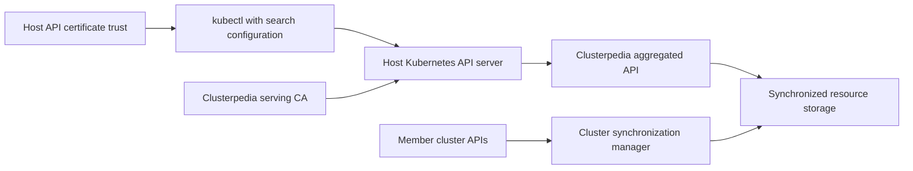

# Configure kubectl for Clusterpedia Multi-Cluster Search

Author: [nawazdhandala](https://www.github.com/nawazdhandala)

Tags: Kubernetes, kubectl, Multi-Cluster

Description: Create a separate kubectl configuration for Clusterpedia search while preserving authentication, certificate trust and the normal host-cluster context.

After installing Clusterpedia, running `kubectl get pods` still queries the cluster selected by your normal kubeconfig. It does not automatically search the resources that Clusterpedia synchronized from other clusters.

The difference is the API path. Clusterpedia exposes a Kubernetes-compatible resource interface beneath the host cluster's aggregated API. A separate kubeconfig can point kubectl at that path while keeping the host cluster's authentication and TLS settings.

This guide uses Clusterpedia **v0.9.0** path conventions and tests local configuration handling with **kubectl v1.34.0**. Use a kubectl version supported by your host cluster. No live Kubernetes request was executed for the local tests described here.

## Understand which server receives the request

The client first connects to the host Kubernetes API server. Kubernetes then forwards the Clusterpedia API request to the registered extension server. The extension searches synchronized data in its storage; it is not simply switching kubectl to a member cluster's live API endpoint.



There are two TLS connections to consider. Your kubeconfig trusts the host API server. The registered APIService separately establishes trust from that server to Clusterpedia. Changing the client's certificate authority does not repair the extension server's serving certificate or APIService CA bundle. Kubernetes documents this separation in its [aggregation-layer configuration](https://kubernetes.io/docs/tasks/extend-kubernetes/configure-aggregation-layer/).

Before changing anything, confirm the host context you intend to use. Replace `HOST_CONTEXT` in the commands below with an existing authorized context name.

## Check the aggregated endpoint first

An administrator can inspect the APIService registration through the normal host context:

```bash
kubectl --context=HOST_CONTEXT get apiservice v1beta1.clusterpedia.io
kubectl --context=HOST_CONTEXT describe apiservice v1beta1.clusterpedia.io
```

Look for an available service and inspect the reported reason if it is unavailable. Check service endpoints, API server reachability and serving-certificate trust before troubleshooting search results.

With an account authorized to use the extension, request its version endpoint:

```bash
kubectl --context=HOST_CONTEXT get \
  --raw='/apis/clusterpedia.io/v1beta1/resources/version'
```

The expected result is version information from the resource API path. It does not prove that member clusters are healthy or that every resource has synchronized. The path is documented in [Clusterpedia's access guide](https://clusterpedia.io/docs/usage/access-clusterpedia/).

Keep this raw request as a diagnostic baseline. If it fails through the host context, rewriting kubeconfig is unlikely to fix the underlying registration or access problem.

## Export only the selected context

Create a private working directory outside source control. Export the selected context into a file instead of printing credentials on screen:

```bash
set -euo pipefail
umask 077
mkdir clusterpedia-client
kubectl --context=HOST_CONTEXT config view \
  --minify --raw --flatten -o json \
  > clusterpedia-client/host.json
```

`--minify` selects the current context's related configuration. `--flatten` embeds referenced certificate material where supported, and `--raw` retains authentication data rather than redacting it. These options are documented in [kubectl config view](https://kubernetes.io/docs/reference/kubectl/generated/kubectl_config/kubectl_config_view/).

Consequently, `host.json` is sensitive. Keep its permissions restrictive and do not attach it to an issue or commit it. Flattening does not package external credential plugins: a configuration using an `exec` authenticator still needs its trusted executable and login environment.

The directory creation intentionally fails if that directory already exists. Choose another new directory for another configuration rather than overwriting an earlier export casually.

## Build a separate search configuration

The v0.9.0 [upstream configuration helper](https://github.com/clusterpedia-io/clusterpedia/blob/v0.9.0/hack/gen-clusterconfigs.sh) constructs the search server by appending `/apis/clusterpedia.io/v1beta1/resources` to the host API address. The following Python 3 script applies that same path convention to the exported file, without editing the normal kubeconfig.

Save it as `make-search-config.py`:

```python
import copy
import json
import os
import sys
from pathlib import Path
from urllib.parse import urlsplit, urlunsplit

config = json.loads(Path(sys.argv[1]).read_text())
if len(config['clusters']) != 1 or len(config['contexts']) != 1:
    raise ValueError('Input must contain exactly one minified context and cluster')
cluster = config['clusters'][0]
context = config['contexts'][0]
if context['context']['cluster'] != cluster['name']:
    raise ValueError('Context does not reference the supplied cluster')
connection = cluster['cluster']
if connection.get('insecure-skip-tls-verify'):
    raise ValueError('Configure verified TLS before creating the search config')
url = urlsplit(connection['server'])
if url.scheme != 'https' or not url.hostname or url.query or url.fragment or url.username:
    raise ValueError('Expected an HTTPS API server URL without credentials or query')
if '/apis/clusterpedia.io/' in url.path:
    raise ValueError('Input already points at Clusterpedia')
result = copy.deepcopy(config)
result['clusters'][0]['name'] = 'pedia-search'
result['clusters'][0]['cluster']['server'] = urlunsplit((
    url.scheme, url.netloc,
    url.path.rstrip('/') + '/apis/clusterpedia.io/v1beta1/resources', '', '',
))
result['contexts'][0]['name'] = 'pedia-search'
result['contexts'][0]['context']['cluster'] = 'pedia-search'
result['current-context'] = 'pedia-search'
fd = os.open(sys.argv[2], os.O_WRONLY | os.O_CREAT | os.O_EXCL, 0o600)
with os.fdopen(fd, 'w') as stream:
    json.dump(result, stream, indent=2)
    stream.write('\n')
```

Run it once for a new destination file:

```bash
python3 make-search-config.py \
  clusterpedia-client/host.json clusterpedia-client/search.json
kubectl --kubeconfig=clusterpedia-client/search.json config current-context
```

The expected context is `pedia-search`. The script retains the user configuration, certificate data, TLS server name, proxy settings and namespace. It refuses an existing output file and creates the new file with owner-only permissions on POSIX systems. It also rejects HTTP and explicitly disabled TLS verification.

Local fixture tests confirmed those preservation rules and that kubectl parses the resulting file. They do not test certificate validity, authentication, network routing or a running Clusterpedia service.

## Query synchronized resources explicitly

Use the separate file on every search command so its purpose remains visible:

```bash
kubectl --kubeconfig=clusterpedia-client/search.json get pods --all-namespaces
kubectl --kubeconfig=clusterpedia-client/search.json get deployments.apps --all-namespaces
```

These commands ask Clusterpedia for supported synchronized resource types. `--all-namespaces` removes the namespace restriction inherited from the host context; it is not a request to discover or import additional clusters.

For a particular member, the documented resource prefix includes `/resources/clusters/<name>`. That name is the PediaCluster identity registered in the host cluster, not an arbitrary local kubeconfig context. Start with the multi-cluster configuration above and introduce member-specific shortcuts only after confirming the intended identifiers.

Keep ordinary host administration on the original context. For example, inspect PediaCluster synchronization state through the host API rather than assuming the search prefix exposes every administrative resource and subresource.

## Separate access failures from empty results

| Symptom | First checks |
| --- | --- |
| Client reports an unknown certificate authority | Host API trust in the exported kubeconfig |
| APIService is unavailable | Extension service endpoints, reachability and serving-certificate trust |
| Request receives 401 or 403 | Host credentials, extension authentication and applicable authorization policy |
| Version endpoint works but search is empty | Imported clusters, synchronization health, enabled resource types and namespace scope |
| Results appear old | Synchronization status and member-cluster reachability |

The search credential is the host-side user's credential. It is not the member-cluster credential used by the synchronization manager. Likewise, filtering a query to one cluster is not a substitute for access control. Have the platform owner verify the intended authorization boundaries before distributing search configurations broadly.

Retain a clearly named search file, document its source context and review it when host credentials, proxy settings or certificate authorities change. During an incident, the ability to tell a live member-cluster query from a synchronized search result is as important as making the command convenient.
