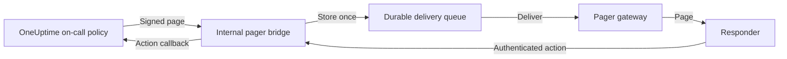

# How to Connect an Internal Pager System to Self-Hosted OneUptime

Author: [nawazdhandala](https://www.github.com/nawazdhandala)

Tags: Air-Gapped, Incident Management, Monitoring

Description: Build an internal pager bridge for OneUptime with signed requests, durable delivery, duplicate protection, and responder-controlled acknowledgment callbacks.

Your monitoring system knows who is on call. Your pager system knows how to reach a particular handset or radio receiver. Connecting them requires a small service that translates between those two worlds without confusing “request accepted” with “person responding.”

This article describes that bridge using OneUptime custom notification channels. The protocol details are checked against OneUptime source commit `0de2d9ceac0a2404f5df7ad1f9ab1e22c56bea7e`. Confirm your installed Enterprise release implements this contract before deploying the bridge. The examples demonstrate signature verification locally; they do not constitute a complete pager server.

## Confirm entitlement and the final delivery path

Custom notification channels require a OneUptime Enterprise license that includes the feature. They are not a Community Edition feature. Confirm entitlement and the offline license-renewal procedure before depending on the channel. The [official custom-channel guide](https://oneuptime.com/docs/en/self-hosted/custom-notification-channels) describes availability and behavior when licensing stops delivery.

Map the pager system's own dependencies. An HTTP endpoint on your LAN might still forward pages through a public SMS provider. A radio gateway might depend on an external control service. Record whether delivery needs internal radio equipment, a carrier, public push services, DNS, a directory, or another application server. Test the actual handset, not just the gateway dashboard.



Keep the bridge and its queue available when the monitored application fails. Give the bridge HTTPS access to OneUptime for callbacks, and OneUptime HTTPS access to the bridge. Install the internal certificate authority in both client runtimes. Message signatures establish authenticity; certificate verification protects the connection. Neither replaces the other.

## Start with a limited channel

In the Admin Dashboard, open **Settings → Notifications → Custom Channels** and add the bridge URL. Store the generated signing secret in your service's secret store, with access restricted to the bridge.

For a pilot, turn off **Page everyone through this channel** before saving. Otherwise the channel is added broadly to users' notification rules. Add the channel to the test responder's **How to Reach Me** rules instead. Use the channel's **Send test** action first. Test events have no actionable incident and no notification identifier; the receiver must handle them without attempting a page acknowledgment. These setup details are covered in the [channel configuration instructions](https://oneuptime.com/docs/en/self-hosted/custom-notification-channels#add-a-channel).

Maintain an explicit mapping from the OneUptime user to the pager recipient. Prefer a stable account identifier with an audited directory mapping. An unknown or disabled recipient should produce a visible routing failure, not a page to a default administrator.

## Verify bytes before parsing JSON

OneUptime sends `X-OneUptime-Signature` as `sha256=` followed by the hexadecimal HMAC-SHA256 of the raw request body. HMAC is a message authentication code created with a shared secret. Changing whitespace in the JSON changes the bytes and therefore the signature. The [pinned sender implementation](https://github.com/OneUptime/oneuptime/blob/0de2d9ceac0a2404f5df7ad1f9ab1e22c56bea7e/packages/App/FeatureSet/Notification/Utils/SignedWebhookPost.ts) defines the signing and retry contract.

Save this dependency-free verifier as `verify-page.cjs`. It uses Node.js crypto APIs documented for Node 22 and later:

```javascript
const { createHmac, timingSafeEqual } = require('node:crypto');

function validSignature(rawBody, header, secret) {
  if (!Buffer.isBuffer(rawBody) || typeof secret !== 'string' || !secret) {
    return false;
  }
  if (typeof header !== 'string' || !/^sha256=[0-9a-f]{64}$/.test(header)) {
    return false;
  }
  const received = Buffer.from(header.slice(7), 'hex');
  const expected = createHmac('sha256', secret).update(rawBody).digest();
  return timingSafeEqual(received, expected);
}

module.exports = { validSignature };
```

The strict header check ensures both buffers have the same length before comparison, as required by [Node's timingSafeEqual API](https://nodejs.org/docs/latest-v22.x/api/crypto.html#cryptotimingsafeequala-b). Capture a bounded raw body in your HTTP handler before JSON middleware changes it. Reject invalid signatures before parsing or enqueueing. After verification, validate the payload version, signed event field, recipient, and supported record type.

This local test uses a deliberately disposable secret and never contacts OneUptime. Save it beside the verifier as `verify-page.test.cjs`:

```javascript
const assert = require('node:assert/strict');
const { createHmac } = require('node:crypto');
const { validSignature } = require('./verify-page.cjs');
const body = Buffer.from('{"version":1,"event":"test"}');
const secret = 'local-test-only';
const signature = 'sha256=' + createHmac('sha256', secret)
  .update(body).digest('hex');
assert.equal(validSignature(body, signature, secret), true);
assert.equal(validSignature(Buffer.concat([body, Buffer.from(' ')]),
  signature, secret), false);
assert.equal(validSignature(body, signature, 'wrong-secret'), false);
assert.equal(validSignature(body, 'sha256=broken', secret), false);
assert.equal(validSignature(body, undefined, secret), false);
console.log('Signature checks passed');
```

Run `node verify-page.test.cjs`. The expected output is `Signature checks passed`. These checks validate the verifier's behavior, not your HTTP middleware, secret distribution, or pager integration.

## Accept durably, then deliver once

The pinned sender allows ten seconds per request. It makes up to three attempts, waiting one second before the second and four seconds before the third. Network failures, HTTP 408, 429, and server errors are retried; other client errors are not. A successful 2xx response ends delivery attempts.

Return success only after safely accepting responsibility for the page, normally by committing it to a durable queue. Do not wait for a handset to acknowledge before replying to OneUptime. Conversely, do not return success while the only copy is in application memory.

Use a database uniqueness constraint on the channel and non-null `notificationId` to prevent retries from creating duplicate queue entries. A duplicate already accepted should return success. Do not use the incident ID as the deduplication key: the same incident can legitimately page multiple people or page someone again. Test and ordinary notification events need separate handling because their identifier can be null.

Your worker also needs duplicate protection at the pager boundary. If a gateway accepts a page but its response is lost, retrying may ring twice. Use the gateway's supported idempotency identifier where available; otherwise document and test the unavoidable ambiguity. Preserve delivery records across bridge restarts.

## Make acknowledgment a person's decision

Store the action URLs received with the page securely. They carry authorization tokens, so keep them out of normal request logs and pager message previews. The bridge should authenticate the responder and confirm they own that page before invoking its action.

Use the supplied action URL, validate that its HTTPS origin is your approved OneUptime origin, and send the documented POST without following arbitrary redirects. Do not construct or replace its token. The [action implementation](https://github.com/OneUptime/oneuptime/blob/0de2d9ceac0a2404f5df7ad1f9ab1e22c56bea7e/packages/Common/Server/Utils/OnCall/CustomChannelActions.ts) processes acknowledgment, escalation, and resolution separately.

A gateway delivery receipt is not acknowledgment by a human. A one-way pager cannot provide an interactive response by itself; give responders a reachable internal interface to acknowledge. Show the callback result and confirm the state in OneUptime. If the callback fails, display a pending or failed action rather than reporting success. Resolution needs its own explicit action and appropriate permission.

## Rehearse failure before enabling everyone

Use a dedicated rehearsal incident and capture evidence at each boundary:

| Test | Required evidence |
| --- | --- |
| Valid page | Correct recipient, one queue record, physical delivery |
| Altered body | Rejection with no queued page |
| Repeated delivery | One accepted queue entry and no duplicate pager submission |
| Queue unavailable | No false success; retry or visible failure |
| Bridge restart after acceptance | Accepted page remains recoverable |
| Callback unavailable | No false acknowledgment; escalation remains observable |
| Wrong responder | Action refused without changing the incident |

Compare bridge records with OneUptime's on-call log and [notification delivery metrics](https://oneuptime.com/docs/en/self-hosted/notification-delivery-metrics). Track queue age and downstream failures separately: a successful custom-channel request only measures delivery to your service.

Finally, block public egress in staging and repeat delivery and acknowledgment from the actual responder device. Retain a tested fallback route that does not share the failed gateway. Enable broader enrollment only after the complete path, including licensing, identity, delivery, and human response, has passed that rehearsal.
