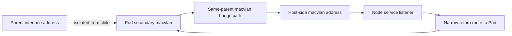

# Connect Multus Macvlan Pods to Services on Their Own Node

Author: [nawazdhandala](https://www.github.com/nawazdhandala)

Tags: Multus, Kubernetes, Networking

Description: Understand macvlan parent isolation and use a carefully scoped host-side macvlan interface when a Pod must reach a service on its own node through the secondary network.

A Pod can reach another machine on its macvlan network, but it cannot reach a service using the parent interface's address on its own Kubernetes node. The service is listening, the subnet looks correct, and another node can connect. This is a recognizable macvlan behavior, not necessarily a firewall failure.

Linux macvlan separates the parent interface from its macvlan children. A host-side macvlan interface can provide a different host endpoint on that network. Alternatively, the service may be reachable through the Pod's primary Kubernetes network, which avoids introducing another node-local address.

This guide explains how to choose between those paths and gives a narrow staging example. Commands follow Linux iproute2 syntax and the CNI macvlan configuration model. They were syntax-checked and their address relationships checked locally; no live host networking was changed.

## Confirm that parent isolation is the problem

First identify the destination actually used by the application. Is it the node's primary address, the macvlan parent's address, a Service IP, or a separate host interface? Record the Pod's source address and selected route. These are different network paths.

From the Pod, inspect the secondary interface and route:

```bash
ip -d link show dev REPLACE_POD_INTERFACE
ip -4 address show dev REPLACE_POD_INTERFACE
ip -4 route get REPLACE_SERVICE_IP from REPLACE_POD_SECONDARY_IP
```

Compare an approved external peer on the same secondary network with the same-node destination. If both fail, resolve general attachment or fabric connectivity first. If only the parent-side node address fails, the macvlan restriction becomes a stronger explanation.

Docker's macvlan documentation describes the underlying Linux restriction and identifies a host-side macvlan interface as a possible communication path. This is a Linux networking property relevant to Multus delegates as well; the commands below do not require Docker. [Macvlan host communication](https://docs.docker.com/engine/network/drivers/macvlan/).

## Prefer an existing supported path where possible

If the service is intended for cluster workloads, determine whether the primary network can reach its approved endpoint. A correctly configured Service or node endpoint may already solve the application requirement. Verify the actual route and policy rather than assuming a Service IP will traverse a secondary attachment.

Use a host-side macvlan only when the secondary network is required and your node-management platform supports it. This adds an address, route ownership, service binding, firewall considerations, and replacement-node preparation. Those responsibilities must have an owner.



The new endpoint is the host-side macvlan address. It does not make the old parent address universally reachable from children.

## Define a single-node staging plan

Assume one disposable Pod has a reserved address `192.0.2.50/24`. Reserve `192.0.2.254` exclusively for the host-side interface. These are documentation addresses: replace them with approved addresses on your actual secondary network before execution.

The host-side interface and Pod delegate must use the same correct parent, including the correct VLAN interface when applicable. The Pod's macvlan mode must permit communication with its sibling; this example assumes bridge mode. Private or VEPA mode has different forwarding behavior. [CNI macvlan modes](https://www.cni.dev/plugins/current/main/macvlan/).

Before changing anything, confirm that the proposed host address is excluded from every relevant IP allocator, that `mvhost0` does not already exist, and that no existing route owns the proposed Pod-specific path. Check the node's network manager so it will not silently undo or duplicate the experiment.

On the selected Linux staging node, use approved elevated access:

```bash
ip -d link show
ip -4 address show
ip -4 route show
```

Keep the output as the baseline. Do not perform this experiment through an unprotected remote session on a production node without an established maintenance and recovery process.

## Create only the required host endpoint

After satisfying those prerequisites, run each command separately and stop if any fails:

```bash
sudo ip link add link REPLACE_PARENT name mvhost0 type macvlan mode bridge
sudo ip address add 192.0.2.254/32 dev mvhost0
sudo ip link set dev mvhost0 up
sudo ip route add 192.0.2.50/32 dev mvhost0 src 192.0.2.254
```

The first command creates a macvlan sibling in the host namespace. The second assigns a single host address. The final command sends traffic for this one test Pod through that interface and selects the new host address as the preferred source. It deliberately uses `add`, not a route replacement that could overwrite an existing route. [ip-link creation](https://man7.org/linux/man-pages/man8/ip-link.8.html), [ip-address syntax](https://man7.org/linux/man-pages/man8/ip-address.8.html), [ip-route syntax](https://man7.org/linux/man-pages/man8/ip-route.8.html).

The `/32` address avoids adding a broad connected-subnet route through the new interface. The narrow Pod route supplies the required host-to-Pod path for this experiment. For many dynamic Pod addresses, design a reserved per-node range and route ownership scheme; do not simply redirect the entire shared secondary subnet through every node's local macvlan.

## Check the return route and the listener

On the host, verify the selected path:

```bash
ip -4 route get 192.0.2.50 from 192.0.2.254
sudo ss -lntp
```

Expect the route to use `mvhost0`. Inspect the service's listening address and port. A process bound only to loopback or the old parent address will not automatically accept connections to `192.0.2.254`. Bind the intended service to the approved new address through its normal configuration, and restrict access appropriately. Avoid exposing unrelated services with an unnecessary wildcard bind. [Socket inspection with ss](https://man7.org/linux/man-pages/man8/ss.8.html).

From the Pod, confirm the new host address selects the secondary path, then use the application's normal authenticated protocol and port. For HTTPS, the service name, certificate, and trust configuration must still agree; a successful route is not a reason to disable certificate verification.

| Observation | Likely next check |
| --- | --- |
| New endpoint has no neighbor resolution | Same parent/VLAN, bridge mode, addresses, and link state |
| Host return route uses the parent | Missing or overridden Pod-specific route |
| TCP connection is refused | Listener address, port, or an explicit reject rule |
| Connection times out | Filtering, path asymmetry, or service availability |
| Only one node works | Node-local preparation and address ownership |

## Remove the staging change deliberately

After stopping the test traffic and restoring any service binding, remove only the route and interface created by this experiment:

```bash
sudo ip route del 192.0.2.50/32 dev mvhost0
sudo ip link delete dev mvhost0
```

Run these only after verifying that those objects still belong exclusively to the test. Do not delete the parent, flush the routing table, or remove an interface adopted by another workload. Confirm the baseline primary network and unrelated services remain healthy.

For production, encode the approved configuration in node lifecycle management and test a reboot and replacement node. Each node needs its own reserved host address and correct local return paths. The durable fix is an explicit service endpoint and routing contract, not a one-off command that disappears at the next maintenance window.
