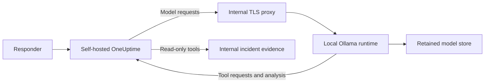

# Connect OneUptime to Ollama for Air-Gapped Incident Investigations

Author: [nawazdhandala](https://www.github.com/nawazdhandala)

Tags: Air-Gapped, Ollama, AI, Incident Management

Description: Stage Ollama and model artifacts offline, connect OneUptime to an internal inference endpoint, and verify tool calling and read-only incident investigations.

An offline language model can produce fluent text while being unable to investigate an incident. Investigation requires more: the model must request useful evidence, understand tool results, and preserve the question as the conversation grows.

Connect OneUptime to Ollama in three stages: prepare reproducible local model artifacts, verify the internal endpoint, then rehearse an investigation against known evidence. Keep automatic remediation disabled while proving the read-only path.

## Choose and record the artifacts

The examples use **Ollama v0.40.16**, whose [official release](https://github.com/ollama/ollama/releases/tag/v0.40.16) supplies platform-specific packages, and **qwen3:8b** as a candidate tool-capable model. This is a source-checked combination to evaluate, not a claim that a live OneUptime investigation was tested with it.

The [Ollama model listing](https://ollama.com/library/qwen3:8b) identifies tool support and the model's license. A model tag can change. During this review, the registry manifest's SHA-256 was:

```text
500a1f067a9f782620b40bee6f7b0c89e17ae61f686b92c24933e4ca4b2b8b41
```

Record the full digest obtained during your preparation and approve any difference. Also retain the model license, runtime archive checksum, operating-system architecture, GPU driver requirements, and selected quantization. Quantization reduces the numerical precision of model weights to reduce resource use; it does not eliminate the memory needed for conversation context.

Download the appropriate runtime and its published checksum file on a connected preparation machine. Verify them before transfer. Include required GPU libraries, drivers, and installation dependencies in your offline plan. An archived runtime alone is not a complete model installation.

## Prepare a dedicated model store

Use the same approved Ollama version on the preparation and destination machines. Configure the preparation server's `OLLAMA_MODELS` to a dedicated directory such as `/srv/ollama/models`, and start that server through your normal service manager. This variable belongs to the server process, not merely to a client shell running `ollama pull`. The [tagged environment configuration](https://github.com/ollama/ollama/blob/v0.40.16/envconfig/config.go) defines the model-store path and listening address.

On that connected machine, with the local server running:

```bash
ollama pull qwen3:8b
curl --silent --show-error --fail \
  http://127.0.0.1:11434/api/tags > prepared-models.json
```

Inspect the saved model name and full digest. The [model-list API](https://docs.ollama.com/api/tags) returns both. Then stop the preparation server using its service manager and archive the complete dedicated model directory, preserving its relative layout. Keep manifests and blobs together; copying only a large weights file is not equivalent to copying the model store.

Transfer that archive, its checksum, the recorded model list, and the approved runtime through your normal offline transfer process. Verify checksums on arrival. Restore into a new dedicated destination directory with ownership suitable for the Ollama service account, then point the destination server at it using `OLLAMA_MODELS`. Do not overwrite a running production model store.

This is a same-version filesystem snapshot, not an Ollama export format. Rehearse it before relying on it. If you instead import a GGUF weights file, use Ollama's documented [model import workflow](https://docs.ollama.com/import) and validate the resulting template and tool behavior separately.

## Expose only the internal inference endpoint

For this example, an internal TLS proxy on the Ollama host serves `https://ollama.internal.example` and forwards to Ollama on that host's loopback interface. OneUptime connects to the proxy's internal address, not to its own loopback interface.



Configure the Ollama service environment as follows, adapting the directory to your restored store:

```bash
OLLAMA_HOST=127.0.0.1:11434
OLLAMA_MODELS=/srv/ollama/models
OLLAMA_NO_CLOUD=1
```

These are service environment settings, not a command that starts Ollama. In v0.40.16, `OLLAMA_NO_CLOUD` disables cloud features. Also enforce the planned network egress policy; a software setting is not evidence that the whole installation stays offline.

Allow only the intended OneUptime servers to reach the proxy. Install the internal CA in the OneUptime runtime's trust store and verify the proxy certificate hostname. The native Ollama provider does not send an API key. If your gateway requires bearer-token authentication, evaluate OneUptime's **OpenAI Compatible** provider against Ollama's `/v1` interface instead; do not put credentials in a URL or assume the native provider sends them.

## Add the provider to one test project

Open **Project Settings → AI → LLM Providers** and create a provider with these fields:

```text
Name: Internal Ollama rehearsal
LLM Provider: Ollama
Base URL: https://ollama.internal.example
Model Name: qwen3:8b
Set as Default: On
```

Do not append `/api/chat`: OneUptime appends it. The exact behavior was checked in the [OneUptime LLM implementation](https://github.com/OneUptime/oneuptime/blob/0de2d9ceac0a2404f5df7ad1f9ab1e22c56bea7e/packages/Common/Server/Utils/LLM/LLMService.ts). The proxy hostname must resolve to an address the OneUptime server is allowed to contact.

Audit project defaults, global providers, and explicit provider selections in AI rules. A project default does not override a rule that selects another provider. Remove unintended hosted-provider selections from the rehearsal path. The [provider selection documentation](https://oneuptime.com/docs/en/ai/llm-provider#which-provider-ai-uses) explains these precedence rules.

Set a context window that fits both your chosen model and hardware. Context is the text the model can consider in one request, including tool definitions and previous evidence. For a server with sufficient capacity, this native-provider Additional Parameters example requests 65,536 tokens:

```json
{"options":{"num_ctx":65536}}
```

Do not apply that value blindly to a small machine. Check model support, memory use, latency, and the context actually loaded. Increasing the response timeout cannot fix a model that lacks enough context or memory. OneUptime's [Ollama configuration guidance](https://oneuptime.com/docs/en/ai/llm-provider#ollama-self-hosted) describes this setting and the distinct OpenAI-compatible path.

## Prove tool calling before asking for a diagnosis

From an approved diagnostic environment with the same network route and CA trust as OneUptime, inspect the internal model list:

```bash
curl --silent --show-error --fail \
  --connect-timeout 5 --max-time 15 \
  --cacert ./internal-ca.pem \
  https://ollama.internal.example/api/tags
```

Replace the certificate file with your approved CA bundle. Expect the staged model and recorded digest. This verifies reachability and inventory, not inference quality.

Next, use **Test** on the OneUptime provider. It checks a model response and a tool call. A tool call is a structured request for the application to run a defined operation; the model does not execute that operation by merely naming it. Ollama's [tool-calling documentation](https://docs.ollama.com/capabilities/tool-calling) illustrates the request and result exchange.

If plain text works but the provider test fails, inspect the model's tool support, template, endpoint type, and context limits. Do not bypass the test because the model answers a greeting.

## Rehearse a read-only investigation

Use a staging project with a known incident, a few relevant logs, and a recorded expected explanation. Keep **Fix new incidents automatically** and the corresponding alert setting off. For follow-up conversation, select **Read-only** rather than relying on the wording of your prompt. OneUptime distinguishes investigation from remediation and interactive actions in its [AI SRE documentation](https://oneuptime.com/docs/en/ai/ai-sre).

First run the provider test after restarting Ollama with public egress blocked. Then investigate the staged incident. Confirm that the activity shows evidence queries, that citations open real internal records, and that conclusions distinguish observed facts from uncertainty. Repeat with a deliberately missing evidence source: an honest limitation is preferable to an invented cause.

Record model digest, runtime version, OneUptime version, provider settings, response time, resource use, and outbound-network observations. Test an unavailable Ollama endpoint and confirm the failure is visible without invoking a hosted fallback. Retain working artifacts for rollback. Enable wider use only after the cold-start, tool-calling, evidence, and offline checks pass on your own infrastructure.
