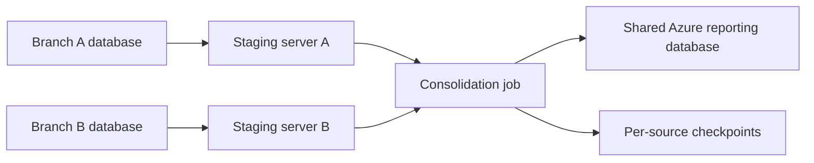

# Consolidate Multiple MySQL Sources into Azure with Safe Staging

Author: [nawazdhandala](https://www.github.com/nawazdhandala)

Tags: Azure, MySQL, Database Migration

Description: Plan MySQL consolidation into Azure with explicit source identities, separate staging feeds, collision checks, and per-source recovery checkpoints.

Two branches can each have an order numbered 42. Moving both databases onto one Azure Database for MySQL Flexible Server does not make those orders the same order. It also does not automatically give the managed server two independent replication connections.

A reliable consolidation plan separates transport from meaning: first collect each source's data without losing its identity, then apply an explicit rule for combining it. This article uses MySQL 8.0 SQL examples and a staging design. The examples have been checked against documentation and parsed locally; they have not been executed against Azure.

## Separate three different requirements

**Hosting multiple databases** means placing separate schemas, such as `branch_a` and `branch_b`, on one server. Applications can continue to use separate tables and identifiers.

**Consolidating records** means building a shared dataset, perhaps one `orders` table for reporting. That requires decisions about identifiers, duplicate customers, currencies, and ownership.

**Multi-source replication** means receiving transactions from multiple upstream servers through independent replication channels. Upstream MySQL supports this, but it does not resolve conflicting transactions for you. Its availability in MySQL does not establish that a managed service exposes the necessary controls. See the [MySQL 8.0 multi-source documentation](https://dev.mysql.com/doc/refman/8.0/en/replication-multi-source.html).

Start by writing down which requirement you actually have. A nightly reporting database rarely needs the same migration procedure as replacing several production applications with one shared writer.

## Treat Azure's documented interface as the boundary

Azure documents `mysql.az_replication_change_master` for file-and-position replication and `mysql.az_replication_change_master_with_gtid` for transaction-identifier replication. Neither documented signature includes a named-channel argument. Calling the procedure repeatedly with different hosts is therefore not a documented recipe for adding independent sources. See [Azure's data-in setup procedure](https://learn.microsoft.com/en-us/azure/mysql/flexible-server/how-to-data-in-replication).

This is an interface observation, not a claim that every conceivable multi-source arrangement is impossible. If direct multi-source replication is mandatory, obtain explicit support confirmation for your service configuration before designing around it. Do not experiment by changing replication settings on an already populated shared target.

For each Azure staging replica, check the current [data-in requirements](https://learn.microsoft.com/en-us/azure/mysql/flexible-server/concepts-data-in-replication). For example, high-availability configurations require GTID-based data-in replication. GTID means global transaction identifier: a way to identify replicated transactions. That requirement concerns the replication feed; it does not solve business-key collisions.

## Choose a staging pattern

Use one of these designs based on how fresh the consolidated data must be:

| Pattern | Suitable use | Main responsibility |
| --- | --- | --- |
| Separate snapshot exports | One-time migration or periodic reporting | Record each snapshot boundary and load into separate staging schemas |
| One upstream per staging server | Existing sources that need ongoing replication | Operate separate feeds, then transform their staged data |
| A change-data-capture pipeline | Continuous consolidated reporting or migration | Prove connector support, update/delete handling, ordering, and replay behavior |

Change data capture, or CDC, reads changes rather than repeatedly copying entire tables. Naming a pipeline “CDC” does not establish its delivery guarantees. Verify those guarantees for the exact connector and version you choose.

The second pattern keeps replication separate from consolidation:



The staging servers are separate endpoints. The consolidation job reads them through supported connections and writes the shared dataset. The checkpoints record how far each feed has been applied. They are not a replacement for database backups.

This design adds infrastructure and operational work. For a one-time move with an acceptable write pause, separate exports may be simpler.

## Preserve source identity before merging

Create an inventory with one row per source: database version, schema names, character set and collation, time zone conventions, primary keys, expected row counts, and application owner. A collation controls text comparison and sorting; changing it can make previously distinct values compare equal.

Agree on a permanent source identifier such as `branch_a`. Do not derive it from a hostname that might change during recovery. For independently allocated IDs, use the pair `(source_id, source_order_id)` as the consolidated identity.

The following MySQL 8.0 example creates a **new table in an existing disposable lab schema**, `consolidation_lab`. It requires permission to create tables there. It is a shape to review with the application owner, not a production schema replacement:

```sql
CREATE TABLE consolidation_lab.orders (
    source_id VARCHAR(32) CHARACTER SET ascii COLLATE ascii_bin NOT NULL,
    source_order_id BIGINT UNSIGNED NOT NULL,
    amount DECIMAL(12, 2) NOT NULL,
    currency CHAR(3) NOT NULL,
    PRIMARY KEY (source_id, source_order_id)
) ENGINE = InnoDB;
```

The composite primary key allows order 42 from two sources while rejecting a second copy of the same source/order pair. The amount and identifier types must be checked against real source ranges. Currency remains explicit; adding amounts across currencies would produce a misleading total. Review the [MySQL CREATE TABLE rules](https://dev.mysql.com/doc/refman/8.0/en/create-table.html) before adapting the schema.

To preview combined rows, first load reviewed extracts into `stage_a.orders` and `stage_b.orders` **on the same lab server**. Both tables must contain compatible `id`, `amount`, and `currency` columns. This read-only query does not reach across database servers:

```sql
SELECT 'branch_a' AS source_id, id AS source_order_id, amount, currency
FROM stage_a.orders
UNION ALL
SELECT 'branch_b' AS source_id, id AS source_order_id, amount, currency
FROM stage_b.orders;
```

If both extracts contain ID 42, expect two rows with different source identifiers. `UNION ALL` retains rows instead of removing duplicates. It does not match customers, reconcile orders, or validate foreign keys. Those are separate transformation rules. See [MySQL UNION semantics](https://dev.mysql.com/doc/refman/8.0/en/union.html).

Carry source identity into related tables too. Otherwise an order from branch A could accidentally join a customer with the same numeric ID from branch B.

## Design replay and cutover together

For each source, retain the snapshot boundary, the subsequent change position, and the last successfully applied batch. Write a checkpoint only after the corresponding target changes are committed. A crash between applying a batch and recording its checkpoint must be recoverable by replay without creating duplicate or older records.

Test updates and deletes as well as inserts. An insert-only demonstration can look correct while leaving cancelled orders in the target forever. Avoid using whichever timestamp is latest as a universal conflict rule: clocks can differ, and two sources may disagree about who owns a field.

A shared report can also contain data from different moments. If branch A is current and branch B is an hour behind, a server-wide “healthy” indicator hides the problem. Publish freshness and failed-batch status per source, and define when a report must be withheld.

For a production cutover, pause the relevant writers, record a final boundary for every source, drain outstanding changes, and reconcile at those boundaries. There is no single cross-source transaction boundary merely because the destination is one server. Workflows spanning sources may need an application-level reconciliation step.

## Prove correctness before switching readers or writers

Compare row counts by source and table, check missing keys and parent-child relationships, and sample financial or inventory totals within appropriate currency and business boundaries. Re-run a completed batch deliberately in staging: the result should remain unchanged. Then simulate a failure during a batch and verify recovery from its checkpoint.

Create destination permissions deliberately. Azure data-in replication does not transfer user accounts and grants; [Microsoft documents their separate creation](https://learn.microsoft.com/en-us/azure/mysql/flexible-server/how-to-data-in-replication). Likewise, validate encrypted connectivity independently for each source-to-stage and job-to-target connection.

Finally, size the destination for combined workload peaks, not average source utilization. One shared server also creates a shared capacity and recovery boundary. Keep the original sources and verified backups available through acceptance, and define how new destination writes would be reconciled before promising a reversible cutover.
