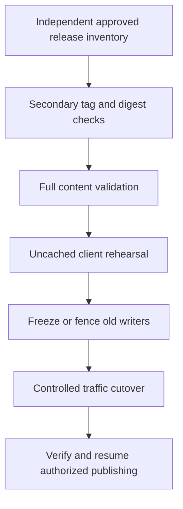

# Fail Over Registries Without Stale Tags or Missing Digests

Author: [nawazdhandala](https://www.github.com/nawazdhandala)

Tags: Container Registry, Disaster Recovery, High Availability

Description: Verify release identity and complete image content before registry failover, control writes during cutover, and rehearse recovery without cached layers.

A secondary registry answers requests, but its `production` tag still points to yesterday's image. Another repository has the right image index but lacks one ARM64 layer. Both registries can pass a basic health check while failing the next deployment.

Registry failover needs two independent answers: whether a reference selects the approved artifact, and whether the secondary can actually deliver that artifact. Routing traffic to a healthy HTTP endpoint does not answer either question.

This guide uses **crane 0.20.6** for read-only acceptance checks and references **containerd 2.1.5** for the distinction between resolving tags and pulling content. The procedure applies to a deliberately replicated secondary, not an assumption that a pull-through cache contains every release.

## Define the recovery contract before the incident

Maintain a release inventory outside both registries. For each required image, record its repository mapping, approved digest, required platforms, release tags, and verification artifacts. Include rollback releases and images used by startup hooks or recovery jobs.

A recovery point objective describes how much recent state you are prepared to lose. For registry failover, express it in release terms as well as time: which approved release must be available, which tag changes may be absent, and whether new releases can be published while the primary is unavailable.

Distinguish these deployment models:

| Model | Principal risk to investigate |
|---|---|
| Replicas sharing one storage backend | Shared storage failure affects both endpoints |
| Separate registries with asynchronous replication | Tags, manifests, and blobs may arrive at different times |
| Pull-through cache | Unrequested content may be absent and require the failed upstream |
| Restored backup | Content and tags reflect the accepted backup point |

A replication dashboard's “healthy” status is useful evidence, but the release inventory is the acceptance boundary. Do not declare every release recovered because one canary image pulls successfully.



## Check the secondary directly

Use a workstation with authorized pull credentials, trusted CA certificates, and crane 0.20.6. Configure the test so it addresses the secondary endpoint directly, rather than a load balancer that might silently return the primary.

The following Bash example assumes `approved.digest` contains one reviewed SHA-256 digest from the independent release record. Replace the repository and tag:

```bash
set -eu
secondary='registry-secondary.example.internal/team/api'
release_tag='approved-release'
expected=$(cat approved.digest)

actual=$(crane digest --platform all "$secondary:$release_tag")
if [ "$actual" != "$expected" ]; then
  printf 'Secondary release tag does not match approval\n' >&2
  exit 1
fi
crane manifest --platform all "$secondary@$expected" > secondary-index.json
```

A tag mismatch does not automatically mean the approved content is absent. It means tag-based clients would receive a different result. Investigate whether replication lag, a later tag update, an incorrect repository mapping, or a competing publisher caused it. Conversely, a matching tag digest does not prove that all referenced blobs are present. [crane digest command](https://github.com/google/go-containerregistry/blob/v0.20.6/cmd/crane/doc/crane_digest.md).

Preserve the approved digest throughout the investigation. Do not overwrite the approval file with whatever the secondary happens to return.

## Validate the complete artifact graph

Run the full validator against the digest-pinned secondary reference:

```bash
crane validate --platform all --remote "$secondary@$expected"
```

The expected result is `PASS` for the pinned artifact. In crane 0.20.6, an index with all platforms selected is passed to index validation; individual images are handled as images. The `--fast` option skips downloading and digesting layers, so do not use it for this content-availability gate. Full validation can transfer substantial data; schedule it for the approved recovery inventory and capacity. [Pinned validate implementation](https://github.com/google/go-containerregistry/blob/v0.20.6/cmd/crane/cmd/validate.go).

A structural or content failure blocks acceptance, but it is not always evidence of lost storage. Interpret the reported object and media type. If a publisher uses artifact types the validator does not support, use its documented verification tool rather than pretending that a partial check is complete.

Index validation also does not discover every separately stored signature or software bill of materials. Check the destination repository's associated artifacts and signature policy independently. OCI referrers are repository-scoped and can require separate traversal. [OCI referrers specification](https://github.com/opencontainers/distribution-spec/blob/v1.1.1/spec.md#listing-referrers).

## Separate tag resolution from content retrieval

A digest-pinned workload knows the object it wants. A tag-based workload must first ask a registry which digest the tag means. These are different trust decisions.

Containerd 2.1.5 expresses this distinction through registry-host capabilities: `pull` allows content retrieval, while `resolve` allows resolving names to digests. A mirror trusted to serve bytes is not automatically trusted to decide what a tag should select. [Pinned containerd registry-host documentation](https://github.com/containerd/containerd/blob/v2.1.5/docs/hosts.md).

If your design gives a secondary only pull capability, do not assume it can complete a tag-based pull when the authoritative resolver is unavailable. Rehearse the exact runtime configuration and image reference form. A configuration that works while the primary is healthy can conceal a dependency on its tag resolution.

For new deployment definitions, digest references reduce the chance of a stale tag selecting the wrong release. They still require the destination to retain and serve every needed object and the client to satisfy TLS and authentication requirements.

## Rehearse from clean clients

Use isolated staging nodes or disposable runtime storage with no cached image layers. Exercise every required CPU architecture through the same authentication, network, and redirect path intended for production.

Make the primary unavailable only to the staging test path through reviewed network controls. Do not disconnect production to prove the secondary works. Observe requests to detect hidden primary access, including token services, object-storage redirects, certificate services, and external artifact verification dependencies.

Check actual application startup after retrieval. Full image validation proves something about stored content, not compatibility with node configuration or application secrets.

For this article, a local test copied a synthetic AMD64/ARM64 image to an owned secondary registry, shut down the source, and passed crane's full validation. Moving the secondary tag to another image was detected by a separate digest comparison. Hiding one required layer then made full validation fail. The fixtures used anonymous loopback HTTP, not real DNS failover, TLS, credentials, containerd, or application execution.

## Control writers during cutover

For a planned change, pause publishing and confirm the required release set has reached the secondary before switching traffic. For an emergency, explicitly accept the secondary's verified recovery point and stop new releases that depend on unavailable content.

Prevent the old primary from accepting conflicting writes when it recovers. This might mean removing its publisher access or keeping it isolated under the incident procedure. Do not leave two independent registries accepting updates to the same mutable tag without a defined conflict-resolution design.

Update routing, credentials, trust, and repository mappings through the controlled deployment path. DNS changes alone do not drain existing connections, update cached configuration, or repair certificates for a new hostname. Keep the cutover reversible until uncached production-path pulls and a controlled publishing test succeed.

## Treat failback as another release migration

Once the old primary is repaired, inventory what changed during the outage. Replicate required content and associated artifacts back, reconcile tag ownership, and verify the approved digests before moving traffic again. Avoid a blind bidirectional synchronization that overwrites newer tags with older state.

Record which releases were available, which were delayed, and how long verification and cutover took. These results tell you whether the recovery contract was met. A useful failover report proves that clients obtained the intended complete artifacts, not merely that a hostname began returning responses.
