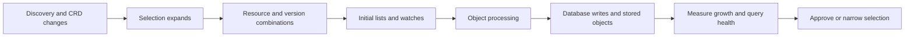

# Control Clusterpedia Wildcard Sync Growth Before It Overloads Storage

Author: [nawazdhandala](https://www.github.com/nawazdhandala)

Tags: Kubernetes, Multi-Cluster, Performance

Description: Bound Clusterpedia wildcard synchronization with explicit resource choices, pinned feature gates, discovery inventories, and measured pilot rollouts.

A wildcard can turn a short synchronization configuration into a much larger collection workload. The risk is not just the number of objects present today. Adding an operator tomorrow can introduce new custom resource types and versions that automatically become eligible for synchronization.

The practical goal is to decide what information your searches need, estimate the resulting collection work, and measure one member before expanding across the fleet. This walkthrough uses **Clusterpedia v0.9.0** and Helm chart **2.7.0**. The configuration and Helm rendering were checked locally; no production capacity numbers or live-cluster results are claimed.

## Distinguish the wildcard mechanisms

An informer is a client-side mechanism that lists objects and then watches for changes. Clusterpedia uses resource synchronization machinery to keep its stored view updated. More selected resource/version combinations can mean more ongoing watch activity, initialization work, and storage writes.

| Selection | Intended scope | What can make it grow |
| --- | --- | --- |
| Explicit group and resource names | A reviewed set of types | Your configuration changes |
| One group with `resources: ["*"]` | Eligible resources in that group | New resource types in that group |
| `syncAllCustomResources: true` | Discovered custom resources | New or changed CRDs |
| `group: "*"` with `resources: ["*"]` | Broad selection across resource groups | Kubernetes, CRD, or aggregated API changes |

The official pages for [all resources](https://clusterpedia.io/docs/features/sync-all-resources/) and [all custom resources](https://clusterpedia.io/docs/features/sync-all-custom-resources/) warn about numerous long-lived connections. Neither option should be treated as a free convenience setting.

There is an important release-specific detail: those documentation tables show the broad-sync gates as enabled by default, but the [v0.9.0 feature definitions](https://github.com/clusterpedia-io/clusterpedia/blob/v0.9.0/pkg/synchromanager/features/features.go) set **both `AllowSyncAllResources` and `AllowSyncAllCustomResources` to false**. Use the pinned source and your actual rendered arguments when assessing this release.



This is a dependency path, not a formula equating one selection with one permanent TCP connection. Connection reuse, retries, version handling, and discovery work affect the actual numbers.

## Prefer an explicit starting point

For a workload inventory that only needs Deployments and StatefulSets, the following is a PediaCluster `spec` fragment:

```yaml
syncResources:
  - group: apps
    resources: [deployments, statefulsets]
```

It is not a complete manifest. Merge it into the configuration you already manage, retaining other required fields and reviewing any shared `ClusterSyncResources` reference. A shared policy can add selections beyond the local list.

An `apps` group wildcard also includes other discovered types in that group. Before choosing it, explain why each additional type is useful to a query or operational workflow. Empty resource types still have discovery and watch-related overhead; busy resource types add object processing on top.

For custom resources, make version choices deliberate. In v0.9.0, leaving custom versions unspecified selects up to the first three supported versions. The [resource negotiator](https://github.com/clusterpedia-io/clusterpedia/blob/v0.9.0/pkg/synchromanager/clustersynchro/resource_negotiator.go) also skips resources without list/watch support and handles version selection. A simple count of CRD names therefore cannot predict exact synchronization cost.

## Inventory the pilot member without listing every object

Use a read-only identity able to inspect discovery and CRDs. Replace `MEMBER_CONTEXT` with the member being considered. This first command lists discoverable resource types that advertise both verbs:

```bash
kubectl --context MEMBER_CONTEXT api-resources --verbs=list,watch -o wide
```

For a CRD inventory with served versions:

```bash
kubectl --context MEMBER_CONTEXT get crds -o json | jq '
  [.items[] | {
    resource: (.spec.names.plural + "." + .spec.group),
    servedVersions: [.spec.versions[] | select(.served) | .name],
    scope: .spec.scope
  }] | sort_by(.resource)'
```

Discovery does not prove that the import identity is authorized to list every resource. Check that identity's permissions separately. Avoid treating authorization failures as a normal way to limit a wildcard: they create collection failures rather than a clear selection policy.

Record the inventory before and after an operator upgrade. A newly installed CRD deserves a capacity and data-sensitivity review if dynamic custom-resource synchronization is enabled. For example, a status-heavy controller might update a few thousand objects frequently, while another stores a handful of largely static objects. Their row counts alone do not describe their write load.

The [`kubectl api-resources` reference](https://kubernetes.io/docs/reference/kubectl/generated/kubectl_api-resources/) documents the verb filter and output options used here.

## Keep broad-sync permissions explicit in Helm

If your policy is to allow reviewed resource lists and group selections while disallowing the two broad mechanisms, use this chart2.7.0 values fragment:

```yaml
clustersynchroManager:
  featureGates:
    AllowSyncAllResources: false
    AllowSyncAllCustomResources: false
```

The chart's [manager template](https://github.com/clusterpedia-io/clusterpedia-helm/blob/clusterpedia-2.7.0/charts/clusterpedia/templates/clustersynchro-manager-deployment.yaml) emits these gates into the synchronization manager's arguments. Render with your complete, protected installation values before considering an upgrade:

```bash
helm template clusterpedia ./clusterpedia-2.7.0.tgz \
  --namespace clusterpedia-system \
  -f reviewed-installation-values.yaml -f sync-guardrails.yaml \
  > rendered.yaml
```

Prerequisites are Helm3.17.3, the verified chart2.7.0 archive, and your existing reviewed installation values. Save the fragment as `sync-guardrails.yaml`. Treat rendered output as potentially sensitive because complete values can contain credentials. The local check for this article confirmed that both false values appear in the manager arguments; rendering does not apply a change or test a running manager.

These gates do not disable group-level wildcards. They also are not a reliable emergency stop for an already running broad selection. In the [v0.9.0 manager validation path](https://github.com/clusterpedia-io/clusterpedia/blob/v0.9.0/pkg/synchromanager/clustersynchro_manager.go), rejecting an all-resource wildcard with the gate disabled does not stop an existing synchronizer. Roll back the selection configuration itself and verify observed behavior.

## Measure a bounded change

Choose a noncritical representative member and record a baseline over a period that includes normal workload activity. Track manager memory and CPU, API request errors and throttling, database write latency and growth, and whether a known changed object reaches search within your acceptable delay. Use the metrics available in your deployment rather than inventing a universal watch or memory limit.

Inspect observed resource/version entries on the hosting cluster:

```bash
kubectl --context HOST_CONTEXT get pediacluster PILOT_MEMBER -o json | jq '
  [.status.syncResources[]? as $g | $g.resources[]? as $r |
    $r.syncConditions[]? |
    {group: $g.group, resource: $r.name, version,
     storageVersion, status, reason}] |
  sort_by(.group, .resource, .version)'
```

This provides a reviewable expansion list, including error states. It is not a connection counter. Compare it with the intended selection and investigate unexpected versions or types.

Approve the change only when the required searches work, synchronization errors are understood, and resource usage remains inside a budget your team set beforehand. Include a manager restart or other controlled re-list event in staging: steady-state watches can look inexpensive while initial lists create a much larger peak.

If the pilot exceeds its budget, restore the previous explicit selection through the normal configuration owner. Confirm that observed synchronization returns to the expected set. Do not expect narrowing selection to instantly reclaim database disk space, and do not delete database rows as a capacity shortcut. Storage cleanup and database maintenance need their own reviewed procedure.

A successful pilot produces evidence about a particular resource mix and workload. Repeat that review when new operators, versions, or high-churn object types enter the fleet; the wildcard's meaning can grow even when its YAML stays unchanged.
