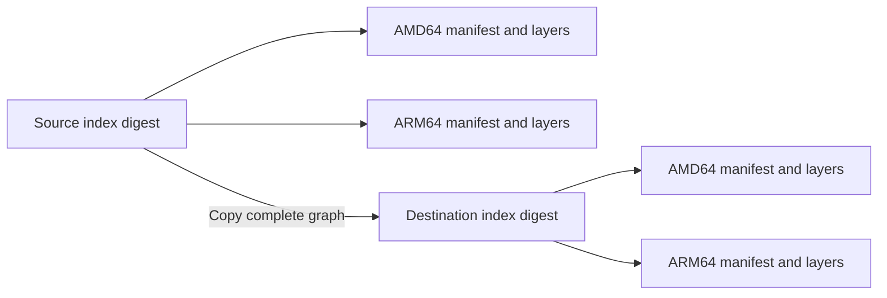

# Copy Multi-Platform Images Between Registries Without Losing Architectures

Author: [nawazdhandala](https://www.github.com/nawazdhandala)

Tags: Container Registry, Docker, Migration

Description: Copy a complete image index with crane0.20.6, pin the source digest, compare destination descriptors, and test both platform content and separate artifact requirements.

A copied image works on an AMD64 node but fails on ARM64. The source tag was multi-platform, yet the destination now contains only the image selected for the machine that performed the transfer. Copying a tag name is not sufficient evidence that the complete image index moved.

This guide uses **crane0.20.6** to copy between registries without a Docker daemon. The procedure resolves the source once, explicitly selects all platforms, and checks the resulting digest and child descriptors. It does not assume that signatures and SBOM referrers automatically follow the image.

## Distinguish the index from its platform images

An image index points to individual image manifests. Each manifest describes a platform's configuration and layers. A tag can identify the index or a single manifest; the tag syntax itself does not tell you which.



The [OCI1.1.1 image-index specification](https://github.com/opencontainers/image-spec/blob/v1.1.1/image-index.md) defines platform descriptors. In crane0.20.6, selecting a specific platform changes the copy path to that platform's image instead of the whole index. The [tagged copy implementation](https://github.com/google/go-containerregistry/blob/v0.20.6/pkg/crane/copy.go) makes that distinction explicit.

Do not confuse `--all-tags` with all platforms. The former copies repository tags. The latter controls which content graph is selected for a particular image reference.

## Prepare a bounded migration

Use an approved crane0.20.6 binary and verify its version:

```bash
crane version
```

Configure source read access and destination write access using approved credential handling. Both endpoints must have valid TLS chains trusted by the copying process. A credential that can inspect a source manifest may still lack access to some referenced content.

Choose a new destination tag in a staging repository and keep ordinary publishers from changing it during the test. Confirm the destination accepts the source media types and platforms. Decide separately whether foreign layers or attached verification artifacts are in scope; licensing and registry support can affect those transfers.

The [crane copy reference](https://github.com/google/go-containerregistry/blob/v0.20.6/cmd/crane/doc/crane_copy.md) documents the flags used here. No verification-disabling flag is needed for a correctly configured HTTPS registry.

## Resolve the source once

Run the following in one shell session, replacing the example repositories and release tag:

```bash
set -eu
SOURCE_REPOSITORY='source.example.internal/team/widget'
SOURCE_TAG="${SOURCE_REPOSITORY}:release-2026-11-20"
DESTINATION='destination.example.internal/team/widget:migration-review'

SOURCE_DIGEST="$(crane digest --platform all "$SOURCE_TAG")"
SOURCE_PINNED="${SOURCE_REPOSITORY}@${SOURCE_DIGEST}"
crane manifest --platform all "$SOURCE_PINNED" > source-index.json
```

The digest-pinned reference prevents a later tag update from silently changing which source you copy. This does not freeze the entire registry; it fixes the selected content identity.

Inspect the platform descriptors with jq1.6:

```bash
jq -e '.manifests | type == "array" and length > 0' source-index.json
jq -r '.manifests[] |
  [(.platform.os // "unspecified"),
   (.platform.architecture // "unspecified"),
   (.platform.variant // ""), .digest] | @tsv' source-index.json
```

If there is no `manifests` array, stop and investigate whether the source is a single-platform image. Check the actual required platform set rather than merely counting entries. Some indexes include descriptors used for other purposes, and variants or operating-system versions can matter for compatibility.

For an AMD64/ARM64 release, both promised platforms must appear before the transfer begins. Do not create a new index that invents an absent platform.

## Copy the complete index

Use the resolved source and the new staging destination:

```bash
crane copy --platform all --no-clobber \
  "$SOURCE_PINNED" "$DESTINATION"
```

`--platform all` is explicit even though it is the default in this version. This makes the intention visible in scripts and avoids accidentally inheriting a single-platform option from a different workflow.

`--no-clobber` checks for an existing destination tag and refuses to replace it when found. It is not an atomic lock against another publisher racing the request. Use your registry's tag immutability or publication controls for that stronger guarantee.

Do not publish the destination to workloads merely because this command exits successfully. Treat copying and acceptance as separate stages.

## Compare content identity and descriptors

Resolve and inspect the destination:

```bash
DESTINATION_DIGEST="$(crane digest --platform all "$DESTINATION")"
test "$SOURCE_DIGEST" = "$DESTINATION_DIGEST"
crane manifest --platform all "$DESTINATION" > destination-index.json

jq -S '.manifests | sort_by(.digest)' source-index.json > source-children.json
jq -S '.manifests | sort_by(.digest)' destination-index.json > destination-children.json
cmp source-children.json destination-children.json
```

For this content-preserving copy, expect the top-level digest and child descriptors to match. `cmp` should produce no output and exit successfully. A mismatch requires investigation, not a rewritten expected value.

Some workflows intentionally change manifest formats or compression, which can change digests. That is a transformation rather than the exact copy described here. Do not claim digest preservation when accepting such a change.

These comparisons verify metadata identity. They do not independently prove that every layer remains downloadable. Pull the destination by digest using clean clients for each required platform, and run the normal workload smoke checks on suitable nodes. A successful AMD64 pull alone is insufficient evidence for ARM64 availability.

## Check artifacts and credentials separately

The image index and its child manifests form one content graph. Referrer artifacts, such as signatures or SBOMs whose `subject` points at the image, require separate discovery and transfer handling. The [OCI Distribution1.1.1 referrers specification](https://github.com/opencontainers/distribution-spec/blob/v1.1.1/spec.md#listing-referrers) describes that relationship.

Inventory the artifacts required by your release policy and verify their discovery at the destination using the production verification tools. A copied image digest does not by itself establish that every signature convention, attestation, or referrer-list mechanism was migrated.

Also test the deployment identity, not only the operator's transfer credentials. The copying account may have broader access than the nodes that will pull the destination image.

## What the local rehearsal established

For this article, crane0.20.6 copied a synthetic two-platform index between two owned loopback test registries. The all-platform copy preserved the index digest, and both child images' compressed layers were readable at the destination. A second copy with `--no-clobber` rejected the existing tag.

A comparison test deliberately selected `linux/amd64`; its destination was a single manifest rather than an index. That reproduced the content-selection difference without involving production images.

The test registries used local HTTP and no authentication. It did not validate production TLS, registry permissions, real application execution, or signature transfer. Keep those checks in the migration acceptance plan, then update workloads to the reviewed destination digest.
