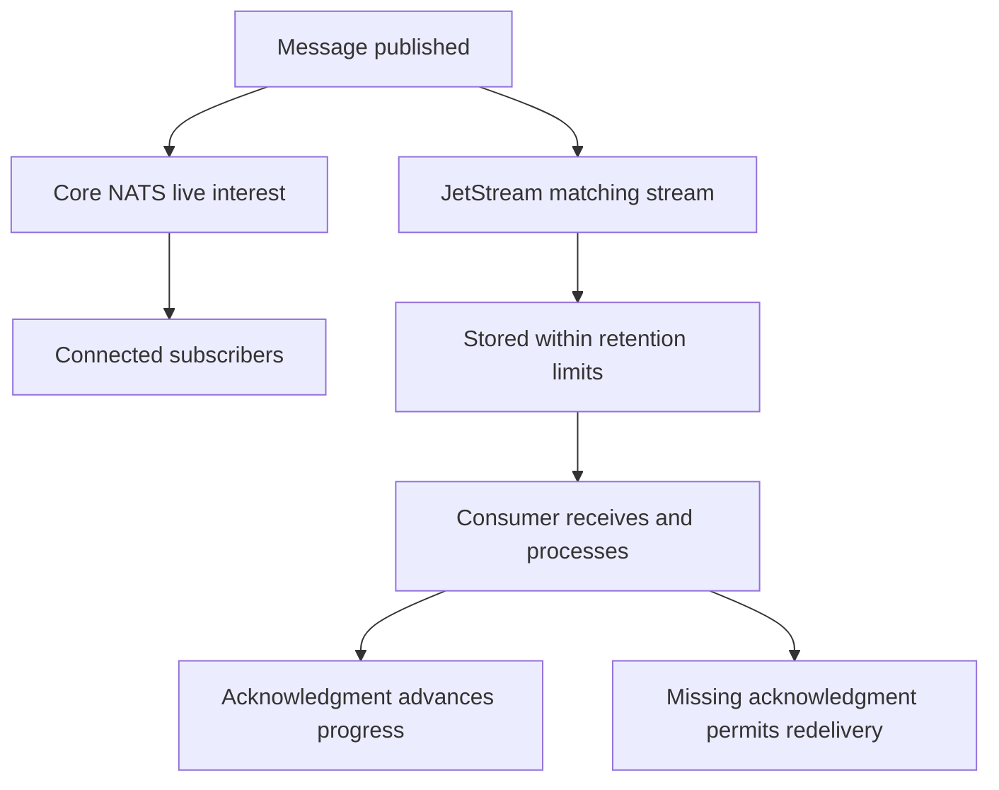

# Core NATS or JetStream: Choose the Right Delivery Guarantee

Author: [nawazdhandala](https://www.github.com/nawazdhandala)

Tags: NATS, Messaging, Go

Description: Choose Core NATS or JetStream per message flow, understand acknowledgment boundaries, and run a local Go example showing late-subscriber behavior.

A typing indicator and a payment-processing request should not have the same delivery contract. Missing an old typing indicator is harmless. Losing a payment request while its worker restarts is not. The right NATS choice starts with what must happen when the receiver is unavailable, not with a preference for the fastest or most feature-rich API.

Core NATS and JetStream can coexist in one system. Choose deliberately for each subject, the routing name to which messages are published. This guide includes a local experiment tested with **NATS Server 2.11.4**, **nats.go 1.42.0**, and **Go 1.25.0**. It demonstrates late-reader behavior, not cluster durability or external transaction correctness.

## Ask what happens while the receiver is away

[Core NATS](https://docs.nats.io/learn/core-nats/) provides at-most-once delivery: it does not keep a replayable server-side history for a subscriber that was absent. A queue group distributes live messages among its members, but that alone is not a durable work queue.

[JetStream](https://docs.nats.io/concepts/jetstream) adds streams and consumers. A stream stores messages matching configured subjects. A consumer tracks delivery and acknowledgment progress through that stream. A durable consumer has a persistent identity so workers can return to the same progress state.

| Message flow | Sensible starting point | Required application decision |
|---|---|---|
| Typing or presence updates | Core NATS | Can the next update replace a missed one? |
| Live request for a current calculation | Core request-reply | What should a timeout mean to the caller? |
| Job that must wait for workers | JetStream | How long may it wait, and how are retries handled? |
| Events needed by several independent processors | JetStream with separate consumers | Which retention window supports each processor? |
| A refresh hint backed by authoritative state | Core NATS may fit | How does a client recover after missing the hint? |

A cache invalidation is not automatically safe to lose. Core NATS is suitable only if expiry, reconciliation, or another mechanism repairs missed updates. Similarly, a request-reply timeout does not prove that a remote side effect never happened. Retrying a command still needs an application-level policy.



## Separate storage confirmation from business completion

A JetStream publish acknowledgment confirms the server accepted the publication into the stream. It does not mean a worker sent an email, updated a database, or charged a card. A consumer acknowledgment is a different signal, sent after handling the message.

With explicit acknowledgments, an unacknowledged message can be delivered again. The [delivery and acknowledgment guide](https://docs.nats.io/learn/jetstream/delivery-and-acknowledgment) explains that loop. The worker must acknowledge after the intended work succeeds, while remaining safe if the same message returns.

Consider a worker that commits a database update and crashes before its acknowledgment reaches NATS. Redelivery is the correct transport behavior, but blindly applying the update again may be wrong. Use a stable operation ID and a durable deduplication record or database constraint around the business change. This is idempotency: repeating the operation does not repeat its effect.

Publish deduplication and acknowledgment confirmation reduce specific messaging ambiguities. They do not create an atomic transaction between JetStream and an arbitrary external database. Also treat a publish timeout as an uncertain outcome: the stream may have accepted the message before the reply was lost. Preserve the same operation identity when reconciling or retrying.

## Run a small late-reader experiment

Use a disposable local environment with the pinned server and Go toolchain installed. The server archive is available from the official [2.11.4 release](https://github.com/nats-io/nats-server/releases/tag/v2.11.4). Verify the downloaded archive against its release checksum before use.

In one terminal, start a server on a free loopback port with a fresh storage directory:

```bash
LAB_STORE=$(mktemp -d)
nats-server -js -a 127.0.0.1 -p 14222 -sd "$LAB_STORE"
```

This intentionally unauthenticated, loopback-only example is a lab, not a production deployment. Keep that terminal running. Stop it with Ctrl-C when finished; no command here deletes an existing stream or production data.

In a new empty project directory in another terminal:

```bash
go mod init example.com/delivery-lab
go get github.com/nats-io/nats.go@v1.42.0
```

Save the following as `main.go`. It first publishes a Core message before subscribing, then stores a JetStream message before creating its consumer. The [tagged Go client guide](https://github.com/nats-io/nats.go/blob/v1.42.0/jetstream/README.md) documents these stream, publish, and pull-consumer APIs.

```go
package main

import (
    "context"
    "errors"
    "fmt"
    "time"

    "github.com/nats-io/nats.go"
    "github.com/nats-io/nats.go/jetstream"
)

func must(err error) { if err != nil { panic(err) } }

func main() {
    nc, err := nats.Connect("nats://127.0.0.1:14222")
    must(err)
    defer nc.Close()
    must(nc.Publish("lab.live", []byte("before subscriber")))
    must(nc.FlushTimeout(time.Second))
    sub, err := nc.SubscribeSync("lab.live")
    must(err)
    must(nc.FlushTimeout(time.Second))
    _, err = sub.NextMsg(300 * time.Millisecond)
    if !errors.Is(err, nats.ErrTimeout) { panic("expected no replay") }
    fmt.Println("Core NATS: no replay to the late subscriber")

    ctx, cancel := context.WithTimeout(context.Background(), 10*time.Second)
    defer cancel()
    js, err := jetstream.New(nc)
    must(err)
    stream, err := js.CreateStream(ctx, jetstream.StreamConfig{
        Name: "DELIVERY_LAB", Subjects: []string{"lab.saved"},
        Storage: jetstream.FileStorage, Replicas: 1,
        Retention: jetstream.LimitsPolicy, MaxMsgs: 10,
        MaxAge: time.Hour,
    })
    must(err)
    ack, err := js.Publish(ctx, "lab.saved", []byte("before consumer"))
    must(err)
    fmt.Println("JetStream stored sequence:", ack.Sequence)
    consumer, err := stream.CreateOrUpdateConsumer(ctx, jetstream.ConsumerConfig{
        Durable: "reader", DeliverPolicy: jetstream.DeliverAllPolicy,
        AckPolicy: jetstream.AckExplicitPolicy,
    })
    must(err)
    batch, err := consumer.Fetch(1, jetstream.FetchMaxWait(2*time.Second))
    must(err)
    received := 0
    for msg := range batch.Messages() {
        fmt.Println("JetStream late consumer:", string(msg.Data()))
        must(msg.DoubleAck(ctx))
        received++
    }
    must(batch.Error())
    if received != 1 { panic("expected one retained message") }
}
```

Run `go run .`. On the fresh lab server, expect:

```text
Core NATS: no replay to the late subscriber
JetStream stored sequence: 1
JetStream late consumer: before consumer
```

The Core flush ensures the earlier publish reached the server before the subscription is established; it is not proof of subscriber processing. The JetStream stream exists before publication, so it captures the message even though the consumer does not yet exist. `DeliverAllPolicy` starts this new consumer from retained history. `DoubleAck` waits for the server's acknowledgment confirmation.

The loop checks both the fetch setup error and the batch's final error. Counting the received message prevents a timeout with an empty batch from looking successful. Use a fresh server storage directory for each independent run; the fixed stream and durable names intentionally keep state between connections.

## Make retention and recovery part of the choice

The example uses file storage, one replica, a ten-message limit, and a one-hour maximum age. Those bounds make the demonstration small. They do not guarantee that a worker returning after two hours can recover its message. Retention limits can remove data before a consumer processes it, depending on the policy and limits you choose.

Production design therefore needs a maximum outage window, storage capacity, replication plan, and backup or recovery procedure. Define how to detect a growing backlog and what happens when retries are exhausted. A single local file-backed server is not a high-availability cluster.

Keep replay tests separate from side-effect tests. Verify that a late consumer can receive retained data, then verify that replaying the same business operation does not repeat an irreversible action. For a live-only flow, instead test reconnection and state reconciliation: the application should recover its current state without pretending it received every intermediate update.

Choose Core NATS when live delivery plus the application's recovery mechanism satisfies the requirement. Choose JetStream when messages must outlive the receiver's absence, and explicitly design the retention, acknowledgment, and idempotency behavior around that requirement. The guarantee is only useful when its boundary matches the business operation you are trying to protect.
