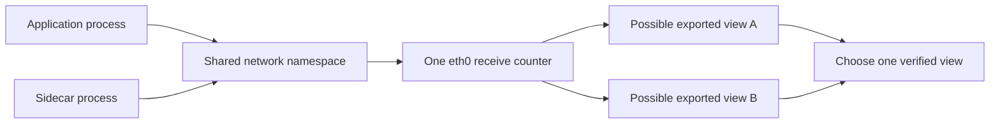

# Correct Duplicate cAdvisor Metrics for Shared Network Namespaces

Author: [nawazdhandala](https://www.github.com/nawazdhandala)

Tags: Docker, Kubernetes, Networking, Prometheus, Monitoring

Description: Identify shared network counters, separate namespace overlap from duplicate scrapes, and select one verified source before calculating network rates.

Two containers show almost identical receive-byte counters. A dashboard adds them and reports twice the expected traffic. The values may be two views of one network namespace rather than independent container traffic.

A network namespace is a Linux networking environment with its own interfaces, routes, and other network state. Counters for an interface belong to that environment. A container name attached to a metric does not automatically make the measurement private to that container's processes. The [Linux namespace documentation](https://man7.org/linux/man-pages/man7/network_namespaces.7.html) explains what is isolated.

Fixing the dashboard requires identifying the accounting boundary before choosing an aggregation. This guide uses cAdvisor 0.55.1 source and Prometheus 3.7.3 query checks; actual runtime label layouts still need inspection.

## Establish why networking is shared

Containers in a Kubernetes pod share a network namespace, including the pod's IP address and ports. Docker also supports joining another container's networking stack with its `container:` network mode. These are documented in [Kubernetes pod networking](https://kubernetes.io/docs/concepts/workloads/pods/#pod-networking) and [Docker container networks](https://docs.docker.com/engine/network/#container-networks).



The diagram describes an accounting risk, not a guarantee that every exporter emits both views. In fact, the [cAdvisor 0.55.1 Docker handler](https://github.com/google/cadvisor/blob/v0.55.1/container/docker/handler.go) removes network metrics for containers whose network mode joins another container. If that path is working, missing network series on the joining container can be expected behavior.

Do not assume the same suppression behavior for every runtime, release, or host-network configuration. Verify what your deployed endpoint actually exports.

## Classify the duplicate before removing it

Three situations need different repairs:

| Observation | Likely investigation | Suitable repair |
|---|---|---|
| Same metric identity collected twice with different scraper labels | Duplicate targets or collection paths | Remove duplicate collection or use explicit replica deduplication |
| Different container identities reference one network namespace | Shared interface accounting | Select one documented representative per namespace/interface |
| Different interfaces observe the same packet along its route | Network topology | Choose the intended observation point |

Equal values alone are not proof. Independent idle interfaces both have zero rates. Two busy interfaces can also happen to have similar traffic. Use runtime metadata and namespace identity rather than grouping series merely because their numbers match.

For Docker, inspect the two candidate containers. Replace the names and run against the correct host context:

```bash
docker container inspect app-container sidecar-container \
  --format '{{.Name}} mode={{.HostConfig.NetworkMode}} pid={{.State.Pid}}'
```

The output shows configured network mode and host process ID. See [Docker inspect](https://docs.docker.com/reference/cli/docker/container/inspect/) for the formatting option. A `container:` mode gives a direct clue about sharing.

On that same native Linux host, while both processes are running, compare their namespace links. Replace the sample process IDs with the values just observed:

```bash
readlink /proc/1234/ns/net
readlink /proc/5678/ns/net
```

Matching namespace identifiers at that moment support that the processes share networking. The [Linux namespaces manual](https://man7.org/linux/man-pages/man7/namespaces.7.html) describes these links and identity checks. Host process IDs are not portable to a remote workstation, and this inspection is not a durable identifier across process lifetimes. Use established host access; do not relax runtime socket permissions to run the check.

## Inspect raw series before summing

In Prometheus, select one target and interface first:

```promql
container_network_receive_bytes_total{
  job="cadvisor", instance="node-a:8080", interface="eth0"
}
```

Replace these values with your target. Preserve every returned label while comparing rows. Record which `id` represents each view, whether the exporter supplies pod metadata, and whether a second scrape path adds another label to an otherwise identical identity.

For the selected target, this query detects multiple series for the same cgroup/interface identity:

```promql
count by (instance, id, interface) (
  container_network_receive_bytes_total{
    job="cadvisor", instance="node-a:8080", interface="eth0"
  }
) != 1
```

An empty result does not rule out shared-namespace overlap: two different IDs can still describe one namespace. This query checks ingestion multiplicity, not namespace ownership. Retain cluster identity too when querying across clusters with reused target names.

## Select one verified representative

Once you have identified the appropriate exported view, calculate its rate directly. This template deliberately uses an explicit identity rather than assuming every runtime labels its network owner `POD`:

```promql
rate(container_network_receive_bytes_total{
  job="cadvisor",
  instance="node-a:8080",
  id="VERIFIED_CGROUP_ID",
  interface="eth0"
}[5m])
```

Replace `VERIFIED_CGROUP_ID` with the observed representative. The result is bytes per second over five minutes. Apply the same ownership decision independently to transmit counters. Prometheus's [rate documentation](https://prometheus.io/docs/prometheus/latest/querying/functions/#rate) explains counter-reset handling and why rates should be calculated before aggregation.

For a fleet dashboard, turn the verified ownership convention into an explicit selector or a maintained identity mapping. Test it after runtime or exporter upgrades. If the selected representative disappears, the panel should reveal missing coverage; silently selecting whichever container remains can change the measurement's meaning.

Do not divide the sum by the number of containers in a pod. Some deployments export only one network view; others have different numbers of visible containers over time. Division would undercount correct inputs. Likewise, `max by (pod)` can conceal duplicates while losing real interfaces or producing misleading results when counters reset at different times.

## Verify both correctness and coverage

Use an approved staging workload with a known shared namespace and inspect one interface. Confirm the corrected query chooses one view and still includes it when a sidecar starts or stops. Check multi-interface pods separately rather than assuming every workload has only `eth0`.

For this article, synthetic Prometheus fixtures gave two identities the same 10-byte-per-second counter. The representative query returned 10, while the unqualified sum would return 20. A separate duplicate-scraper fixture checked that the multiplicity query detects repeated collection of one identity. These tests validate query behavior, not actual Linux namespace discovery.

Finally, name the panel according to its boundary: pod network, shared namespace network, or host interface network. If you need per-process or per-container traffic attribution inside a shared namespace, interface counters alone cannot provide it. That requires instrumentation designed to attribute traffic at a finer level. An accurate namespace total is more useful than a container-level label attached to duplicated bytes.
