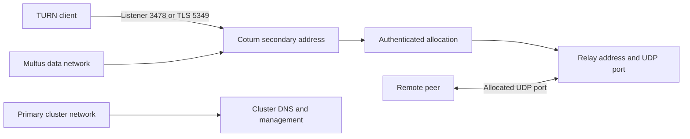

# Expose Coturn Relay Ports Through a Dedicated Multus Network

Author: [nawazdhandala](https://www.github.com/nawazdhandala)

Tags: Multus, Kubernetes, Networking

Description: Bind Coturn listeners and relay allocations to a Multus address, align firewall and NAT port mappings, and verify real relayed traffic instead of only a successful TURN connection.

Coturn can accept a client connection while relayed media still fails. The listener is only the entry point. A TURN allocation also gives the client a relay address and port that peers must be able to reach.

A dedicated Multus network can give Coturn a directly reachable secondary address and avoid routing its relay-port range through a Kubernetes Service. It does not automatically configure the external firewall, NAT, return routes, or authentication.

This guide reviews **Coturn 4.19.2**, **Multus v4.3.1**, and **CNI plugins v1.8.0**. It provides a single-instance staging design with explicit placeholders. Configuration fields were checked against official source; no Coturn process, Kubernetes deployment, or media session was run during validation.

## Separate listener traffic from relay traffic

TURN means Traversal Using Relays around NAT. A client asks the server for an allocation, obtains a relay endpoint, and exchanges data with peers through that allocation. The [TURN specification](https://www.rfc-editor.org/rfc/rfc8656.html) describes these distinct relationships.



For the example below, the relay range is UDP 49160 through 49259. That is a small staging range, not a production sizing recommendation. Capacity depends on allocations, address families, reservations and traffic patterns; do not translate 100 port numbers into a guaranteed user count.

| Traffic | Example destination | Required path |
| --- | --- | --- |
| TURN over UDP or TCP | Secondary address, port 3478 | Client to listener and reply |
| TURN over TLS/TCP | Secondary address, port 5349 | Client to TLS listener and reply |
| Relayed peer traffic | Relay address, UDP 49160–49259 | Peer to allocated port and reply |

This design disables DTLS and TCP relay allocations to keep that matrix narrow. TURN clients can still use TCP or TLS to reach the server while requesting UDP relay allocations. Client transport and relay transport are different choices.

## Prepare a stable secondary address

Use a dedicated data network that permits the selected CNI attachment type and has a reviewed route to clients and peers. This example uses macvlan and one reserved address. The parent must exist on every eligible node, and the switch or virtualization platform must permit additional MAC addresses.

```yaml
apiVersion: k8s.cni.cncf.io/v1
kind: NetworkAttachmentDefinition
metadata:
  name: coturn-data
  namespace: communications
spec:
  config: |
    {
      "cniVersion": "0.3.1",
      "name": "coturn-data",
      "type": "macvlan",
      "master": "REPLACE_DATA_INTERFACE",
      "mode": "bridge",
      "ipam": {
        "type": "static",
        "addresses": [{"address": "192.0.2.50/24"}]
      }
    }
```

Replace the documentation address with a reserved, reachable staging address. The [macvlan](https://www.cni.dev/plugins/current/main/macvlan/) and [static IPAM](https://cni.dev/plugins/current/ipam/static/) references describe these fields. This exact address assignment supports only one owner. Do not scale replicas or allow overlapping replacement Pods to reuse it.

Add this metadata fragment to the Coturn Pod template:

```yaml
annotations:
  k8s.v1.cni.cncf.io/networks: '[{"name":"coturn-data","interface":"net1"}]'
```

The namespace must already exist, and the approved Coturn image should be pinned to a verified release digest. Install the required CNI binaries and verify node placement separately. Multus documents annotation selection in its [v4.3.1 usage guide](https://github.com/k8snetworkplumbingwg/multus-cni/blob/v4.3.1/docs/how-to-use.md).

## Bind Coturn to the intended address

Merge this networking fragment into an existing authenticated Coturn configuration. It is deliberately not a complete server configuration: retain your reviewed authentication backend, realm, quotas, peer restrictions, logging and certificate handling.

```ini
listening-ip=192.0.2.50
relay-ip=192.0.2.50
listening-port=3478
tls-listening-port=5349
min-port=49160
max-port=49259
no-dtls
no-tcp-relay
```

`listening-ip` selects where clients connect. `relay-ip` selects the local address used for relay allocations. Pinning both avoids accidentally advertising or using the primary cluster address. The [4.19.2 sample configuration](https://github.com/coturn/coturn/blob/4.19.2/examples/etc/turnserver.conf) documents the settings.

Before exposing the listeners, configure a supported authenticated credential mechanism and test valid and invalid credentials. Mount secrets through the deployment's secret-management process. For TLS, provide the server certificate and key through Coturn's documented `cert` and `pkey` settings, and ensure clients trust the certificate for the DNS name they use. Do not disable authentication or certificate verification to diagnose routing.

No Kubernetes `containerPort` declaration opens an external firewall. In this direct-address design, route and permit the intended traffic to the secondary address itself. Keep management endpoints out of that exposure.

## Add NAT mapping only when NAT exists

If the secondary address is directly reachable by the intended peers, do not invent an `external-ip`. If a firewall translates a public address to the local relay address, configure the actual mapping. For example, after replacing both documentation addresses:

```ini
external-ip=198.51.100.50/192.0.2.50
```

This advertises the public relay address; it does not create NAT rules. Coturn's [4.19.2 manual](https://github.com/coturn/coturn/blob/4.19.2/man/man1/turnserver.1) requires direct port mapping for relays: an allocated local port must map to the same external port. Map the listener ports and the approved relay range according to the transport matrix, with symmetric return handling.

Do not route different packets of one allocation to arbitrary replicas. The allocation belongs to the server instance that created it. A replacement process does not inherit active relay state merely because it acquires the same IP address.

## Verify routing from the Pod's perspective

The NAD above adds no default route. That preserves the primary route but means remote data-network destinations need a deliberate routing design. Same-subnet staging traffic is simpler; routed or public peers may need explicit routes or source-based routing through the data gateway.

With iproute2 available in the diagnostic environment, inspect:

```bash
kubectl -n communications exec REPLACE_COTURN_POD -- ip address show dev net1
kubectl -n communications exec REPLACE_COTURN_POD -- ip route show
kubectl -n communications exec REPLACE_COTURN_POD -- \
  ip route get REPLACE_PEER_IP from REPLACE_SECONDARY_IP
```

The lookup should select the intended data path for that source and peer. It does not prove successful delivery. See the [ip-route manual](https://man7.org/linux/man-pages/man8/ip-route.8.html) for source-aware route lookup. If replies leave through the primary interface, repair the route design before blaming Coturn's relay settings.

## Test an allocation and actual data

Use an authenticated TURN-capable test client or your application's staging call flow. Record the allocated relay address and port, confirm that they match the reachable address and allowed range, and force a relayed path so a successful direct peer connection cannot mask a broken relay.

Verify data in both directions, then repeat with each supported client transport. A TLS handshake, successful authentication, or STUN binding response alone is insufficient. Also test expired or invalid credentials and confirm they cannot obtain usable allocations.

If allocation succeeds but data fails, compare the advertised address, firewall range, port-preserving NAT and return route. If Coturn cannot bind, compare its configured address with the actual secondary interface. If a replacement Pod fails, investigate address overlap and placement before widening firewall rules.

Roll out with an explicit session-draining plan and capacity monitoring. The useful outcome is not merely an exposed UDP range: it is authenticated clients receiving reachable relay endpoints, with traffic and lifecycle behavior verified on the dedicated network.
