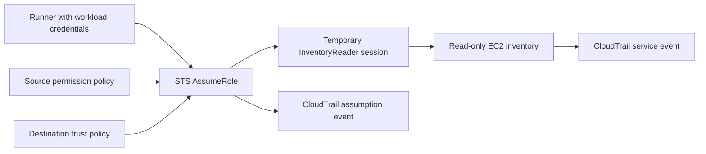

# Trace Cross-Account AWS Automation with STS Roles and CloudTrail

Author: [nawazdhandala](https://www.github.com/nawazdhandala)

Tags: AWS, IAM, Cloud Automation

Description: Configure cross-account role trust, constrain automation permissions, handle temporary sessions, and connect each run to its CloudTrail identity.

A cross-account job can fail before it obtains credentials, succeed at assuming a role but fail its first service call, or complete successfully while leaving an ambiguous audit trail. Those are different problems. Treat role trust, service permissions, and attribution as separate parts of the design.

AWS Security Token Service, or STS, issues temporary credentials. Identity and Access Management, or IAM, determines who can request them and what the resulting session may do. A role's trust policy answers who may assume it; its permissions policy answers what the assumed role can access.

This example gives an automation runner in account `111111111111` read-only volume inventory access in account `222222222222`. Both account identifiers and the role names are placeholders. Replace them with reviewed values before applying policies. No IAM policies were deployed for this article.

## Establish the two sides of cross-account trust

The runner already has temporary credentials for `AutomationRunner`, supplied by its workload platform. Do not embed a long-lived access key in the job. Attach the following identity-policy statement to that source role:

```json
{
  "Version": "2012-10-17",
  "Statement": [{
    "Effect": "Allow",
    "Action": ["sts:AssumeRole", "sts:SetSourceIdentity"],
    "Resource": "arn:aws:iam::222222222222:role/InventoryReader"
  }]
}
```

In the destination account, give `InventoryReader` this trust policy:

```json
{
  "Version": "2012-10-17",
  "Statement": [{
    "Effect": "Allow",
    "Principal": {
      "AWS": "arn:aws:iam::111111111111:role/AutomationRunner"
    },
    "Action": ["sts:AssumeRole", "sts:SetSourceIdentity"],
    "Condition": {
      "StringEquals": {"sts:SourceIdentity": "inventory-bot"},
      "StringLike": {"sts:RoleSessionName": "inventory-*"}
    }
  }]
}
```

The source role may request this destination role, and the destination trusts that specific source role. The [AssumeRole documentation](https://docs.aws.amazon.com/STS/latest/APIReference/API_AssumeRole.html) describes both requirements for cross-account access. An allow on only one side is insufficient.

The example also permits setting a source identity. AWS requires `sts:SetSourceIdentity` on the relevant source permission and destination trust policies for this cross-account role chain. See the [source identity guidance](https://docs.aws.amazon.com/IAM/latest/UserGuide/id_credentials_temp_control-access_monitor.html).



## Grant the destination role only its inventory operation

Trust does not grant EC2 access. Attach a separate permissions policy to `InventoryReader`:

```json
{
  "Version": "2012-10-17",
  "Statement": [{
    "Effect": "Allow",
    "Action": "ec2:DescribeVolumes",
    "Resource": "*",
    "Condition": {
      "StringEquals": {"aws:RequestedRegion": "eu-west-1"}
    }
  }]
}
```

This grants volume discovery in the selected region, not volume deletion or modification. Inventory calls such as DescribeVolumes use the wildcard resource scope; compensate by limiting the action, account, and supported conditions rather than inserting a volume ARN that the action does not support. Review the [EC2 authorization reference](https://docs.aws.amazon.com/service-authorization/latest/reference/list_amazonec2.html) when extending the policy.

Permissions boundaries, organization controls, and explicit denies may still restrict the session. A session policy can narrow permissions but cannot expand the role's permissions. Diagnose those layers using [IAM policy evaluation rules](https://docs.aws.amazon.com/IAM/latest/UserGuide/reference_policies_evaluation-logic.html), rather than replacing the destination policy with administrator access after an error.

## Give the job and the run different identifiers

Use a session name such as `inventory-run-20261120-001` to identify one execution. Use `inventory-bot` as the stable source identity for this application. Record the run identifier in your own workflow log before requesting credentials.

A session name is caller-supplied text, so it is not independent proof of a human identity. Source identity also needs a controlled issuer and policy constraints. This example identifies an application, not the person who originally launched a pipeline.

Source identity persists through role chaining and cannot be changed once set. The source workload session for this example must either have no prior source identity or already carry the same permitted value. If your platform supplies a different inherited identity, adapt the policy and call deliberately instead of attempting to overwrite it. Additional role hops must preserve the necessary permissions.

For third-party automation, evaluate an external ID to prevent the confused-deputy problem, where a service is tricked into using its authority for the wrong customer. AWS explains that an [external ID is not a secret](https://docs.aws.amazon.com/IAM/latest/UserGuide/id_roles_common-scenarios_third-party.html). It serves a different purpose from the session name or source identity.

## Keep temporary credentials inside the process

The following function uses [Boto3 1.40.76](https://pypi.org/project/boto3/1.40.76/), checked locally with Python 3.11.13. Pass it an STS client created from the runner's approved credential provider. It requests a fifteen-minute destination session, verifies its account and role, and returns the session plus its expiration:

```python
import boto3

TARGET_ACCOUNT = "222222222222"
TARGET_ROLE = f"arn:aws:iam::{TARGET_ACCOUNT}:role/InventoryReader"
REGION = "eu-west-1"

def inventory_session(sts, run_id, session_factory=boto3.Session):
    response = sts.assume_role(
        RoleArn=TARGET_ROLE,
        RoleSessionName=f"inventory-{run_id}",
        SourceIdentity="inventory-bot",
        DurationSeconds=900,
    )
    credentials = response["Credentials"]
    target = session_factory(
        aws_access_key_id=credentials["AccessKeyId"],
        aws_secret_access_key=credentials["SecretAccessKey"],
        aws_session_token=credentials["SessionToken"],
        region_name=REGION,
    )
    identity = target.client("sts").get_caller_identity()
    if identity["Account"] != TARGET_ACCOUNT:
        raise RuntimeError("Unexpected destination account")
    expected = f"arn:aws:sts::{TARGET_ACCOUNT}:assumed-role/InventoryReader/"
    if not identity["Arn"].startswith(expected):
        raise RuntimeError("Unexpected destination role")
    return target, credentials["Expiration"]
```

Use a short run identifier containing only STS-supported session-name characters. Never log the entire response: it contains the secret key and session token. The [Boto3 STS reference](https://boto3.amazonaws.com/v1/documentation/api/latest/reference/services/sts/client/assume_role.html) documents these request and response fields.

After verification, use `target.client("ec2")` for the inventory paginator. Creating a fresh default EC2 client instead would return to the runner's original credentials, which is a common wrong-account bug. The account and role checks are a useful guard, not a replacement for restrictive IAM permissions.

## Plan for expiration and role-chain limits

A role session used to assume another role is role chaining. STS limits chained sessions to one hour, even when the destination role permits a longer maximum session duration. Requesting a longer duration does not bypass that limit.

The function explicitly constructs a session from returned credential values. Those credentials do not automatically refresh inside that session. Complete short inventory work before expiration, or implement renewal at a durable checkpoint. Do not retry a partly completed mutating workflow from its beginning simply because credentials expired.

For production jobs that fit a standard role profile, the [AWS CLI role provider](https://docs.aws.amazon.com/cli/latest/userguide/cli-configure-role.html) manages temporary credentials for configured role assumptions. Whichever provider you choose, verify how it obtains and refreshes source credentials, and how your required source identity is supplied.

## Prove attribution with the resulting events

Record the requested role, run ID, source identity, expiration, and STS request identifier without recording credentials. In CloudTrail, inspect the assumption event and then a destination service event. The latter should identify an assumed-role session, the destination account, the role in `sessionContext.sessionIssuer`, and the expected source identity where applicable. AWS documents these fields in the [CloudTrail userIdentity reference](https://docs.aws.amazon.com/awscloudtrail/latest/userguide/cloudtrail-event-reference-user-identity.html).

Configure the necessary event collection and retention; logging is part of the acceptance test. Verify a successful read and an intentionally unauthorized action in an isolated account, then confirm the audit trail identifies the run correctly. Local tests here used SDK stubs to check request fields, credential forwarding, expiration, account and role guards, and error propagation. They did not validate live trust-policy evaluation, credential refresh, or CloudTrail delivery.
