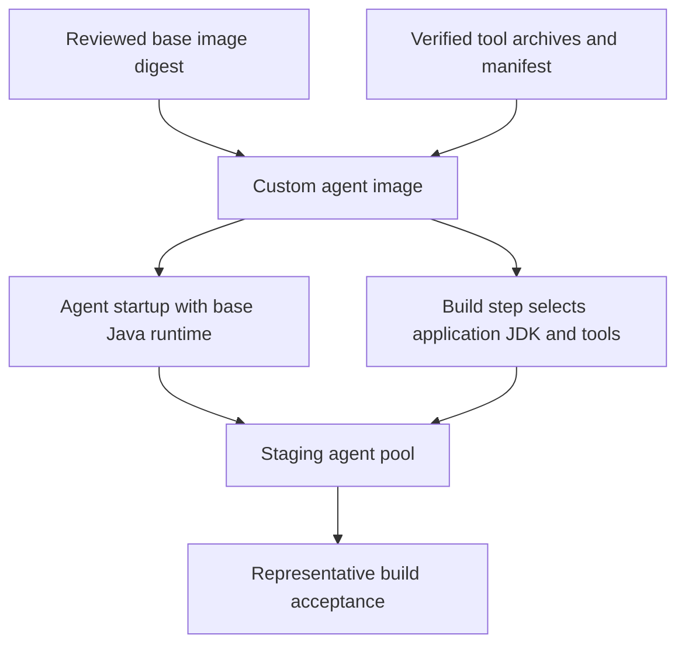

# Build a Custom TeamCity Agent Image with Pinned Toolchains

Author: [nawazdhandala](https://www.github.com/nawazdhandala)

Tags: Docker, CI/CD, DevOps

Description: Build a repeatable TeamCity agent image with verified tool archives, an explicit build JDK, controlled PATH, and checks before pool rollout.

A build that works on one TeamCity agent and fails on another often has a hidden dependency: a different Node.js release, a missing command-line tool, or a Java installation selected by accident. Installing tools manually on the working machine hides the problem until that agent is replaced.

A custom image makes those choices reviewable. Its Dockerfile describes the filesystem, while a tool manifest records the exact inputs. The goal is to recreate a known environment and deliberately update it, rather than keep an old image forever.

This walkthrough uses a Linux AMD64 agent and locally prepared tool archives. The commands are source-reviewed examples, not a claim that the finished image was built or connected to TeamCity during preparation of this article.

## Separate the agent runtime from build tools

The TeamCity agent itself runs on Java. Your application can use a different Java Development Kit, or JDK, for compilation. Replacing the agent's Java just to satisfy an application's compiler requirement can break agent startup.

TeamCity documents its agent Java lookup through locations and variables such as `TEAMCITY_JRE`, `JAVA_HOME`, and `JRE_HOME`. Preserve the supported base image's runtime arrangement, and select the application JDK explicitly in the build runner or build step. [Configure Java for an agent](https://www.jetbrains.com/help/teamcity/configure-java-for-agent.html)



Also distinguish Docker's command-line client from its daemon. Adding a client binary does not give the agent permission to build containers. Daemon access, worker isolation, and registry credentials remain runtime configuration.

## Record the inputs before writing the Dockerfile

Select a supported TeamCity agent release and resolve the appropriate Linux image to a digest. Keep its readable tag in your manifest as context, but build from the digest. Tags can change; Docker recommends digest pinning when you need control over base image updates. [Docker build practices](https://docs.docker.com/build/building/best-practices/)

For every additional tool, record these fields:

| Field | Example purpose |
| --- | --- |
| Product and complete release | Distinguish a Java feature release from its patch and build |
| Operating system and architecture | Prevent copying a macOS or ARM executable into a Linux AMD64 image |
| Original download URL | Identify the vendor source |
| Expected checksum and verification method | Detect changed bytes and record how the publisher was authenticated |
| Destination directory | Make tool selection predictable |
| Expected version output | Give the acceptance check a concrete target |

An illustrative historical fixture could select Temurin **21.0.9+10**, Node.js **24.11.0**, and Docker CLI **28.5.1**. These releases exist in the [Temurin release archive](https://github.com/adoptium/temurin21-binaries/releases/tag/jdk-21.0.9%2B10), [Node.js release notes](https://nodejs.org/en/blog/release/v24.11.0), and [Docker 28 release notes](https://docs.docker.com/engine/release-notes/28/). They illustrate exact version selection, not a recommendation to deploy those historical patches today. Select currently approved patches and update the manifest and expectations together.

Pin additional tools the same way. For example, a Kubernetes deployment agent should record the exact kubectl release, check its downloaded checksum, and respect the supported client/server version relationship. Do not fetch `stable.txt` during every image build if you expect identical inputs. [Install kubectl on Linux](https://kubernetes.io/docs/tasks/tools/install-kubectl-linux/)

## Prepare a small, verified build context

Download and verify archives in a separate preparation step. Temurin publishes checksums and signatures, and Node's release downloads include signed checksum information. Checking bytes against an untrusted checksum alone does not establish who published them. [Temurin archive verification](https://adoptium.net/installation/archives/), [Node.js downloads](https://nodejs.org/en/download/archive/v22.14.0)

After verification, extract the selected tools into this layout, removing each archive's outer version directory:

```text
agent-image/
  Dockerfile
  toolchain-manifest.json
  payload/
    jdk/bin/java
    jdk/bin/javac
    node/bin/node
    node/bin/npm
    node/lib/...
    cli/docker
    cli/kubectl
```

Copy the **complete** JDK and Node installations, including libraries and symbolic links. Copying only `node/bin/npm` loses the package it references. For Docker, this example adds only the client executable from the selected Linux static distribution. It does not install a daemon or Docker CLI plugins. Docker's static-binary instructions explain that this installation method requires manual updates; own that maintenance responsibility. [Docker binary installation](https://docs.docker.com/engine/install/binaries/)

If a pipeline needs Buildx, Compose, a credential helper, or a cloud CLI, treat each as another versioned dependency with its own installation procedure. A successful `docker --version` cannot prove those extensions exist.

Keep this context dedicated to image construction. Do not include an agent configuration directory, kubeconfig, SSH keys, registry login files, or previous build checkouts.

## Add tools without replacing startup behavior

The following Dockerfile assumes the reviewed JetBrains Linux base has the documented `buildagent` account. Confirm that account for your selected variant. It copies prepared payloads without downloading mutable packages during the image build:

```dockerfile
ARG BASE_IMAGE
FROM ${BASE_IMAGE}
USER root
COPY payload/jdk/ /opt/build-jdk/
COPY payload/node/ /opt/build-node/
COPY payload/cli/ /opt/build-cli/
COPY toolchain-manifest.json /opt/toolchain-manifest.json
RUN test -x /opt/build-jdk/bin/java \
 && test -x /opt/build-jdk/bin/javac \
 && test -x /opt/build-node/bin/node \
 && test -x /opt/build-cli/docker \
 && test -x /opt/build-cli/kubectl
ENV BUILD_JAVA_HOME=/opt/build-jdk
ENV PATH="/opt/build-node/bin:/opt/build-cli:${PATH}"
USER buildagent
```

`BUILD_JAVA_HOME` is a custom variable for your build steps, not a special TeamCity setting. The JDK is deliberately absent from the image-wide PATH so the added compiler does not silently change startup Java selection. Node and the CLI directory take precedence over similarly named tools inherited from the base.

The final `USER` restores the agent account after filesystem setup. There is no replacement `ENTRYPOINT` or `CMD`, so the base's startup behavior remains inherited. These are standard [Dockerfile instruction semantics](https://docs.docker.com/reference/dockerfile/); JetBrains also provides [custom agent image examples](https://github.com/JetBrains/teamcity-docker-images/blob/2ff7c4a1cc8c5bc10f7b52ded42f85d5bf1615ff/custom/README.md).

From the prepared directory, replace the digest placeholder and build on an approved Linux AMD64 Docker worker:

```bash
docker build --platform linux/amd64 \
  --build-arg BASE_IMAGE='jetbrains/teamcity-agent@sha256:REPLACE_WITH_REVIEWED_DIGEST' \
  -t local/teamcity-agent:toolchain-review .
```

A successful build only proves the Dockerfile completed. The executable-bit checks do not prove binary compatibility with the base's libraries.

## Verify behavior as the actual agent user

Run a local inspection container before connecting it to TeamCity:

```bash
docker run --rm --network none --entrypoint sh \
  local/teamcity-agent:toolchain-review -ec '
    "$BUILD_JAVA_HOME/bin/java" -version
    "$BUILD_JAVA_HOME/bin/javac" -version
    node --version
    npm --version
    docker --version
    kubectl version --client
  '
```

This overrides startup for the inspection only and uses the image's configured user. It needs no server credentials or Docker socket. Compare every reported release against the manifest. The Docker check is client-only, and kubectl's `--client` check does not contact a cluster.

Next, create a staging agent through your established deployment process. In a command-line build step, select the application JDK only for that process:

```bash
#!/bin/sh
set -eu
export JAVA_HOME="${BUILD_JAVA_HOME:?Missing build JDK path}"
export PATH="$JAVA_HOME/bin:$PATH"
javac -version
```

Expect the compiler version from the manifest. For Maven or Gradle runners, configure their JDK selection explicitly as well; do not assume a preceding shell step changes later steps. Check the agent's reported parameters before adding compatibility requirements. TeamCity detects Java installations and exposes related parameters, but a custom variable alone is not evidence of successful discovery. [Predefined build parameters](https://www.jetbrains.com/help/teamcity/predefined-build-parameters.html)

## Promote a tested image, then keep updating it

Run a representative application build, including native dependencies, registry access, artifact upload, and any required Docker daemon operation. Check cold-worker behavior too: preinstalled tools do not eliminate Maven, npm, or image downloads performed by the build itself.

Publish the accepted image to your registry and record its resulting digest beside the manifest and build results. Move a small agent pool first, drain old agents before replacement, and retain the previous approved digest for a controlled fallback. Keep mutable build workspaces out of the image.

Schedule explicit tool and base-image updates. Reproducibility should make an upgrade explainable: reviewers can see which input changed, which acceptance checks ran, and which image each agent now uses.
