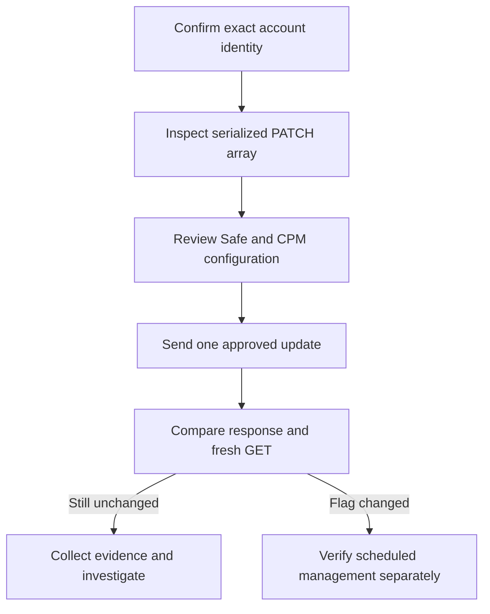

# Fix CyberArk PATCH Requests That Leave Secret Management Unchanged

Author: [nawazdhandala](https://www.github.com/nawazdhandala)

Tags: CyberArk, REST API, Troubleshooting

Description: Diagnose successful CyberArk account PATCH responses that leave secretManagement unchanged using typed payloads, exact account IDs, and independent read-back checks.

Your script reports HTTP 200 after enabling automatic password management, yet the account still shows `automaticManagementEnabled: false`. Running the same request a hundred more times is unlikely to explain the problem. First establish which account was addressed, what bytes were sent, and what state the server actually returned.

This procedure targets the second-generation PAM Self-Hosted account API. It uses a single approved test account and separates changing a management setting from proving that the Central Policy Manager (CPM) can rotate its password. Re-enabling management can allow scheduled work to resume, so coordinate the test with the account owner before sending a write.

## Capture a useful before state

Record the exact PVWA, or Password Vault Web Access, version and patch level, the API base address, account ID, Safe, platform, username, and target address. Obtain the ID from an authorized account lookup rather than guessing it from a display name. Two accounts can look similar while belonging to different Safes or platforms.

Read the selected account by ID and retain only the metadata needed for the investigation. You do not need to retrieve its password. A saved response should include the management flag and manual-management reason when present, but never a session token.

Compare that identity with the account open in the browser. A useful troubleshooting record is “account ID X stayed false after request Y,” not “the account page looked unchanged.” Also verify that a proxy or authentication page did not return HTML with a misleading successful status.

## Use the correct update contract

The documented second-generation endpoint is:

```text
PATCH /PasswordVault/API/Accounts/{AccountID}/
Content-Type: application/json
```

Its body is an array of operations, not an account-creation object. For the management flag, use the documented nested path and Boolean type. A minimal request body is:

```json
[
  {
    "op": "replace",
    "path": "/secretManagement/automaticManagementEnabled",
    "value": true
  }
]
```

The property table describes `automaticManagementEnabled` as Boolean, although some documentation examples show quoted values. Prefer an actual JSON Boolean and verify your release accepts the intended request. Avoid changing capitalization or substituting a platform property with a similar name. [Official Update account reference](https://docs.cyberark.com/pam-self-hosted/latest/en/content/sdk/updateaccount%20v10.htm).

Do not mix this with the first-generation account API, which has a different endpoint and replacement behavior. Nor should you send the entire GET response back as a PATCH body: it contains fields that are observations, not writable instructions.

## Inspect serialization before touching the server

PowerShell can accidentally turn a one-element pipeline into a single object. This locally runnable example, checked with **PowerShell 7.5.4**, passes the array through `-InputObject` explicitly and checks the serialized type. It prints a non-secret body; it sends no request.

```powershell
$operations = @(
    [ordered]@{
        op = 'replace'
        path = '/secretManagement/automaticManagementEnabled'
        value = $true
    }
)
$body = ConvertTo-Json -InputObject $operations -Depth 5 -Compress
if (-not $body.TrimStart().StartsWith('[')) {
    throw 'PATCH body must be an array'
}
$decoded = ConvertFrom-Json -InputObject $body
if ($decoded.value -isnot [bool] -or $decoded.value -ne $true) {
    throw 'Expected a JSON Boolean true'
}
$body
```

The expected output begins with `[` and contains `"value":true`. If it contains `"value":"true"`, inspect the code that reads your CSV or configuration. In PowerShell, casting a nonempty string to Boolean does not implement a strict textual true/false parser. Validate the input explicitly rather than assuming a cast understands its meaning. [PowerShell Boolean conversion](https://learn.microsoft.com/en-us/powershell/module/microsoft.powershell.core/about/about_booleans?view=powershell-7.5).

CyberArk's official onboarding utility also contains specific handling for automatic management and manual-management reasons. Its reviewed source is version **2.6.1** at commit `b75e88768143fbfeb065aa7d47afe4e0c30ec3e1`. Use that source to inspect your wrapper's behavior, not as evidence that every generated request necessarily matches your intended change. [Pinned utility](https://github.com/cyberark/epv-api-scripts/blob/b75e88768143fbfeb065aa7d47afe4e0c30ec3e1/Account%20Onboard%20Utility/Accounts_Onboard_Utility.ps1).

## Check the management prerequisites separately

Confirm the Safe has the intended managing CPM and that the selected CPM is the one responsible for these accounts. Do not assign a random CPM simply to populate an empty field. The correct assignment depends on target connectivity, supported platforms, ownership, and operational policy.

Use the pinned official Safe-management utility to inspect the Safe without changing it:

```powershell
& .\Safe-Management.ps1 `
    -PVWAURL 'https://REPLACE_PVWA_FQDN/PasswordVault' `
    -Report -SafeName 'REPLACE_SAFE'
```

Run it from the reviewed utility directory with an authorized account. Inspect `managingCPM` in the output. The example uses Safe-management version **2.2.6** at the same pinned repository commit. [Official reporting usage](https://github.com/cyberark/epv-api-scripts/blob/b75e88768143fbfeb065aa7d47afe4e0c30ec3e1/Safe%20Management/README.md).

Also review the caller's account-property permissions, CPM Safe membership, platform assignment, and any intentional operational hold. These checks narrow the investigation; an empty setting alone is not proof of the cause in every release. Keep configuration changes separate so that you can identify which correction affected the result.



## Do not apply old workarounds indiscriminately

CyberArk documents an older re-enable defect that required `manualManagementReason` in the request and was fixed in **11.2**. Its reported symptom was HTTP 500 with `CAWS00001E`, not every HTTP 200 response that leaves a property unchanged. [Vendor defect article](https://knowledgebase.paloaltonetworks.com/KCSArticleDetail?id=kA1hj0000000oclCAA&lang=en_US).

Check the installed build before applying a historical workaround. On a current release, clearing reasons, removing properties, and toggling the flag repeatedly can obscure the original condition. If the account was disabled for a valid operational reason, resolve that reason with its owner before re-enabling it. Preserve the prior reason in the change record even when the intended update removes it.

## Make read-back a required postcondition

After the approved request, inspect both its returned representation and a fresh GET of the same account ID. A postcondition is the state that must be true before your automation reports success. This helper checks only the flag and identity; it does not contact CyberArk or prove rotation works.

```python
def require_enabled(account, expected_id):
    if account.get('id') != expected_id:
        raise ValueError('Read-back returned the wrong account')
    management = account.get('secretManagement')
    if not isinstance(management, dict):
        raise ValueError('Read-back lacks secretManagement')
    if management.get('automaticManagementEnabled') is not True:
        raise ValueError('Automatic management is not confirmed enabled')
```

The strict `is True` check rejects a string, missing field, false value, or numeric substitute. Call it on a validated JSON response. A failure must stop the batch instead of adding the account to the success list.

If read-back is still wrong, retain sanitized before/after metadata, exact request body, timestamps, responding PVWA node where available, and the product build. Investigate competing automation and relevant server logs, then escalate with that reproducible evidence. If read-back is correct, continue with a separately approved CPM verification or scheduled observation. An enabled flag establishes configuration; a successful password-management operation establishes that the configured workflow actually works.
