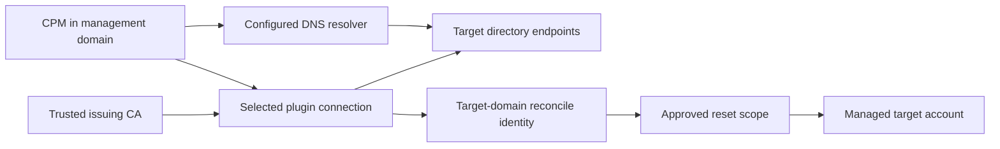

# Rotate Cross-Domain Windows Accounts with CyberArk CPM

Author: [nawazdhandala](https://www.github.com/nawazdhandala)

Tags: CyberArk, Active Directory, Troubleshooting

Description: Plan cross-domain CyberArk rotation by separating DNS, plugin protocols, TLS trust, authentication paths, and target-domain reconcile permissions.

A CPM server in one domain may need to rotate an account belonging to another. The phrase “cross-domain” hides several separate questions: can the server find the target, can it reach the correct endpoint, can the selected identity authenticate there, and can that identity perform the requested operation?

Answer them separately. Opening a firewall does not grant reset permissions, and adding a trust does not repair a certificate-name mismatch. This guide uses a Windows Server 2022 target directory as an example and the current official CyberArk plugin documentation. Match the installed plugin version and supported settings before applying the illustrated configuration. No live cross-domain rotation was performed for this article.

## Identify the plugin and the identities

Record the platform ID and plugin, not just the display name of the managed account. CyberArk documents both a Windows Domain plugin using Windows protocols and a Windows Domain Accounts via LDAP plugin. Its [Windows Domain reference](https://docs.cyberark.com/plugins-pam-sh/latest/en/pam-sh/pasimp/windows-domain-accounts/) recommends the LDAP alternative for domain-account management, but an existing installation may still use Windows protocols.

For each operation, identify the account whose credential is actually presented. The managed account, an optional linked logon account, and a reconcile account can be different identities. Also distinguish the CPM machine's domain from the domain that owns those identities.

Write an endpoint map before changing configuration:



The certificate-authority relationship applies to the TLS path. Windows-protocol authentication has its own requirements. This diagram deliberately keeps name resolution, connection security, and reset authorization separate.

## Prove DNS from the CPM network

Use the resolver configuration actually used by the responsible CPM. A lookup from your laptop may succeed through a different DNS path. Check both the selected controller's hostname and the target domain's service-location records when controller discovery is relevant.

Run this read-only Windows PowerShell example on the approved CPM host or an equivalent diagnostic host in the same network. Replace the example names first.

```powershell
$ErrorActionPreference = 'Stop'
$domain = 'target.example.com'
$controller = 'dc01.target.example.com'
Resolve-DnsName -Name $controller -Type A -DnsOnly
Resolve-DnsName -Name "_ldap._tcp.dc._msdcs.$domain" -Type SRV -DnsOnly
```

The first query returns IPv4 address records. The second returns service records identifying directory controllers; inspect their targets and resolve those names as needed. Add an AAAA lookup if the connection uses IPv6. Microsoft documents the query options in [Resolve-DnsName](https://learn.microsoft.com/en-us/powershell/module/dnsclient/resolve-dnsname?view=windowsserver2025-ps).

Unexpected addresses, stale controller records, or unresolved target names should be fixed through the DNS design. Avoid replacing names with IP addresses simply to bypass discovery: hostname-dependent authentication and certificate checks can then fail for a different reason.

## Map ports to the selected operation

Use this table to discuss required flows with the network owner, not as an instruction to open every port between domains.

| Purpose | Common destination ports | Scope to establish |
|---|---|---|
| DNS | TCP/UDP 53 | CPM to its configured resolver |
| Kerberos | TCP/UDP 88; 464 for Kerberos password changes | Relevant domain authentication endpoints when that path is used |
| LDAP transport | TCP 389; LDAPS commonly TCP 636 | Selected directory endpoint and configured transport |
| Windows remote operations | TCP 135, TCP 445, negotiated RPC ports as applicable | Actual servers and protocols used by the plugin |

Microsoft's [domain-and-trust firewall guidance](https://learn.microsoft.com/en-us/troubleshoot/windows-server/active-directory/config-firewall-for-ad-domains-and-trusts) explains that required flows depend on the participating roles. Do not copy replication-only requirements into a client-to-controller rule without justification.

For an approved LDAPS endpoint, test its TCP listener:

```powershell
$controller = 'dc01.target.example.com'
Test-NetConnection -ComputerName $controller -Port 636 -InformationLevel Detailed
```

Expect the intended remote address and `TcpTestSucceeded: True`. Microsoft's [Test-NetConnection reference](https://learn.microsoft.com/en-us/powershell/module/nettcpip/test-netconnection?view=windowsserver2025-ps) describes this TCP test. Success proves neither a valid TLS handshake nor permission to change a password.

For a Windows-protocol deployment, testing TCP 135 alone is also insufficient. The RPC endpoint mapper can direct the client to another port. Microsoft describes this two-stage behavior in its [RPC troubleshooting guidance](https://learn.microsoft.com/en-us/troubleshoot/windows-client/networking/rpc-errors-troubleshooting). Correlate the failing operation with firewall evidence rather than scanning or opening a broad range indiscriminately.

## Configure one explicit LDAP path

The following is an illustrative set of fields for a reviewed LDAP-plugin lab, not an import file or a universal production default:

| Field | Example value |
|---|---|
| Address | `dc01.target.example.com` |
| Username | `svc-payroll@target.example.com` |
| AuthenticationType | `Basic` |
| Port | `636` |
| UseSSL | `Yes` |
| StartTLS | `No` |
| LogonDomain | Empty when using this UPN form |

A UPN is a user principal name. The documented [LDAP plugin](https://docs.cyberark.com/plugins-pam-sh/latest/en/pam-sh/plugins/plugin-ldap/) requires SSL for Basic authentication and disallows an IP-format address with `UseSSL=Yes`. It also documents username-format rules and does not support alternate UPN suffixes. Confirm that the example's suffix actually matches the supported target environment.

The controller needs a valid server-authentication certificate covering its hostname, and the CPM must trust the issuing certificate chain. Microsoft explains these requirements in [LDAP over SSL](https://learn.microsoft.com/en-us/troubleshoot/windows-server/active-directory/enable-ldap-over-ssl-3rd-certification-authority). Test the certificate path in the context used by the plugin, not merely in an administrator's browser. Fix missing trust or name coverage rather than disabling certificate verification.

If the approved design requires Kerberos instead, use the plugin's documented authentication settings and validate that path separately. Do not silently fall back to a different authentication method to obtain a green result.

## Treat trust and reset rights as separate decisions

When an identity from one domain authenticates to resources in another through Windows integrated authentication, the trust path and direction matter. Microsoft describes how [domain and forest trust paths](https://learn.microsoft.com/en-us/entra/identity/domain-services/concepts-forest-trust) are evaluated. A trust still does not grant the target operation's permissions.

Do not infer that every cross-domain CPM deployment requires a new two-way forest trust. First establish which principal and authentication protocol the plugin uses. A target-domain identity supplied to the target directory is a different design from relying on a management-domain identity's integrated access. Have directory owners approve the actual path and restrictions before changing trust relationships.

For recovery, associate a reconcile account whose supported permissions cover the intended target accounts. The LDAP plugin documents delegated reset permissions and additional lockout-time rights when unlocking is enabled. Limit that scope and test an out-of-scope disposable account as well as an allowed one. Protected administrators need separate analysis; ordinary OU inheritance does not establish their effective reset permissions. Microsoft describes their [special permission handling](https://learn.microsoft.com/en-us/windows-server/identity/ad-ds/plan/security-best-practices/appendix-c--protected-accounts-and-groups-in-active-directory).

## Accept the deployment with operation-level evidence

On a representative test account, run Verify, one approved Change, and a fresh Verify. Test Reconcile separately under the documented recovery procedure; a successful Change does not prove the reconcile association works. Record the actual CPM, endpoint, authentication method, plugin version, and target response for each attempt.

If the account supplies services or tasks, validate their updated usages and fresh authentication too. Finally, exercise the approved alternate-controller or failover path if the design depends on it. A fixed endpoint that works today is not evidence that every discovered controller has equivalent certificates, permissions, and firewall reachability.

The completed runbook should identify a working path for each operation and an owner for each dependency. That makes the next failure diagnosable without broadening trust, opening unrelated ports, or granting domain-wide privileges as a shortcut.
