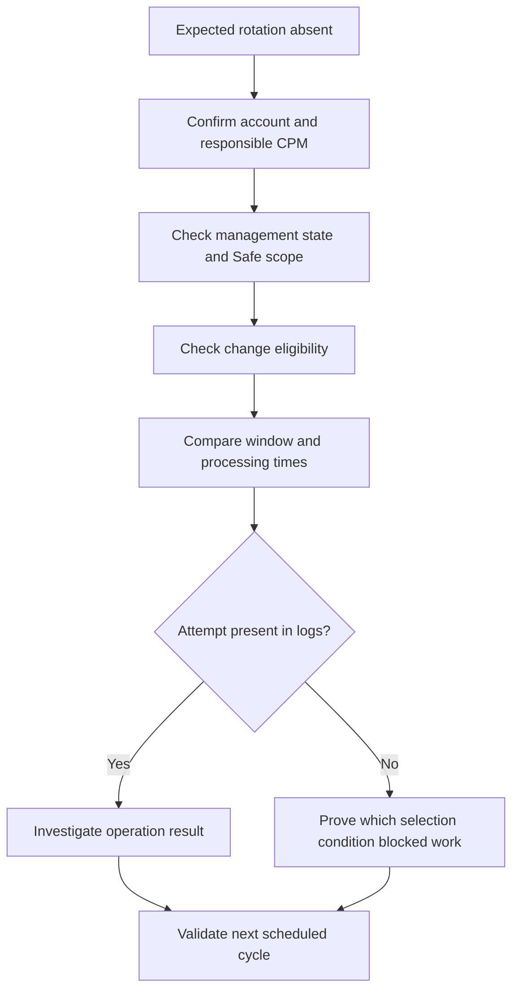

# Troubleshoot CyberArk CPM Rotations Skipped Without an Error

Author: [nawazdhandala](https://www.github.com/nawazdhandala)

Tags: CyberArk, Troubleshooting, Security

Description: Trace missing CyberArk rotations through account eligibility, Safe scope, scheduling windows, management state, and CPM logs before changing policy.

An account has not rotated when expected, yet its error view is empty. That does not necessarily mean the Central Policy Manager (CPM) tried and silently failed. It may never have selected the account, the account may not yet be eligible, or the permitted execution window may have closed before processing.

Investigate the decision before the password operation. This guide uses PAM Self-Hosted documentation identifying itself as version 15.2. Compare settings with your installed release and account type, especially when account groups, dependencies, or one-time credentials are involved. The examples inspect evidence; they do not trigger a password change.

## Start with one account and a specific missed expectation

Replace “rotation is broken” with a statement such as: “Account X in Safe Y was expected to change during Tuesday's approved window, but its recorded password-change time remained unchanged.” Record the account object, Safe, platform ID, assigned CPM, last successful change, management status, and expected window including time zone.

Distinguish three outcomes:

| Outcome | Evidence to seek |
|---|---|
| No attempt selected | Scope, platform processing, account eligibility, scheduling, and management state |
| Attempt started and failed | Matching CPM operation, plugin output, and target response |
| Primary changed but a consumer did not | Dependency result and application authentication evidence |

A successful Verify is not a successful Change. A user request to change is also not proof that the target password has already changed. Preserve those distinctions in the incident timeline.



## Check whether CPM can select the account

Confirm the account is assigned to the intended platform and its Safe is handled by the expected CPM. Review management status and any recorded reason for suspension. Do not resume every disabled account merely because several appear overdue; each may have a different cause.

Next inspect `AllowedSafes`. This platform setting is a Safe-name pattern, not an authorization grant. An account moved to a new Safe may no longer match the platform's intended scope. Conversely, changing the setting to match every Safe can create a much larger management boundary than the incident requires. The [general platform reference](https://docs.cyberark.com/pam-self-hosted/latest/en/content/pasref/automatic%20password%20management%20-%20general.htm) defines this setting and the processing intervals.

Check the actual Safe name against the reviewed pattern, including punctuation and anchors where used. Validate the match in the product's behavior before accepting a local regular-expression experiment as proof; regex engines and configuration interpretation can differ.

A suspended account can also reflect a previous failure, even when the currently displayed time window contains no new error. The vendor describes retry limits and the need to resume management after correction in its [password-change failure article](https://live.paloaltonetworks.com/t5/pam-self-hosted-articles/cpm-what-happens-in-the-event-of-a-failure-in-a-password-change/ta-p/1429366). Look back far enough to find the original reason.

## Separate due dates, execution windows, and processing intervals

Inspect the effective Master Policy and platform settings together. `PerformPeriodicChange` governs periodic changes, while `PerformChangeTask` controls whether the change operation is performed. `HeadStartInterval` expresses how many days before expiration CPM may begin. `FromHour`, `ToHour`, and `ExecutionDays` constrain when changes may occur. These are documented in [Password Change parameters](https://docs.cyberark.com/pam-self-hosted/latest/en/content/pasref/automatic%20password%20management%20-%20password%20change.htm).

Do not confuse a window with an appointment. The general `Interval` is measured in minutes between platform-processing loops. A narrow window and a long interval deserve investigation together; lowering the expiration period alone does not make CPM examine the platform more frequently. Similarly, `ImmediateInterval` relates to user-initiated work and is not a promise of a zero-delay change.

Build a small timeline from observed processing times. For example, if a platform's next observed processing pass happens after its approved window, first investigate why processing did not occur within that window. Do not calculate a supposed guaranteed change time from one interval value without considering load and the other constraints.

Check the CPM host's time zone, not the browser's. The vendor states that [FromHour and ToHour use the CPM host time zone](https://live.paloaltonetworks.com/t5/pam-saas-articles/what-time-zone-is-used-by-the-fromhour-and-tohour-parameters-in/ta-p/1428428). On the responsible Windows CPM host, an authorized operator can record:

```powershell
Get-Date -Format o
Get-TimeZone | Select-Object Id, DisplayName
```

The first command prints an unambiguous timestamp with an offset; the second identifies the configured zone. Microsoft documents [Get-Date](https://learn.microsoft.com/en-us/powershell/module/microsoft.powershell.utility/get-date?view=powershell-7.5) and the Windows-only [Get-TimeZone](https://learn.microsoft.com/en-us/powershell/module/microsoft.powershell.management/get-timezone?view=powershell-7.5). Keep historical daylight-saving offsets in mind when comparing older logs; the current offset alone does not reconstruct an earlier event.

## Read informative logs, not just errors

CyberArk's `pm.log` contains general and informative messages as well as warnings and errors. `pm_error.log` is narrower. Searching only the error file can miss evidence explaining why work was not attempted. See the [CPM logging reference](https://docs.cyberark.com/pam-self-hosted/latest/en/content/pasimp/cpmlogging.htm).

On a workstation with authorized copies of the relevant files, use this PowerShell search. Replace the paths and object text; select a distinctive non-secret value that appears in the logs.

```powershell
$ErrorActionPreference = 'Stop'
$logs = @('.\incident\pm.log', '.\incident\pm_error.log')
$objectName = 'REPLACE_EXACT_ACCOUNT_OBJECT_TEXT'
Select-String -LiteralPath $logs -Pattern $objectName -SimpleMatch -Context 2,4
```

`LiteralPath` prevents brackets in filenames from becoming wildcard syntax. `SimpleMatch` treats punctuation in the account text literally. The command prints matching lines with surrounding context, which can include adjacent accounts; retain the output in restricted incident storage. These options are defined by [Select-String](https://learn.microsoft.com/en-us/powershell/module/microsoft.powershell.utility/select-string?view=powershell-7.5).

No matches means only that this text was absent from these files. Confirm the responsible CPM, retained time range, account naming, and archive coverage before concluding that the account was never processed. Then inspect platform-level messages around the same time.

## Recognize intentional special-case behavior

Keep Change, Verify, and Reconcile schedules separate. They have distinct controls. CyberArk also documents a reconciliation option that can skip processing when no reconcile account is linked, with an informative reason recorded in the logs. That is a reconciliation decision, not proof that ordinary Change is broken. Review [automatic account management](https://docs.cyberark.com/pam-self-hosted/latest/en/content/pasimp/configuring-accounts-for-automatic-management.htm).

For service usages, `(CPM)DependentService` can indicate that the root of a service dependency chain handles the dependent service. The [Windows Service plugin reference](https://docs.cyberark.com/plugins-pam-sh/latest/en/pam-sh/pasimp/windowsservicesaccounts/) describes this behavior. Account groups also have distinct scheduling semantics; do not copy a regular-account diagnosis onto a group member without checking its controlling configuration.

## Validate the correction through the same path that failed

Correct the smallest evidenced issue: the Safe pattern, an approved scheduling mismatch, a mistaken platform assignment, or the cause of suspension. Record the prior setting and the expected effect. Review the number of accounts affected before changing a shared platform.

A manual Change can help test the operation during an approved window, but it does not prove periodic selection works. Observe the next applicable scheduled cycle, confirm the new change timestamp and operation result, then verify dependent consumers where relevant.

Close the incident only when the evidence explains both the missed rotation and the subsequent successful scheduled processing. An empty error view is not the acceptance criterion; the expected account must actually be selected and rotated through its intended policy.
