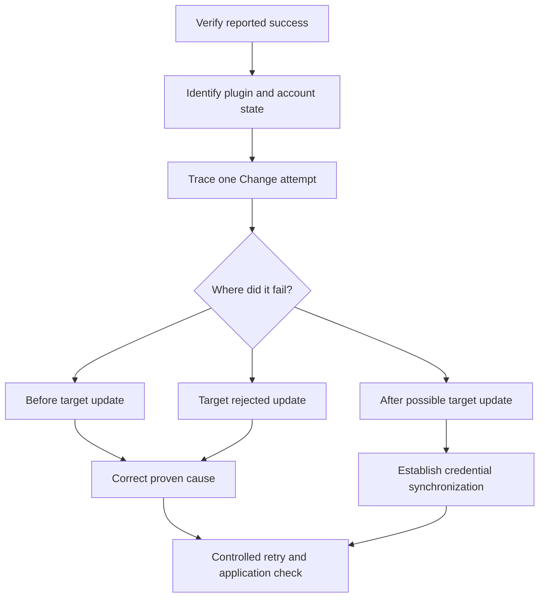

# Diagnose CyberArk CPM When Verify Passes but Password Change Fails

Author: [nawazdhandala](https://www.github.com/nawazdhandala)

Tags: CyberArk, Security, Troubleshooting

Description: Trace CyberArk password-change failures through account restrictions, target password policy, plugin logs, and controlled recovery after a successful Verify.

A green Verify result followed by a failed Change looks contradictory until you separate the operations. CyberArk's Central Policy Manager (CPM) checks and rotates managed credentials. Establishing that a stored password is correct does not establish that the account can perform every step required to replace it.

Start with one affected account and one recorded attempt. Repeatedly clicking Change can obscure the original failure and introduce additional account-state changes. This guide focuses on PAM Self-Hosted troubleshooting, with a concrete Active Directory inspection example. The commands were checked against Microsoft's Windows Server 2025 module documentation; no CyberArk rotation or directory query was executed for this article.

## Understand what the successful check established

Verify must be interpreted through the actual platform plugin. A plugin defines how CPM communicates with a particular target. The Windows `PMWindows.dll` plugin, for example, does not behave identically to a platform that uses LDAP, the directory access protocol.

The vendor describes cases where `PMWindows.dll` treats Verify as successful because the supplied password is correct, although an account restriction prevents the overall logon. Its examples include an expired password, a required password change, and a disallowed logon type. Therefore, do not translate a green status into “interactive login and password changes are both permitted.” See the vendor's [Windows-plugin Verify behavior article](https://live.paloaltonetworks.com/t5/pam-self-hosted-articles/cpm-srs-how-the-pmwindows-dll-plugin-handles-the-outcome-of/ta-p/1429805).

Record the platform ID, plugin version, CPM version, target account type, and target operating system. A Windows-specific explanation is a hypothesis for a Windows plugin, not a universal explanation for SSH, database, or web-account plugins.



This is a troubleshooting map, not a claim that all plugins implement the same internal sequence.

## Build a timeline before selecting a fix

Capture the account's Safe, object identifier, address, username, platform, selected action, and action time including time zone. A Safe is the Vault container that controls access to stored accounts. Identify which CPM actually handled the operation; logs from a different CPM can create a false impression that nothing happened.

Find the matching attempt in `pm.log`, then use `pm_error.log` and the account's plugin log for detail. The first contains general messages as well as errors; the second concentrates on warnings and errors. Third-party plugin logs can identify the remote operation that failed, and additional detail may require platform debug. CyberArk documents these distinctions in [CPM logs](https://docs.cyberark.com/pam-self-hosted/latest/en/content/pasimp/cpmlogging.htm).

Use the configured installation and log locations rather than assuming a drive letter. Preserve the relevant time window before rotation removes it. If deeper logging is necessary, enable the documented setting for the installed plugin during a bounded investigation, then restore its prior setting. Keep captured output in restricted incident storage and remove credentials before sharing excerpts.

For each attempt, answer three questions: did CPM reach the target, did the target accept the password update, and did the overall workflow finish? A final error alone may not answer the second question.

## Compare the evidence with the likely cause

| Observed evidence | Next check | Useful correction |
|---|---|---|
| Login restriction despite Verify success | Account expiry, required-change flag, permitted logon type, plugin behavior | Correct the approved account-state issue or use the documented recovery path. |
| Target rejects the proposed password | Effective length, complexity, history, minimum age, custom password filters | Align generation and rotation policy with the target's requirements. |
| Permission denied on the change operation | Identity used by that operation and its exact target permissions | Repair the narrow missing right rather than granting broad administration. |
| Plugin cannot complete its interaction | Platform/plugin compatibility and the failing operation's detailed output | Correct the supported plugin configuration or target behavior. |
| Target update may have succeeded before later failure | Target audit, CPM sequence, Vault state, dependent applications | Establish synchronization before scheduling another change. |

For example, CyberArk associates Windows return code `2245` with password-policy rejection and identifies generation settings such as `PasswordLength` and character requirements that must agree with the target. Review its [password-policy troubleshooting note](https://community.cyberark.com/s/article/CPM-winRc-2245-The-password-does-not-meet-the-password-policy-requirements-Check-the-minimum-password-length-password-complexity-and-password-history-requirements). Do not put the proposed password in the incident ticket to demonstrate complexity.

## Inspect the policy that applies to this account

For an Active Directory domain user, a fine-grained password policy can differ from the domain default. Run the following read-only example on an authorized Windows administration host with the ActiveDirectory PowerShell module. Replace the account, domain, and domain-controller values with the actual target environment; use an identity permitted to read these objects.

```powershell
$ErrorActionPreference = 'Stop'
$account = 'REPLACE_SAM_ACCOUNT_NAME'
$domain = 'REPLACE_DOMAIN_DNS_NAME'
$server = 'REPLACE_DOMAIN_CONTROLLER_FQDN'

Import-Module ActiveDirectory
Get-ADUser -Identity $account -Server $server -Properties PasswordLastSet,
    PasswordExpired, CannotChangePassword, AccountExpirationDate |
    Select-Object SamAccountName, Enabled, PasswordLastSet,
        PasswordExpired, CannotChangePassword, AccountExpirationDate

Get-ADUserResultantPasswordPolicy -Identity $account -Server $server |
    Select-Object Name, MinPasswordLength, ComplexityEnabled,
        PasswordHistoryCount, MinPasswordAge, MaxPasswordAge

Get-ADDefaultDomainPasswordPolicy -Identity $domain -Server $server |
    Select-Object MinPasswordLength, ComplexityEnabled,
        PasswordHistoryCount, MinPasswordAge, MaxPasswordAge
```

The first query provides account-state evidence; it does not prove effective permission to change a password. The second reads the user's resultant fine-grained policy. The third retrieves the domain default for comparison and for accounts without an applicable fine-grained policy. An error must be resolved rather than interpreted as an absent policy. Microsoft documents [Get-ADUser](https://learn.microsoft.com/en-us/powershell/module/activedirectory/get-aduser?view=windowsserver2025-ps), [resultant policies](https://learn.microsoft.com/en-us/powershell/module/activedirectory/get-aduserresultantpasswordpolicy?view=windowsserver2025-ps), and [domain defaults](https://learn.microsoft.com/en-us/powershell/module/activedirectory/get-addefaultdomainpasswordpolicy?view=windowsserver2025-ps).

Compare `PasswordLastSet` with the attempted change time and effective minimum age. A password may still authenticate while policy prevents another user-initiated change so soon. Microsoft's [minimum-password-age documentation](https://learn.microsoft.com/en-us/previous-versions/windows/it-pro/windows-10/security/threat-protection/security-policy-settings/minimum-password-age) explains that distinction. Do not lower the domain's policy globally to make one test succeed.

## Recover deliberately and prove the whole workflow

Reconciliation is a separate recovery mechanism, not a stronger Verify button. CyberArk describes using an associated reconcile account to reset and synchronize an out-of-sync credential in its [official reconciliation walkthrough](https://www.youtube.com/watch?v=QN_3jga-bu4). Before using it, confirm the association, authorized target scope, account health, and application impact. A successful reset does not automatically remove every account restriction.

Where Windows target audit is available, correlate it with CPM activity. Event 4724 records password-reset attempts, but Microsoft explicitly notes that access-denied resets do not produce its Failure event. Absence of that event therefore cannot prove that the reset was never attempted. See [event 4724](https://learn.microsoft.com/en-us/previous-versions/windows/it-pro/windows-10/security/threat-protection/auditing/event-4724).

After correcting the evidenced cause, perform one approved attempt on a representative test account or within the affected account's maintenance procedure. Confirm the final CPM outcome, a fresh verification, and the service or application that consumes the credential. Existing authenticated sessions are poor evidence that new authentication works.

Close the incident with the failing stage, target response, narrowly scoped correction, and post-change evidence. That record should explain why the next scheduled rotation can succeed, rather than merely showing that the last red status disappeared.
