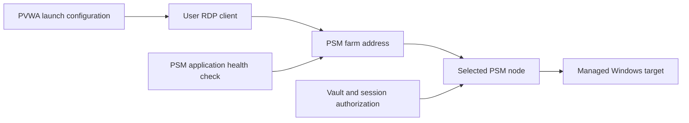

# Troubleshoot CyberArk PSM RDP, NLA, and Load-Balancer Failures

Author: [nawazdhandala](https://www.github.com/nawazdhandala)

Tags: CyberArk, RDP, Troubleshooting

Description: Isolate CyberArk RDP failures by checking each connection leg, the correct NLA boundary, component overrides, and load-balancer health behavior.

A PSM connection involves more than one RDP session. The user reaches the Privileged Session Manager (PSM), and PSM establishes the managed connection to the target. A failure on either leg can appear to the user as an RDP error, but the credentials, certificates, and settings involved differ.

Start by identifying which leg failed. This guide follows PAM Self-Hosted documentation identifying itself as 15.2 and uses read-only PowerShell examples. The examples passed local syntax checks; no live PSM, Windows RDP session, or load-balancer change was tested.

## Draw the actual connection path

Record whether the user launched through the Password Vault Web Access (PVWA) portal, a native RDP route, or an HTML5 gateway. Also record the account, connection-component ID, selected PSM node, client version, exact message, and time including time zone.



For an HTML5 session, add the browser-to-gateway leg rather than forcing it into the native-client diagram. A working browser connection to PVWA does not prove that either RDP leg is available.

Classify the evidence:

| Observation | First area to investigate |
|---|---|
| Client fails before a PSM session appears | Farm routing, PSM listener, client authentication mode, certificate trust |
| PSM session starts but target launch fails | Selected component, target address/port, target NLA and authentication |
| Only sessions assigned to one PSM fail | Node-specific policy, certificates, software, target reachability |
| Individual nodes work but farm access fails | Farm configuration, load-balancer routing and health checks |

These are investigation directions, not definitive diagnoses. Correlate the client message with the node and session evidence before changing shared configuration.

## Distinguish NLA on PSM from NLA on the target

Network Level Authentication (NLA) performs authentication before the full Remote Desktop session is established. Its placement matters in a proxy architecture.

The vendor's [PSM NLA explanation](https://knowledgebase.paloaltonetworks.com/KCSArticleDetail?id=kA1hj00000012qzCAA&lang=en_US) distinguishes PVWA-generated token connections to PSM from the subsequent connection to the target. For the documented portal-token flow, requiring standard NLA on the PSM proxy can reject the token before PSM processes it. The same article supports and recommends NLA on target servers and describes different behavior for native RDP authentication paths.

Therefore, do not respond to an NLA error by disabling it on every target. Identify the launch mode and apply the supported PSM-host configuration for that mode and release. Keep the target's intended protection. A setting appropriate for portal-generated access is not automatically appropriate for every direct native route.

NLA and TLS are also separate. TLS protects the connection and authenticates the server through its certificate. CyberArk documents [TLS configuration for PSM and targets](https://docs.cyberark.com/pam-self-hosted/latest/en/content/pasimp/securing-rdp-connections-with-ssl.htm), including the issuing-CA trust required on PSM for target certificates. Removing server authentication to suppress a certificate error hides the cause instead of fixing it.

## Inspect the generated connection without changing it

On the authorized user's Windows workstation, inspect a newly generated RDP file. Replace the path below. The filter deliberately prints only three diagnostic settings, not the entire file.

```powershell
$ErrorActionPreference = 'Stop'
Select-String -LiteralPath '.\REPLACE_SESSION.rdp' -Pattern @(
    '^full address:s:',
    '^enablecredsspsupport:i:',
    '^authentication level:i:'
)
```

This uses Microsoft's documented [Select-String](https://learn.microsoft.com/en-us/powershell/module/microsoft.powershell.utility/select-string?view=powershell-7.5) regular-expression filtering. Preserve the original file securely; generated launch material can contain sensitive session information. Missing lines do not prove a feature is disabled because defaults and client policy can also apply.

Compare the destination with the intended farm or node and the authentication settings with the supported launch mode. Do not manually rewrite a signed or generated connection file as a permanent fix. Correct the source configuration and generate a fresh launch.

## Verify the effective connection component

Confirm the account is using the intended component, such as `PSM-RDP`, and inspect platform or account overrides. CyberArk's [RDP component parameters](https://docs.cyberark.com/plugins-pam-sh/latest/en/pam-sh/pasimp/psmconnectioncomponents/) document the target port and `AuthenticationLevel`, including override support. A healthy global component does not rule out a conflicting narrower setting.

From the actual PSM node selected for the failed session, test the target's configured port. This example assumes the documented default RDP port; replace it if the effective component uses another value.

```powershell
Test-NetConnection -ComputerName 'REPLACE_TARGET_FQDN' -Port 3389 -InformationLevel Detailed
```

A successful TCP connection narrows the investigation but does not establish NLA compatibility, certificate trust, or permission to log on. The behavior of this diagnostic is documented in [Test-NetConnection](https://learn.microsoft.com/en-us/powershell/module/nettcpip/test-netconnection?view=windowsserver2025-ps).

Compare the failing node with a working peer: effective target settings, Windows policies, trusted issuing certificates, relevant client versions, and target-side authentication evidence. Keep the account and component constant during the comparison. Avoid replacing the target hostname with an IP address merely to bypass a name-related failure.

## Check what the load balancer considers healthy

PSM's TCP listener can be reachable while the PSM application is unavailable. CyberArk recommends combining RDS connectivity monitoring with its application health service in [load-balanced PSM deployments](https://docs.cyberark.com/pam-self-hosted/latest/en/content/pas%20inst/installing-psm-in-a-load-balancing-environment.htm).

If that service is installed, query the approved HTTPS endpoint from an authorized diagnostic host that trusts its certificate:

```powershell
$ErrorActionPreference = 'Stop'
$health = Invoke-WebRequest -Uri 'https://REPLACE_PSM_FQDN/psm/api/health' -UseBasicParsing
$health | Select-Object StatusCode
$health.Content
```

The request uses [Invoke-WebRequest](https://learn.microsoft.com/en-us/powershell/module/microsoft.powershell.utility/invoke-webrequest?view=powershell-7.5) with normal certificate verification. Interpret the response according to the configured mode. In Classic mode, HTTP 200 can accompany either `PASS` or `FAIL`. CodeBased mode uses 200 for healthy and 503 for unhealthy. HeaderBased adds an `IsHealthy` header to Classic behavior. These distinctions are documented in [PSM Health Check](https://docs.cyberark.com/pam-self-hosted/latest/en/content/psm/psm_healthcheck.htm). An HTTP error may terminate the example, so retain that error as evidence instead of treating missing output as health.

Check the load balancer's actual response match, destination port, timeout, and selected pool member. CyberArk's [F5 example](https://docs.cyberark.com/pam-self-hosted/latest/en/content/psm/exampleloadbalancer.htm) distinguishes RDS and application monitors; its appliance procedure is version-specific, so translate the monitoring intent to the installed product rather than copying every legacy field.

Also verify consistent PSM versions, farm protocol configuration, and certificates covering the expected names. Live monitoring can require routing to the node hosting the session rather than ordinary farm selection. The load-balancing guide documents these requirements. A successful new session through the farm does not prove reconnect or live-monitoring behavior.

## Validate through the original user path

After the narrow correction, repeat the original launch with the same approved target and component. Confirm the expected node, target authentication, session usability, recording availability, and live monitoring if required. Test the relevant peers before returning a drained node to service.

Record which connection leg failed, the evidence identifying it, and the changed setting. The useful outcome is a reproducible working session with the intended authentication and server trust intact, not merely the disappearance of one RDP dialog.
