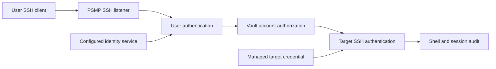

# Diagnose CyberArk PSMP Authentication Failures One Hop at a Time

Author: [nawazdhandala](https://www.github.com/nawazdhandala)

Tags: CyberArk, SSH, Troubleshooting

Description: Separate client, Vault, and target authentication failures in CyberArk PSMP using a controlled connection, correlated logs, and precise account checks.

An SSH password prompt does not tell you which password the system wants. In a CyberArk Privileged Session Manager for SSH connection, commonly called PSMP, the person authenticating to CyberArk and the account used on the target are different identities. Resetting the target password will not fix a rejected user challenge or an incorrectly selected account.

Treat the connection as a sequence of checkpoints. This guide follows the PAM Self-Hosted documentation labeled 15.2. The commands use OpenSSH and a documented RHEL 8 service example. Local command parsing was checked; no PSMP deployment or target login was exercised.

## Identify the last successful checkpoint

Draw the path before editing configuration:



A connection can complete an earlier stage and fail later. A target shell that appears briefly and then closes is different from a client that never authenticates to PSMP. Likewise, access to the web portal does not prove that the SSH authentication route uses the same method or has the same prerequisites.

Create one incident record containing the user, target account, target address, proxy node, client version, timestamp with time zone, and exact error. Include whether the session was native SSH, launched through the portal, or involved AD Bridge. Avoid combining evidence from different routes into one supposed reproduction.

## Start with an explicit, controlled connection

For a simple target account without a domain qualifier, CyberArk documents the following connection shape. Replace every uppercase placeholder with an approved value, keep the quotes, and use the delimiters configured on your deployment:

```bash
ssh -vv -E ./psmp-client-debug.log \
  'VAULT_USER@TARGET_USER@TARGET_FQDN@PSMP_FQDN'
```

The final hostname is the proxy. The earlier fields tell PSMP which user and managed target to use. This follows the vendor's [connection syntax](https://docs.cyberark.com/pam-self-hosted/latest/en/content/pasimp/psso-pmsp.htm). Authenticate using the configured CyberArk user method when prompted; do not assume that prompt requests the managed target secret.

Run this from an authorized workstation with a protected working directory. The debug file can reveal account names, hostnames, and authentication details. Keep it restricted and redact it before sharing. Make one controlled attempt rather than repeatedly triggering lockouts.

OpenSSH documents `-v` debugging, `-E` log output, and `-G` configuration inspection in its [client manual](https://man.openbsd.org/ssh.1). Before a network attempt, this variation prints the client's effective configuration and exits:

```bash
ssh -G 'VAULT_USER@TARGET_USER@TARGET_FQDN@PSMP_FQDN'
```

Check `hostname`, `user`, `port`, and any unexpected proxy configuration. The result should point to the intended PSMP endpoint. It only checks OpenSSH's interpretation; it does not prove that PSMP accepts the embedded target fields. Review local SSH configuration before running it because site-specific configuration can itself invoke helper commands.

If usernames or deployment conventions require different separators, follow the [syntax-delimiter documentation](https://docs.cyberark.com/pam-self-hosted/latest/en/content/pasimp/configuring-psmp-syntax-delimiters.htm). Do not change server-wide delimiters to repair one mistyped command. In particular, the separator before the proxy address remains `@` even when the internal required-field separator changes.

## Check the client-to-proxy hop

Read the client log in sequence. Did it resolve the proxy, reach its listener, negotiate SSH, and accept the expected server identity? A connection timeout belongs to a different investigation from an authentication rejection.

For a host-key warning, compare the presented fingerprint with the administrator's approved inventory through an independent trusted channel. A rebuild or replacement node may explain the change, but the warning alone does not establish that explanation. Do not disable host-key checking or delete the entire known-hosts file as a diagnostic shortcut.

A negotiation error naming a cipher or host-key algorithm occurs before password authentication. Record the offered algorithms and installed versions on both sides. Check supported product and operating-system combinations before changing policy. Enabling obsolete algorithms globally can conceal a single outdated node while weakening unrelated connections.

When only one proxy node fails, reproduce with an approved node-specific route while keeping the user, account, and client constant. Confirm that the node name has the correct host-key trust entry. Do not silently bypass an access gateway that is part of the required security path.

## Separate user authentication from account authorization

Once the listener is reached, ask whether CyberArk accepted the human user's configured authentication method. Challenge-response, password, and key flows need different evidence. A successful portal session can be useful context, but it is not a substitute for checking this SSH attempt.

After user authentication, confirm that the intended managed account can be selected. CyberArk requires **Use accounts** and **List accounts** permissions for transparent connections. Compare the target username and stored address carefully; the documented target username is case-sensitive, and a stored DNS address must be matched appropriately. See the [connection requirements](https://docs.cyberark.com/pam-self-hosted/latest/en/content/pasimp/psso-pmsp.htm).

Do not grant broad Safe access merely to make an error disappear. Have the Safe owner verify the required permissions, account selection, and applicable approval conditions for the specific operation. An account-selection failure is not evidence that the target operating system rejected a password.

## Correlate PSMP evidence before testing the target

An authorized administrator should identify the proxy node that handled the attempt. On the RHEL 8 arrangement documented by CyberArk, this read-only service query is available:

```bash
systemctl status psmpsrv-psmpserver
```

The [administration reference](https://docs.cyberark.com/pam-self-hosted/latest/en/content/pasimp/administrating-the-psmp.htm) lists different service commands for other operating systems. An active service is a starting point, not proof that Vault connectivity or target sessions are healthy. Preserve failure evidence before considering a restart.

The vendor's [log-location reference](https://live.paloaltonetworks.com/t5/pam-self-hosted-articles/where-can-i-find-the-logs-for-each-cyberark-product/ta-p/1427490) identifies `PSMPConsole.log` and `PSMPTrace.log` under `/var/opt/CARKpsmp/logs/`, plus session-specific component logs. Find the attempt by time and session identifier, then follow its component evidence. Confirm the paths for your installed release rather than assuming every session produces the same filenames.

If the proxy cannot authenticate its own component identity to the Vault, user password retries cannot repair it. Route that evidence to the component administrator. Preserve the credential files and their permissions; do not recreate them simply because a user saw an authentication error.

## Examine the proxy-to-target hop

Only investigate the managed target credential after evidence shows the connection reached that stage. Confirm the effective target address, port, username, authentication type, and linked logon account if used.

The [PSMP-SSH component reference](https://docs.cyberark.com/pam-self-hosted/latest/en/content/pasimp/configuring-psmp-connection-component-parameters.htm) documents platform and account overrides, including the target port and `PSMRemoteUsername`. The latter can transform the username sent to the target. Compare effective values rather than reading only the global defaults.

Ask the target administrator to correlate authentication events with the proxy's source address and attempt time. Distinguish a rejected credential from an account restriction, unsupported authentication method, or a connection that never reached the target. Avoid extracting the managed secret for an informal direct-login test.

If authentication succeeds but the session stalls during elevation or prompt handling, examine the configured logon sequence and prompt recognition. The component reference distinguishes prompt timeouts and shell-audit recognition. Increasing a timeout will not fix an incorrect response sequence or a mismatched target identity.

## Close the incident with evidence from every stage

Repeat the original approved path after the narrow correction. Verify the intended account and target, successful session use, and required recording or audit availability. Where multiple proxy nodes serve the route, check that the correction is consistent before restoring normal routing.

Keep the final record concise: the last successful checkpoint, the first failed checkpoint, the evidence connecting them, and the validated correction. That record makes the next incident faster to diagnose without turning every SSH failure into another password reset.
