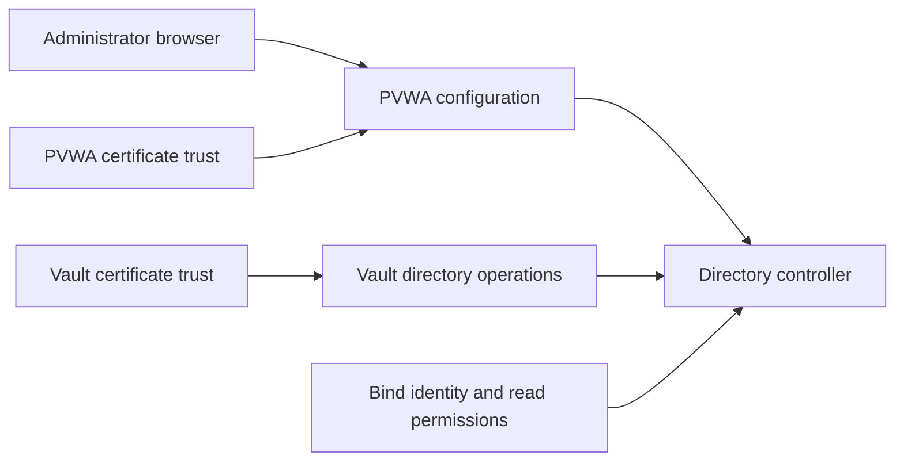

# Fix CyberArk PVWA Domain Connection Errors with LDAPS

Author: [nawazdhandala](https://www.github.com/nawazdhandala)

Tags: CyberArk, LDAP, Troubleshooting

Description: Diagnose PVWA domain connection failures by checking both server paths, LDAPS certificates, bind credentials, and every configured domain controller.

“Failed to contact the domain” describes an outcome, not a root cause. The directory server might be unreachable, its TLS certificate might be untrusted, or the bind account might be rejected. The page displaying the error also does not identify every server involved in the failed operation.

For CyberArk PAM Self-Hosted, investigate the PVWA and Vault paths separately. This guide follows the current documentation labeled 15.2, with Windows inspection examples. The snippets were syntax-checked locally; no live CyberArk directory integration or Windows certificate validation was performed.

## Understand the two directory clients

LDAP, the Lightweight Directory Access Protocol, lets applications query directory information. LDAPS protects that traffic with TLS, usually on TCP port 636. The directory's **bind account** is the identity used to establish an authenticated directory connection.

CyberArk's [LDAP troubleshooting article](https://knowledgebase.paloaltonetworks.com/KCSArticleDetail?id=kA1hj000000149jCAA&lang=en_US) explains that PVWA needs directory connectivity during configuration, while the Vault needs it for operations including directory mapping, synchronization, and transparent user logons.



A successful browser connection to PVWA proves neither LDAPS path. Likewise, a workstation test is useful for comparison but cannot certify the Vault's routing or trust store.

Build a small evidence table before changing anything:

| Source | Destination | Evidence to collect |
|---|---|---|
| Each relevant PVWA node | Each selected controller | Resolved address, TCP result, TLS result |
| Each relevant Vault node | Each selected controller | Supported name resolution, TCP result, TLS result |
| Actual integration | Configured directory and base context | Bind result and returned directory objects |

Record the failure time, selected controller, interface used, and full inner error. Keep the bind password out of the table.

## Confirm the names and port actually being used

Use the controller's intended fully qualified domain name, or FQDN. Check the configured directory hosts against the infrastructure inventory. A stale address can route a valid-looking name to an old controller.

On an authorized Windows server with the NetTCPIP module, replace the example name and run:

```powershell
Test-NetConnection -ComputerName 'REPLACE_DC_FQDN' -Port 636 -InformationLevel Detailed
```

Review `RemoteAddress`, `RemotePort`, `SourceAddress`, and `TcpTestSucceeded`. Microsoft's [Test-NetConnection reference](https://learn.microsoft.com/en-us/powershell/module/nettcpip/test-netconnection?view=windowsserver2025-ps) documents this diagnostic. Repeat it from the relevant source hosts under the Vault's approved administration procedure.

Success proves that a TCP connection was established. It does not validate a certificate, bind a user, or search a directory. Failure needs a routing, listener, or firewall investigation before password changes become useful.

CyberArk's [Vault LDAP configuration guide](https://docs.cyberark.com/pam-self-hosted/latest/en/content/pas%20inst/configuring-transparent-user-management.htm) describes explicit hosts-file entries for controllers on the hardened Vault. PVWA deployments with appropriate DNS resolution may not need the same arrangement. Review the supported design rather than enabling broad DNS or directory traffic on the Vault just to reproduce a workstation result.

If a temporary diagnostic network rule is necessary, make it an approved, destination-specific, time-limited change. Test the intended encrypted port. Opening unencrypted LDAP is not required merely to prove that LDAPS is broken.

## Verify the certificate presented by each controller

TLS server authentication asks two different questions: is this certificate trusted, and does it identify the server being contacted? Importing a certificate authority does not repair a hostname mismatch.

Microsoft's [LDAPS certificate requirements](https://learn.microsoft.com/en-us/troubleshoot/windows-server/active-directory/enable-ldap-over-ssl-3rd-certification-authority) cover the controller name, Server Authentication purpose, associated private key, and trusted issuing chain. Check validity dates and the certificate actually selected by the directory service. A newly issued certificate sitting in a store is not proof that the listener presents it.

Inspect the certificate from the affected controller, not a convenient working peer. Ask the directory and certificate administrators to confirm the expected fingerprint and chain through the approved inventory. Export the public certificate only; the controller's private key is not needed for this diagnosis.

With that public certificate available on the Windows client being investigated, Microsoft's [LDAPS troubleshooting procedure](https://learn.microsoft.com/en-us/troubleshoot/windows-server/active-directory/ldap-over-ssl-connection-issues) uses this inspection:

```powershell
certutil -v -urlfetch -verify '.\REPLACE_DC_CERTIFICATE.cer'
if ($LASTEXITCODE -ne 0) {
    throw 'Certificate verification failed; retain the diagnostic output.'
}
```

Read the complete result, not just the final exit status. The `-urlfetch` option can contact certificate-chain or revocation endpoints, so run it only where those requests are approved. A failure may identify an unavailable revocation source rather than a missing root. This checks the supplied certificate and its chain; it does not prove that the live endpoint presents that file or that an LDAP bind succeeds.

Check trust in the Local Computer context used by the components. Importing a root into an administrator's personal store can leave the service unchanged. CyberArk documents certificate trust on both the Vault and PVWA. Have the certificate owner distinguish roots, intermediates, and server certificates before importing them; do not turn an arbitrary server certificate into an organization-wide trust anchor.

## Test encrypted LDAP separately from the bind

Where the approved Windows administration tools include Ldp.exe, use Connection > Connect with the controller FQDN, port 636, and SSL enabled. Microsoft documents Ldp.exe as an LDAPS diagnostic. A successful connection and directory information narrow the problem to later stages; they do not establish that your configured bind identity is accepted.

Then test the intended bind method with the same approved account, using the tool's credential dialog. Avoid repeated retries after a rejection because they can lock the account. Compare the username representation, account state, password currency, and directory-server authentication events.

In the modern CyberArk interface, the [integration setup reference](https://docs.cyberark.com/pam-self-hosted/latest/en/content/landing%20pages/lpldapintegration.htm) lists the domain name, secure connection setting, bind username and password, and domain base context. Its documented username examples include `user@DomainName.com` and `Domain_Name.com\user`. Older interface fields differ, so check the instructions for the page you are using.

The base context is the directory branch beneath which objects are searched, such as `DC=example,DC=com`. A valid bind with an incorrect search base can still produce unusable integration results. Confirm that the account can read the required users and groups; CyberArk's preparation guide calls for read permissions rather than directory modification rights.

## Review every configured controller

One healthy controller does not make all configured entries valid. CyberArk's troubleshooting reference explains that saving host configuration validates the listed hosts, so a previously broken entry can prevent a new configuration from saving.

Compare each controller's resolution, certificate, and bind results. If only one fails, repair or retire that entry through the directory change process while preserving the required redundancy. Do not delete the entire directory configuration to make the wizard start over.

Use the detailed error to prioritize the next check. The vendor gives certificate-related and bind-related examples, but a numeric code without its surrounding message is insufficient evidence for a password reset. When ordinary logs are inconclusive, use the documented, temporary LDAP tracing procedure with the support team, capture one controlled attempt, and restore the previous logging level.

## Accept the repair only after an end-to-end check

Repeat the original configuration action and confirm the expected directory objects appear. Then test an approved mapped user through the intended login path and verify their assigned access. Keep mapping changes separate from transport repairs: granting a broader role cannot fix an untrusted certificate.

Record results for every retained controller and source node, including any failover path in scope. Schedule follow-up checks for certificate renewal and controller replacement. The durable fix is consistent naming, trust, and authenticated directory access across the actual paths, not a single successful connection from an administrator's laptop.
