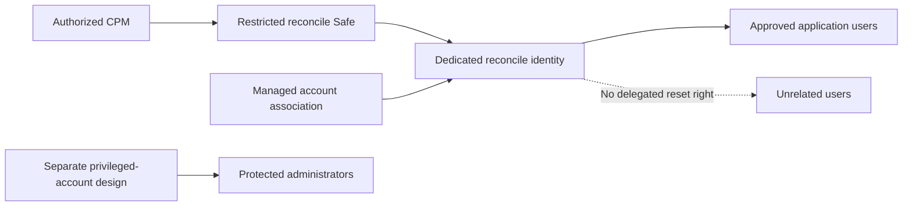

# Configure a CyberArk Reconcile Account with Least Privilege

Author: [nawazdhandala](https://www.github.com/nawazdhandala)

Tags: CyberArk, Security, Access Control

Description: Scope CyberArk reconciliation to approved accounts using separate target permissions, Vault access, account associations, and positive and negative tests.

A reconcile account can recover a managed password when the stored value no longer matches the target. That makes it useful, but also powerful: anyone able to use its reset permissions may be able to take control of the accounts it manages.

Least privilege therefore means more than removing Domain Admin membership. Define which accounts the identity may reset, how CyberArk obtains its credential, and which managed objects may select it. This tutorial uses ordinary Active Directory domain users as the concrete case. Protected administrative accounts, local Windows accounts, and other platforms need separate permission designs.

The CyberArk documentation reviewed here identifies itself as PAM Self-Hosted 15.2. The directory concepts also apply to supported Windows Server releases listed in the linked Microsoft documentation. No live delegation or reconciliation was performed for this article.

## Define the recovery boundary first

Write down a small initial scope: one application, one environment, one domain, and an explicit collection of managed accounts. For example, a payroll test environment could have a dedicated organizational unit (OU) containing only its ordinary service identities. An OU is an Active Directory container that can carry permissions inherited by objects beneath it.

Create a dedicated delegation group and reconcile identity through your normal identity-provisioning process. Keep production and test recovery paths separate. Avoid placing unrelated users into the same delegated subtree later without reviewing the consequences.

Microsoft describes delegating specific tasks, including password resets, through [OU-based administration](https://learn.microsoft.com/en-us/windows-server/identity/ad-ds/plan/delegating-administration-by-using-ou-objects). The important boundary is the set of objects affected by the permission, including future children if inheritance is enabled.



The dotted line represents an intended restriction that must be tested. A diagram cannot establish effective access.

## Separate three permission layers

| Layer | What it controls | What to review |
|---|---|---|
| Target directory | What the reconcile identity can reset or modify | Object scope, inherited permissions, group membership, optional unlock behavior |
| Vault Safe | Who can access or manage the stored reconcile credential | Actual CPM identity, operators, retrieval and administrative access |
| CyberArk association | Which managed account selects which reconcile object | Account override, platform default, Safe and object references |

A narrow association does not compensate for a directory identity that can reset every domain user. Likewise, a tightly scoped directory identity still deserves restricted Vault access. Treat people who can change its permissions or retrieve its password as part of the recovery trust boundary.

## Delegate the required target operation

For ordinary domain users, have the directory owner delegate the reset operation to the dedicated group at the approved OU or individual objects. Inspect the resulting permissions rather than accepting a broad wizard preset without review. Limit inheritance to the intended object type and subtree. Preserve a before-change record and an exact removal plan for the new permission entries.

Start from the installed plugin's documented requirements. Do not copy an internet permission set containing Full Control, ownership changes, or broad security-descriptor modification merely because it makes a test pass. Additional operations can require additional permissions; password reset and account unlock are not interchangeable tasks.

CyberArk's [automatic-management reference](https://docs.cyberark.com/pam-self-hosted/latest/en/content/pasimp/configuring-accounts-for-automatic-management.htm) defines `UnlockUserOnReconcile` and `ChangePasswordInResetMode` separately. Leave optional behavior out of the initial design unless it is required. The latter changes ordinary password changes into resets using the associated reconcile account, so enabling it expands reliance on that identity.

The vendor's [delegation article](https://live.paloaltonetworks.com/t5/pam-self-hosted-articles/how-to-reconcile-a-domain-admin-account-without-domain-admin/ta-p/1427191) contains both broad historical examples and a version-qualified section describing narrower unlock permissions from PAS 9.10 onward. Those sections are not a sound basis for granting every listed right. Confirm the supported permission set for your installed plugin and enabled operations before applying it.

For Windows plugins using remote SAM calls, also review the effective remote-call restriction on the relevant server. SAM is Windows' Security Accounts Manager interface. Microsoft's [remote SAM policy documentation](https://learn.microsoft.com/en-us/previous-versions/windows/it-pro/windows-10/security/threat-protection/security-policy-settings/network-access-restrict-clients-allowed-to-make-remote-sam-calls) distinguishes domain-controller and member-server defaults. A denied remote call is not automatically evidence that the identity needs Domain Admin membership.

## Inspect the target permissions without changing them

On an authorized Windows administration host where `dsacls.exe` is installed, these commands display the access-control lists (ACLs) of a lab OU and one account. Replace the example distinguished names with your approved objects. Run from an elevated Command Prompt with directory read access.

```cmd
dsacls "OU=Payroll-Test,DC=example,DC=com"
dsacls "CN=svc-payroll-test,OU=Payroll-Test,DC=example,DC=com"
```

There are no grant, remove, or reset switches. Microsoft documents that supplying only an object makes [dsacls display its permission entries](https://learn.microsoft.com/en-us/previous-versions/windows/it-pro/windows-server-2012-r2-and-2012/cc771151%28v%3Dws.11%29).

Review the delegation group's entries on both objects, including inherited scope and any unrelated broad grants. This output is evidence about the ACL, not a complete effective-access calculation: nested group membership, deny entries, and protected-object behavior can change the outcome. Save the output securely and compare it after the approved delegation.

## Treat protected administrators separately

An OU experiment with a normal user does not validate reconciliation of Domain Admins. Active Directory uses AdminSDHolder and the SDProp process to maintain permissions on protected accounts. Moving a protected account into the test OU does not make ordinary inheritance behave as expected. Microsoft's [protected-account explanation](https://learn.microsoft.com/en-us/windows-server/identity/ad-ds/plan/security-best-practices/appendix-c--protected-accounts-and-groups-in-active-directory) describes this mechanism.

A reset right over a protected administrator is itself highly privileged, even when the reset identity is absent from the Domain Admins group. Do not modify AdminSDHolder as a routine fix for an ordinary-account deployment. Give that design its own security review, recovery identity, monitoring, and evidence of which protected objects receive the permission.

## Store and associate the reconcile account

Onboard the dedicated identity into a restricted Safe and verify its stored credential through the supported platform. Give the relevant CPM the required access using the deployment's documented Safe-permission model. Ordinary users of the application account do not automatically need access to retrieve its recovery credential.

Begin with an account-level association on the test account. In the documented classic interface, open Account Details, use Associate in the CPM pane, and select the reconcile account. Account-level association overrides a platform default, as described in [reconciling passwords](https://docs.cyberark.com/pam-self-hosted/latest/en/content/pasimp/reconciling-passwords.htm).

For a later platform-wide rollout, the documented reference fields are `ReconcileAccountSafe`, `ReconcileAccountFolder`, and `ReconcileAccountName`. Record their resolved values in the change review; they identify the stored object, not its password. Restrict the platform to intended Safes using the supported `AllowedSafes` setting and verify its matching behavior before rollout. These controls are described in the [automatic-management reference](https://docs.cyberark.com/pam-self-hosted/latest/en/content/pasimp/configuring-accounts-for-automatic-management.htm).

## Prove both allowed and denied behavior

Use disposable test accounts with application owners' approval. Demonstrate that the intended account can be reconciled and freshly verified. Then test an otherwise comparable disposable account outside the delegated scope: the reset must be denied. A failure caused by a typo or network outage does not prove the permission boundary, so correlate it with target and CPM evidence.

If unlocking is part of the approved design, test that separately. Also verify that an unauthorized operator cannot retrieve the reconcile secret, and that account-level overrides do not select the wrong recovery identity.

Finally, rotate and monitor the reconcile credential itself, document its independent recovery procedure, and assign an owner to review scope changes. Record the tested account set and denied case. A successful reset proves functionality; the denied case and permission review establish the boundary that makes the configuration defensible.
