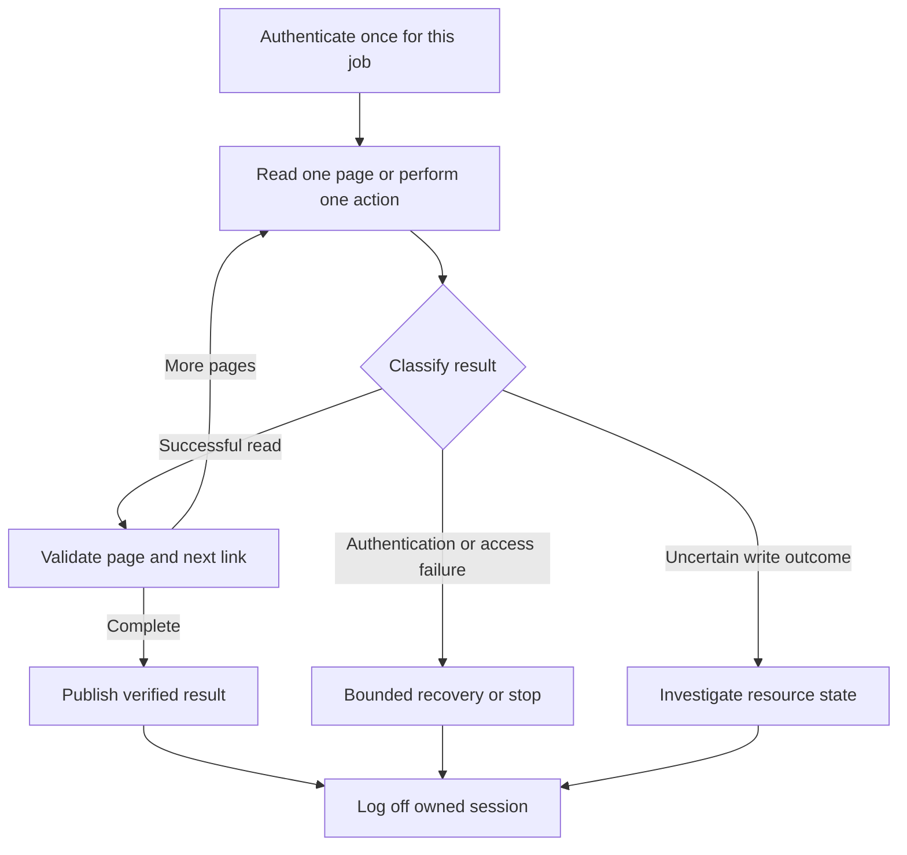

# Handle CyberArk API Tokens, Pagination, and Errors Safely

Author: [nawazdhandala](https://www.github.com/nawazdhandala)

Tags: CyberArk, REST API, Troubleshooting

Description: Design CyberArk API clients that protect session tokens, finish paginated reads, and handle authentication, conflicts, and throttling without unsafe retries.

An inventory job can appear successful while returning only its first page. An onboarding job can create duplicate work when it retries a timed-out request. Both failures come from treating an API call as a single command instead of a conversation with state.

This guide targets the second-generation PAM Self-Hosted REST API exposed by Password Vault Web Access (PVWA). CyberArk Identity, Conjur, and Privilege Cloud authentication flows have different contracts. Do not move a token format or retry rule between those products just because they share a vendor name.

## Give each job a clear session lifecycle

For the CyberArk authentication method, the documented logon endpoint is `/PasswordVault/API/auth/Cyberark/Logon/`. It accepts JSON and returns a session token. The documented default session length is 20 minutes, but a client should handle actual expiry rather than assume that every deployment behaves identically. `concurrentSession` is the exact optional Boolean property for enabling multiple sessions. [Official authentication reference](https://docs.cyberark.com/pam-self-hosted/latest/en/content/sdk/cyberark%20authentication%20-%20logon_v10.htm).

Use the returned token directly in the PAM `Authorization` header as demonstrated in CyberArk's official scripts. Do not add an OAuth `Bearer` prefix or encode it again unless the particular endpoint's contract requires that format. The source reviewed here is pinned to commit `b75e88768143fbfeb065aa7d47afe4e0c30ec3e1`. Its logoff helper posts to `/PasswordVault/API/Auth/Logoff`. [Pinned account-report script](https://github.com/cyberark/epv-api-scripts/blob/b75e88768143fbfeb065aa7d47afe4e0c30ec3e1/Get%20Accounts/Get-Accounts.ps1).

Keep credentials and tokens in memory or an approved secret-delivery mechanism. Exclude authorization headers, logon bodies, and password responses from debug logs. Give one worker responsibility for refreshing a shared session; otherwise, a burst of failures can produce a burst of competing logons.

Use cleanup logic to log off the session that this job owns. Report cleanup failure separately without hiding the original job failure. Do not log off a token borrowed from another process without an ownership agreement.



## Complete the inventory before using it

The Get accounts API requires List Accounts permission in the relevant Safe. Its pagination uses `offset`, `limit`, and a returned `nextLink`. Results are also affected by the PVWA `MaxDisplayedRecords` setting. Reaching the final page proves traversal finished; it does not prove the caller saw every account in the organization. [Get accounts reference](https://docs.cyberark.com/pam-self-hosted/latest/en/content/sdk/getaccounts.htm).

Keep the query and authorized scope stable throughout a run. Record account IDs, detect duplicates, and avoid treating partial output as a completed inventory. Concurrent additions or removals can disturb offset-based pagination. For decisions that remove accounts or access, use a controlled inventory window or repeat the read and resolve differences first.

The following original Python helper illustrates a bounded, read-only traversal. `fetch_json` is an injected transport function: it must perform an authenticated GET, verify TLS, reject redirects, apply timeouts, and raise on non-success responses. It must not return an HTML login page as if it were JSON. This separation lets the traversal be tested without real credentials.

```python
from urllib.parse import urljoin, urlsplit

def collect_accounts(base, fetch_json, max_pages=1000):
    base = base.rstrip('/') + '/'
    origin = urlsplit(base)
    endpoint = urljoin(base, 'API/Accounts')
    path = urlsplit(endpoint).path.lower()
    link = endpoint + '?limit=100'
    visited, ids, accounts = set(), set(), []
    for _ in range(max_pages):
        url = urljoin(base, link)
        parsed = urlsplit(url)
        if (parsed.scheme != 'https' or parsed.netloc != origin.netloc
                or parsed.username is not None or parsed.fragment
                or parsed.path.rstrip('/').lower() != path):
            raise ValueError('Unexpected pagination destination')
        if url in visited:
            raise ValueError('Repeated pagination link')
        visited.add(url)
        page = fetch_json(url)
        if not isinstance(page, dict) or not isinstance(page.get('value'), list):
            raise ValueError('Unexpected account page')
        for account in page['value']:
            identity = account['id']
            if not isinstance(identity, str) or not identity or identity in ids:
                raise ValueError('Missing or repeated account ID')
            ids.add(identity)
            accounts.append(account)
        link = page.get('nextLink')
        if not link:
            return accounts
        if not isinstance(link, str):
            raise ValueError('Unexpected nextLink type')
    raise ValueError('Page budget exceeded; inventory is incomplete')
```

Pass your approved base address, such as `https://REPLACE_PVWA_FQDN/PasswordVault`. The helper accepts links only to that origin and account-list path. It returns a result only after the final page; an exception means callers must discard the incomplete run. It intentionally has no write or authentication code. Test the actual link shape from your PVWA version before adapting it to a production transport.

## Classify errors before retrying

HTTP status codes are a starting point. Preserve a sanitized product error code, request identifier if supplied, method, operation name, timestamp, and responding infrastructure layer. A proxy-generated login response and a Vault authorization error require different investigations.

| Result | First decision | Action to avoid |
| --- | --- | --- |
| 401 | Check token presence, validity, intended endpoint, and session routing | Repeatedly submitting the same invalid credentials |
| 403 | Review the operation's required permissions and policy | Granting administrator access just to make the job pass |
| 409 | Inspect the conflicting resource and compare intended state | Assuming every conflict means “already completed” |
| 429 | Identify the throttling layer and delay eligible requests | Increasing worker count or immediate retries |

The first three meanings follow HTTP authentication, refusal, and conflict semantics; product-specific error details still determine the remedy. [HTTP semantics](https://www.rfc-editor.org/rfc/rfc9110.html#name-status-codes).

For a failed GET, allow at most one approved reauthentication attempt before stopping. Do not create a login loop. A missing-session error can also involve load-balancer routing: CyberArk documents cases where requests move between PVWA servers. Check session and load-balancer configuration with the platform owner instead of bypassing the approved endpoint permanently. [CyberArk session-routing guidance](https://knowledgebase.paloaltonetworks.com/KCSArticleDetail?id=kA1hj0000000rNrCAI&lang=en_US).

For 409, retrieve the relevant object and compare its stable identity and requested properties. An existing account with a different platform, Safe, or address is a conflict requiring review, not a successful retry. Record whether the previous write is known to have completed, known to have failed, or still unresolved.

## Bound delays and protect writes

A 429 response may include `Retry-After`; HTTP permits that value to describe a delay or a date. Respect a valid server-provided delay. If it exceeds the job's time budget, defer the job rather than retry sooner. Without a usable value, apply bounded backoff with jitter, meaning a randomized delay that spreads workers apart. [429 specification](https://www.rfc-editor.org/rfc/rfc6585.html#section-4), [Retry-After format](https://www.rfc-editor.org/rfc/rfc9110.html#name-retry-after).

These are client-design recommendations, not a claim that every PAM version enforces the same request quota. A gateway may produce throttling independently of PVWA. Share the delay across workers using the same constrained service, and limit both attempts and total elapsed time.

Treat a transport timeout after a write as an unknown outcome. Do not automatically replay account creation, password change, or another action merely because a retry library considers the connection temporary. Resolve the outcome using the resource state and operation evidence, then make an explicit recovery decision.

Before release, simulate a two-page result, repeated link, foreign destination, duplicate ID, expired session, forbidden operation, conflict, and throttled read. Verify that incomplete reads never feed a destructive reconciliation job. The useful success criterion is a complete, explainable result with bounded recovery, not simply a process that eventually exits with code zero.
