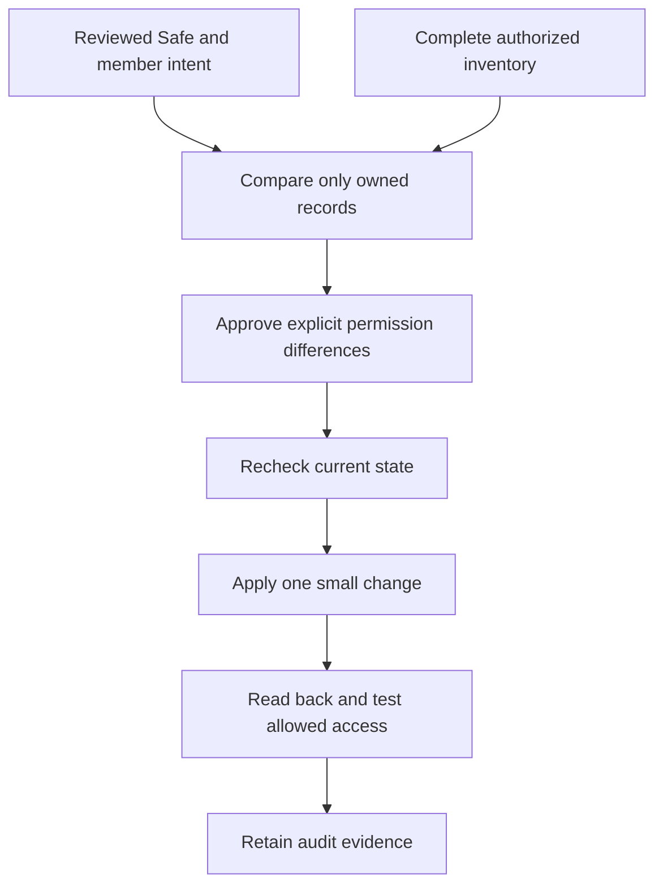

# Manage CyberArk Safes and Membership Permissions as Code

Author: [nawazdhandala](https://www.github.com/nawazdhandala)

Tags: CyberArk, Access Control, Automation

Description: Build a reviewable CyberArk Safe permission workflow with explicit ownership, complete permission records, controlled updates, and read-back verification.

A CyberArk Safe is a container for privileged accounts with its own access rules. Managing those rules as code means storing intended settings in version control, reviewing changes, and checking that the deployed settings match. It should not mean replacing every membership with whatever happens to appear in today's spreadsheet.

Consider an application team that needs to use accounts through approved sessions without retrieving their passwords. The change should grant that team's approved access while preserving the password-management service, emergency administrators, and other application teams. This tutorial builds that boundary into the workflow.

## Pin the tool and separate two kinds of change

The examples use CyberArk's `Safe-Management.ps1` **2.2.6**, inspected at repository commit `b75e88768143fbfeb065aa7d47afe4e0c30ec3e1`. Its documented baseline is PVWA 12.1 or later, where PVWA means Password Vault Web Access. Check compatibility against your installed release before using it. These are source-reviewed examples, not a claim of testing against a live Vault. [Official script and version history](https://github.com/cyberark/epv-api-scripts/blob/b75e88768143fbfeb065aa7d47afe4e0c30ec3e1/Safe%20Management/Safe-Management.ps1).

Keep two reviewed files: one describing Safe properties, and another describing memberships. Safe properties include the managing Central Policy Manager (CPM), retention settings, and description. Membership records identify a principal, such as a directory group, and its permissions. A membership-only release should not accidentally change password retention or assign a different CPM.

For new Safes, approve the retention policy explicitly. The pinned implementation chooses either a retained-version count or a day-based retention setting. Do not fill both with arbitrary defaults. Treat deletion of an existing Safe as a separate destructive change, never as automatic cleanup for an absent configuration entry.

## Declare what the automation owns

Maintain an ownership list of exact Safe and member identities. Include the identity source, such as the configured LDAP directory, rather than relying on a short group name. LDAP is the directory protocol used to look up organizational users and groups.

| Record | Intended handling |
| --- | --- |
| Managed member already matches | Record verification; perform no write |
| Managed member differs | Review the complete proposed permission change |
| Intended new member | Confirm directory identity, then use the add operation |
| Member absent from the ownership list | Preserve and report it |
| Managed member scheduled for removal | Require a separate approved removal plan |

A missing member in an API response is not automatically evidence that the member does not exist. Confirm the caller's visibility, filters, and pagination first. A report filtered to ordinary users is insufficient evidence for deleting system identities.



The recheck matters: another administrator may have changed access between planning and execution. Stop and produce a new plan when the observed state differs from the reviewed baseline. A version-control approval does not lock the Vault.

## Read before you write

From a restricted working directory containing the reviewed script, use PowerShell to inspect one Safe and its members. Replace both placeholders. The account running these commands needs authorized visibility; authenticate through your approved interactive process and keep exported reports private.

```powershell
& .\Safe-Management.ps1 `
    -PVWAURL 'https://REPLACE_PVWA_FQDN/PasswordVault' `
    -Report -SafeName 'REPLACE_SAFE'

& .\Safe-Management.ps1 `
    -PVWAURL 'https://REPLACE_PVWA_FQDN/PasswordVault' `
    -Members -SafeName 'REPLACE_SAFE'
```

The first command reports Safe settings; the second lists memberships without supplying a new user. The utility's member-list implementation filters predefined users by default and does not implement a pagination loop in that function. Supplement it with the release-specific API inventory where necessary before claiming completeness. These reports are useful observations, not a backup of all access configuration. [Official usage](https://github.com/cyberark/epv-api-scripts/blob/b75e88768143fbfeb065aa7d47afe4e0c30ec3e1/Safe%20Management/README.md).

## Make every permission intentional

Start from the pinned `safe-members-sample.csv` header, but replace its permissive example rows. `UseAccounts` permits use without viewing passwords; `RetrieveAccounts` permits retrieval. `ManageSafeMembers` is administrative authority, not ordinary application access. Review permission interactions too: adding accounts also grants account-property updates, and disabling CPM management operations disables specifying the next password. [Permission definitions](https://docs.cyberark.com/pam-self-hosted/latest/en/content/webservices/update%20safe%20member.htm).

For the selected member, fill every permission column with `true` or `false`. The script converts invalid Boolean text to false after logging an error. A blank cell therefore must not mean “leave unchanged.” Its CSV `RequestsAuthorizationLevel` is an integer: 0, 1, or 2; the implementation translates it into two API flags.

The following original Python check validates the CSV shape against the pinned sample header. Save it as `check_members.py`. Supply the unmodified sample file first and your proposed membership file second. It reads local files only; it does not authorize their contents or contact CyberArk.

```python
import csv
import sys

with open(sys.argv[1], newline='', encoding='utf-8-sig') as f:
    expected = next(csv.reader(f))
identity = ['Safename', 'Member', 'MemberLocation', 'MemberType']
level = 'RequestsAuthorizationLevel'
boolean = set(expected) - set(identity) - {level}
seen = set()
with open(sys.argv[2], newline='', encoding='utf-8-sig') as f:
    reader = csv.DictReader(f)
    if reader.fieldnames != expected:
        raise ValueError('Header must match the reviewed sample exactly')
    for number, row in enumerate(reader, 2):
        if None in row or any(v is None for v in row.values()):
            raise ValueError(f'Row {number}: wrong number of fields')
        if any(not row[k].strip() for k in identity):
            raise ValueError(f'Row {number}: incomplete identity')
        key = tuple(row[k].strip().casefold() for k in identity[:3])
        if key in seen:
            raise ValueError(f'Row {number}: duplicate membership')
        seen.add(key)
        if row[level] not in {'0', '1', '2'}:
            raise ValueError(f'Row {number}: invalid approval level')
        if any(row[k].lower() not in {'true', 'false'} for k in boolean):
            raise ValueError(f'Row {number}: use explicit true or false')
if not seen:
    raise ValueError('No membership rows')
print(f'Validated {len(seen)} membership rows; approval still required')
```

This check deliberately targets Self-Hosted records with an explicit directory location and member type. Privilege Cloud Shared Services uses different identity-location conventions; do not reuse this policy unchanged there. It also cannot detect overlapping directory-group memberships or establish a user's effective access.

## Apply narrowly and verify independently

After review and a staging rehearsal, the pinned utility exposes this explicit update mode:

```powershell
& .\Safe-Management.ps1 `
    -PVWAURL 'https://REPLACE_PVWA_FQDN/PasswordVault' `
    -UpdateMembers -FilePath '.\REPLACE_APPROVED_MEMBERS.csv'
```

This command changes access. Begin with one test Safe and one owned member. The utility sends a `PUT` to the Safe-member endpoint with its complete permission object. Do not enable `AddOnUpdate` merely to suppress an unexpected missing-member error; resolve the identity first. Also inspect membership expiry: the pinned helper constructs an empty expiration value, so it is unsuitable for blindly preserving time-limited memberships. Use an explicitly reviewed API request when expiry must be retained.

Read back the member after each change and compare all intended fields, including expiry. Test permitted access and a specifically prohibited operation using a nonprivileged test identity. A successful HTTP response alone does not prove the resulting authorization is correct, especially when directory groups contribute additional access.

Retain the approved input, before-and-after permission records, actor, timestamp, and change reference. Keep tokens and passwords out of those records. If access differs unexpectedly, stop the batch and restore only the affected, reviewed membership state after checking for concurrent changes. Preserve a separately tested emergency access path throughout the rollout.
