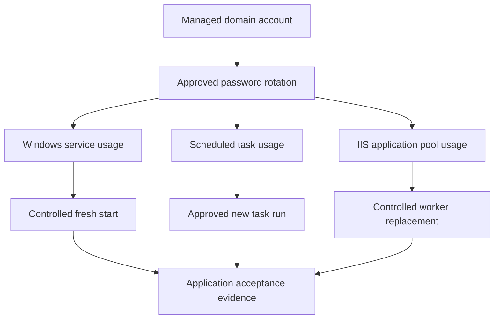

# Rotate Windows Service, Task, and IIS Credentials with CyberArk

Author: [nawazdhandala](https://www.github.com/nawazdhandala)

Tags: CyberArk, Windows Server, Security

Description: Inventory Windows credential consumers, configure CyberArk dependencies, and verify service, scheduled-task, and IIS recovery after password rotation.

Changing a domain account password is only part of rotating an application credential. A Windows service, a scheduled task, and an IIS application pool may each retain a configured copy of that password. If one copy stays old, the application may continue running until its next start and then fail.

CyberArk dependent accounts describe those places where a managed credential is used. Build the dependency inventory before the first rotation, then test fresh starts rather than relying on a green account status. This guide uses Windows Server 2022 and IIS 10 as its example environment. Review the installed CPM and plugin versions against the linked compatibility documentation before adopting the workflow.

## Identify the account and every consumer

Separate the domain identity from its usages. `EXAMPLE\svc-payroll` is one identity; a service on one server and two tasks on other servers are three consumers. Record each host, exact consumer name, configured identity, application owner, restart procedure, and expected business result.

Do not treat discovery as proof of completeness. Include infrequently used recovery hosts, disabled tasks that may be re-enabled, and secondary application nodes. Ask the application owner about copies in configuration files and other systems outside this article's three consumer types.



These arrows show the required coverage and checks. They do not promise an atomic update across multiple hosts or a particular plugin execution order.

## Inspect the consumers without displaying passwords

Run the following examples locally on an authorized target server. Use Windows PowerShell 5.1 with the relevant Windows modules installed and permission to inspect the configuration. Replace placeholder names before running. The examples read selected metadata and do not change passwords or restart workloads.

For services, inspect the actual service name and its configured logon identity:

```powershell
$ErrorActionPreference = 'Stop'
Get-CimInstance -ClassName Win32_Service |
    Select-Object Name, DisplayName, StartName, State, StartMode
```

Use `Name`, rather than the friendly display name, when identifying a service usage. `StartName` identifies the account under which the service is configured to run. These fields come from Microsoft's [Win32_Service class](https://learn.microsoft.com/en-us/windows/win32/cimwin32prov/win32-service); [Get-CimInstance](https://learn.microsoft.com/en-us/powershell/module/cimcmdlets/get-ciminstance?view=powershell-7.5) retrieves the instances. Inventory output is still sensitive operational information, even without passwords.

For one scheduled task, preserve both its folder and name:

```powershell
$ErrorActionPreference = 'Stop'
$task = Get-ScheduledTask -TaskPath '\REPLACE_FOLDER\' -TaskName 'REPLACE_TASK'
$task | Select-Object TaskPath, TaskName, State
$task.Principal | Select-Object UserId, LogonType
$task | Get-ScheduledTaskInfo |
    Select-Object LastRunTime, LastTaskResult, NextRunTime
```

The [task definition](https://learn.microsoft.com/en-us/powershell/module/scheduledtasks/get-scheduledtask?view=windowsserver2025-ps) and [runtime information](https://learn.microsoft.com/en-us/powershell/module/scheduledtasks/get-scheduledtaskinfo?view=windowsserver2025-ps) answer different questions. A previous successful run does not validate the next password. Check `LogonType`: a password-based task is different from one using an existing interactive session or S4U, which does not store a password. Microsoft defines those [task logon types](https://learn.microsoft.com/en-us/windows/win32/taskschd/principal-logontype).

For IIS, inspect the selected pool's process identity:

```powershell
$ErrorActionPreference = 'Stop'
Import-Module WebAdministration
$pool = Get-Item 'IIS:\AppPools\REPLACE_POOL'
$pool | Select-Object Name, State
$pool.processModel | Select-Object identityType, userName
```

This uses the [IIS PowerShell provider](https://learn.microsoft.com/en-us/iis/manage/powershell/powershell-snap-in-making-simple-configuration-changes-to-web-sites-and-application-pools). A custom `SpecificUser` identity has credentials to manage; the built-in `ApplicationPoolIdentity` is a different mechanism. Microsoft's [process-model reference](https://learn.microsoft.com/en-us/iis/configuration/system.applicationhost/applicationpools/add/processmodel) explains the distinction. Avoid displaying the complete process-model object because the selected fields are sufficient for this inventory.

## Confirm the plugin prerequisites

Check the three integrations individually. A reachable domain controller does not establish that CPM can update configuration on an application server.

| Consumer | Required planning decision |
|---|---|
| Windows service | Exact `ServiceName`, host address, management identity, restart behavior, and service dependencies |
| Scheduled task | Exact folder/name, supported password-storage mode, management identity, and safe execution time |
| IIS application pool | Pool identity, supported IIS version, compatibility components, remote access, and worker replacement procedure |

The [Windows Service plugin](https://docs.cyberark.com/plugins-pam-sh/latest/en/pam-sh/pasimp/windowsservicesaccounts/) documents `ServiceName`, `Address`, and optional `RestartService`, whose default is `No`. Decide whether the plugin or the application runbook owns the restart. Do not assume successful password propagation restarted the service.

The [Scheduled Tasks plugin](https://docs.cyberark.com/plugins-pam-sh/latest/en/pam-sh/pasimp/windowsscheduledtasksaccounts/) documents an unsupported case where the password is stored separately from the task. It also specifies host and authentication requirements. Resolve these before rotation rather than treating an unsupported storage arrangement as a retryable failure.

For the documented [IIS Application Pool plugin](https://docs.cyberark.com/plugins-pam-sh/latest/en/pam-sh/pasimp/windowsiisapplicationpools/), IIS 10 requires IIS 6 management compatibility components, and the plugin cannot update a pool on the CPM's own machine. Its remote communication and authorization requirements differ from a simple directory password change. Review those requirements with the Windows security owner; do not change host security settings indiscriminately across the estate.

An additional linked logon account can provide the remote management identity where the primary account is unsuitable. Keep that role distinct from a reconcile account that resets the primary password. Confirm the actual plugin's supported permissions and approved authentication path, including host-name resolution for domain authentication.

## Add dependencies to the correct primary account

In the documented classic interface, first link the dependent platform to the target platform and enable Search for Usages at the target-platform level. Then select the primary account, choose the relevant dependency type in Account Details, click Add, and save the required information. This sequence is documented in [Manage dependent accounts](https://docs.cyberark.com/pam-self-hosted/latest/en/content/pasimp/managing-service-accounts.htm).

Repeat for each inventory entry. Compare the saved host and consumer identifier with the actual Windows configuration, not just its display label. Keep one primary account relationship for the shared credential rather than independently rotating separate copies of the same domain identity.

Windows service-to-service dependencies also need attention. The service plugin documents special handling by the root of a service dependency chain, including a `(CPM)DependentService` reason on affected accounts. Investigate that relationship before re-enabling an entry that appears disabled; it may represent documented coordination rather than an unmanaged consumer.

## Rehearse a complete rotation

Begin with a representative test application and a scheduled maintenance window. Establish a healthy baseline, record the inventory, and confirm how the application will be recovered if only some consumers update.

Perform one approved primary-account rotation. Follow the primary and dependent results separately. For each service, perform the planned fresh start and verify useful application work. For each task, run only an approved test or wait for its next planned execution; a payroll task must not be launched merely to prove authentication. Check its new run time, result, and output.

For IIS, use the application's controlled recycle or worker replacement procedure, then exercise an endpoint that actually reaches the protected downstream resource. A cached homepage is insufficient evidence.

If one dependency fails after the primary password changes, preserve the logs and establish which value is current before recovery. Avoid repeatedly rotating the primary or restoring an old Vault value alone: neither guarantees that the directory and every consumer agree. Recover the failed usage through the supported procedure and repeat its acceptance check.

Roll out only when the inventory matches the successful dependency updates and fresh-authentication evidence. Keep adding and removing usages as application topology changes; credential rotation stays reliable only while that inventory remains accurate.
