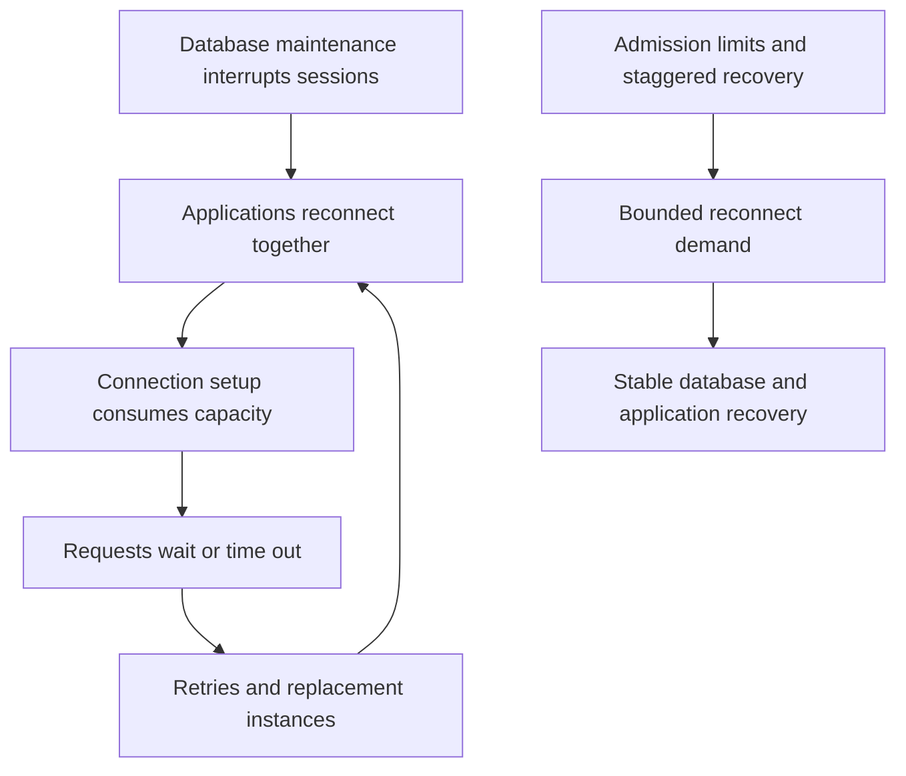

# Prevent Connection Storms After Database Maintenance

Author: [nawazdhandala](https://www.github.com/nawazdhandala)

Tags: AWS, PostgreSQL, Reliability

Description: Keep a managed database restart from becoming a longer outage by budgeting fleet connections, limiting retries, and restoring traffic in controlled stages.

The database restarts for maintenance and becomes reachable again. Then hundreds of application processes try to rebuild their pools together. Authentication, TLS handshakes, and session creation compete with the first returning queries. Requests time out, retries increase, and the recovery wave becomes a second outage.

This is a fleet coordination problem. Fixing one application's broken connection is necessary, but it does not control how many other applications reconnect at the same moment.

The examples below use RDS DB instances, AWS CLI 2.38.1, and a small Python 3.11 capacity calculation. They do not trigger maintenance or alter the database. Use them to prepare and rehearse a bounded recovery policy for your own workload.

## Separate the maintenance event from the recovery surge

Track three intervals: when database service was interrupted, when fresh connections began succeeding, and when normal application operations recovered. Record connection attempts and failures per second, not only the total number of open sessions.

A database with a moderate connection count can still spend substantial effort handling a rapid cycle of failed connections. Conversely, many stable idle sessions do not prove that new requests can acquire the sessions they need.



Inspect whether the surge came from ordinary pool recovery, application restarts, autoscaling, background workers, or all of them. Each producer needs to respect the same database capacity budget.

## Inspect the planned work in advance

Some RDS maintenance requires taking an instance offline. Deferred instance modifications are also relevant, and they are not all represented by the same maintenance list. AWS directs operators to inspect `PendingModifiedValues` for deferred modifications. Its pending-maintenance API is eventually consistent, so a just-applied action may not immediately appear changed. [RDS maintenance guidance](https://docs.aws.amazon.com/AmazonRDS/latest/UserGuide/USER_UpgradeDBInstance.Maintenance.html).

For a known instance ARN, this read-only command reports pending maintenance:

```bash
aws rds describe-pending-maintenance-actions \
  --profile production-readonly --region us-east-1 \
  --resource-identifier arn:aws:rds:us-east-1:123456789012:db:app-db \
  --no-cli-pager
```

Replace the profile, Region, account, and database name. An empty result is not a promise that no restart or deferred configuration change can occur. Pair it with the instance configuration and your change record. [Pending-maintenance command reference](https://docs.aws.amazon.com/cli/latest/reference/rds/describe-pending-maintenance-actions.html).

Schedule the application response before the window: identify which discretionary workers can pause, who controls admission, and which signals permit normal traffic to resume. Avoid making your first recovery design decision while the database is already restarting.

## Budget connections across the whole fleet

Count every process that owns a pool, including multiple worker processes within one container. Include deployment surge capacity and autoscaling limits, not just today's steady instance count.

This arithmetic example checks an illustrative connection allocation. The values are assumptions for planning, not measured PostgreSQL limits:

```python
processes = 80
max_connections_per_process = 12
other_workloads = 160
operational_reserve = 40
planned_database_budget = 1000

potential_demand = (
    processes * max_connections_per_process
    + other_workloads
    + operational_reserve
)

print(f"Potential allocation: {potential_demand}")
print(f"Budget margin: {planned_database_budget - potential_demand}")
```

It prints a potential allocation of 1,160 and a margin of -160. The configuration can exceed the planned budget even if each individual pool looks small. Reducing the example pool maximum to eight changes the allocation to 840, but that arithmetic does not establish adequate throughput or a suitable production setting.

Choose the database budget from tested workload capacity and required headroom, not merely the largest configurable `max_connections` value. A connection ceiling is not a promise that the database can execute that many expensive operations efficiently.

Account separately for connection creation rate. Rebuilding 800 sessions over a minute and rebuilding them in one second have different effects even though their eventual count is identical.

## Control both retries and new work

During recovery, cap concurrent work admitted to the database-dependent path. Bound queued requests and reject or defer work that cannot finish within its request deadline. An unbounded queue turns a short interruption into a long backlog.

Use bounded retries with backoff and jitter, meaning increasing delays with a randomized component. Coordinate retry ownership so an API, worker, and driver do not each multiply attempts independently. A timeout does not establish that a write failed; use stable operation identities and reconciliation before repeating ambiguous business actions. [AWS retry guidance](https://aws.amazon.com/builders-library/timeouts-retries-and-backoff-with-jitter/).

Do not reopen every paused worker immediately after the first successful query. Start a small cohort, observe database load and application outcomes, then expand. Keep retry volume and queued work visible while increasing admission.

Jitter spreads timing but does not impose a fleet-wide rate limit. A large enough fleet can overwhelm the database even when every process adds a random delay. Use explicit concurrency or admission controls alongside it.

## Stop health checks from amplifying the event

Review what happens when a dependency check fails. In Kubernetes, failed liveness checks can restart containers, while failed readiness checks remove Pods from matching Service endpoints without the same restart action. A startup probe changes when the other probes begin evaluating. [Kubernetes probe behavior](https://kubernetes.io/docs/tasks/configure-pod-container/configure-liveness-readiness-startup-probes/).

If a healthy application process is restarted simply because the database is briefly unavailable, the restart can discard useful state and synchronize pool initialization across the fleet. Design liveness around whether the process itself needs restarting. Let readiness and application admission express whether it can currently serve the relevant traffic.

Also inspect background jobs: removing a Pod from Service traffic does not necessarily stop its queue consumers. Ensure their retry and admission behavior is part of the recovery policy.

## Evaluate a proxy with its actual limits

RDS Proxy can reuse backend database connections and queue, throttle, or reject requests when capacity is unavailable. It can reduce session-creation pressure, but it does not remove the need for bounded application demand. [RDS Proxy behavior](https://docs.aws.amazon.com/AmazonRDS/latest/UserGuide/rds-proxy.html).

Its `MaxConnectionsPercent` governs backend connection limits, while `ConnectionBorrowTimeout` governs how long a request can wait for a database connection. Compare borrowing latency and allowed backend connections with the application's deadline. A proxy queue longer than the caller can tolerate simply moves the timeout elsewhere. [Proxy connection settings](https://docs.aws.amazon.com/AmazonRDS/latest/UserGuide/rds-proxy-connections.html).

Test the actual application session behavior. Pinning keeps a client associated with a particular backend connection and reduces sharing efficiency. Do not assume a dramatic connection reduction from a proxy without measuring the workload's pinning behavior. [RDS Proxy pinning](https://docs.aws.amazon.com/AmazonRDS/latest/UserGuide/rds-proxy-pinning.html).

## Prove recovery under representative demand

Rehearse the restart response in an approved environment with the intended fleet size or a documented approximation. Include warm pools, background workers, retries, and the deployment surge you permit. Keep the workload controller independent from the database.

Compare peak connection-attempt rate, accepted work, queue depth, error rate, and time to sustained correct operations. Preserve any manual intervention in the result. A test that passes only after restarting every process has not demonstrated automatic recovery.

The successful policy restores controlled test traffic first, then normal writers, without losing track of ambiguous operations. Keep the capacity calculation and admission settings with the maintenance runbook so future scaling changes do not silently recreate the storm.
