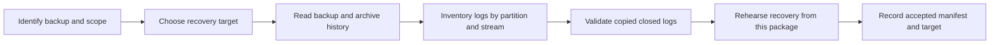

# Identify the Db2 Archive Logs Your Backup Needs Before Transfer

Author: [nawazdhandala](https://www.github.com/nawazdhandala)

Tags: Database, SQL, Backup

Description: Build a Db2 recovery-log inventory from backup history, included logs, and the intended recovery target, then validate the package before moving it off-host.

Copying a Db2 backup image to another server does not necessarily copy everything needed to recover it. An online image needs logs to become consistent, and recovery beyond the backup requires additional logs. Those files also belong to a particular database, partition, log stream, and log chain.

The useful question is therefore not “Which log filenames are near this backup's timestamp?” It is “Which recovery inputs are required to reach our selected target from this particular image?” This guide builds that inventory for **Db2 LUW 11.5**, starting with a full online backup and explicitly separating minimum recovery from later point-in-time recovery.

## Make the recovery target part of the inventory

Choose one target before collecting files:

| Target | What the package must support |
| --- | --- |
| End of the online backup | Enough logs to make that image consistent |
| A later timestamp | The required continuous recovery history through that time |
| End of available logs | A defined, verified set of available logs, with the resulting recovery point understood |

IBM's [archive logging guide](https://www.ibm.com/docs/en/db2/11.5.x?topic=logging-archive) explains why an online image requires rollforward at least through backup completion. The last log associated with a backup event is not automatically the last log needed for a target several hours later.

Record the target timestamp and time zone when applicable. Avoid a package manifest that merely says “latest”: its meaning changes as the source database continues writing.



## Query the history for the selected backup

Use an authorized monitoring connection to the source database. Replace `20261120010000` with the exact backup timestamp, save this as `backup-history.sql`, and run it through the Db2 Command Line Processor:

```sql
SELECT DBPARTITIONNUM, EID, START_TIME, END_TIME,
       SEQNUM, OPERATIONTYPE, NUM_LOG_ELEMS,
       FIRSTLOG, LASTLOG, LOCATION
FROM SYSIBMADM.DB_HISTORY
WHERE OPERATION = 'B'
  AND START_TIME = '20261120010000'
ORDER BY DBPARTITIONNUM, SEQNUM;
```

```bash
db2 -tvf backup-history.sql
```

IBM's [DB_HISTORY reference](https://www.ibm.com/docs/en/db2/11.5.x?topic=views-db-history-history-file) defines these columns. The view reads history across database partitions. `FIRSTLOG` and `LASTLOG` identify the earliest and latest logs associated with the event; `NUM_LOG_ELEMS` tells you how many log streams are represented. Keep stream identifiers intact when values contain lists.

Match the returned operation and image locations with the actual backup files. If the timestamp produces no rows, investigate the selection and history retention rather than silently substituting the newest backup. An image can remain available after history has been pruned, so an empty history result is not proof that no backup exists.

The query is a starting boundary and identity check. It does not prove that the named files remain in archive storage or that they can be read.

## Correlate archived files with the same history

Inspect the archive history on each relevant database partition:

```bash
db2 list history archive log all for SAMPLE
```

Replace `SAMPLE` with the database alias. Unlike the cross-partition view above, the [LIST HISTORY command](https://www.ibm.com/docs/en/db2/11.5.x?topic=commands-list-history) reports the partition on which it is issued. A complete distributed package needs the corresponding records for every required partition and stream.

Retain the archive method and location alongside each file. A filename such as `S0000123.LOG` alone is not a globally unique recovery artifact. The same name can appear in another database or recovery history. Preserve the archive's identity and directory context instead of flattening unrelated sources into one folder.

For a later recovery target, collect the continuing archive chain, not just the backup event's original range. Do not infer exact transaction coverage from filesystem modification times: copying or retrieving a file can change those times without changing the transactions it contains.

## Determine what is already inside the image

If the backup used `INCLUDE LOGS`, its embedded recovery logs may satisfy the end-of-backup requirement. IBM's [log inclusion documentation](https://www.ibm.com/docs/en/db2/11.5.x?topic=management-including-log-files-backup-image) describes extracting those logs with `LOGTARGET`.

For a conventional image, the following is a **logs-only extraction example** for an isolated inspection host. The image directory must contain the complete selected backup, and the extraction directory must already exist, be writable, and be empty. Replace the alias, timestamp, and paths:

```bash
db2 "restore db SAMPLE logs \
  from /srv/inspection/images/run01 \
  taken at 20261120010000 \
  logtarget /srv/inspection/logs/run01"
```

This requests log extraction rather than restoration of database data. The [restore reference](https://www.ibm.com/docs/en/db2/11.5.x?topic=commands-restore-database) requires `LOGTARGET` for `LOGS` and notes that extraction can take as long as a full restore. Keep the generated partition and stream directories.

Advanced Log Space Management adds a limitation: data-less restore modes do not extract its extraction-log files. A logs-only listing is therefore not a complete inventory of every dependency in an ALSM-enabled image. Retain the original image and use a full recovery rehearsal to establish sufficiency.

Do not use `db2ckbkp -l` as though it lists the embedded log filenames: it displays log-file-header and mirror-log-file-header data. Likewise, uppercase `-H` is header inspection, not image validation. These distinctions are documented in the [backup check reference](https://www.ibm.com/docs/en/db2/11.5.x?topic=commands-db2ckbkp-check-backup).

## Validate the archived copies you intend to move

Check closed archive logs with `db2cklog`. Suppose the verified range for one stream is `S0000123.LOG` through `S0000127.LOG`, staged together in a dedicated directory. The command uses numeric identifiers, not complete filenames:

```bash
db2cklog 123 TO 127 ARCHLOGPATH /srv/inspection/stream0-chain7
```

Replace both numbers and the path with the verified range. IBM's [archive-log checking procedure](https://www.ibm.com/docs/en/db2/11.5.x?topic=tools-db2cklog) explains that the tool stops at the first error. Review results for every required file; the first successful file does not validate the remainder.

Use closed, readable archive files and the required release-compatible utilities and key access. An active-log warning is not a pass. If a required archived copy fails, locate and validate another copy through the backup owner. Do not edit log bytes, rename an unrelated file, or omit the gap.

Internal validity is one check. It does not alone establish that a file belongs to this backup's recovery chain. Keep the identity evidence and the validation output together.

## Prove the package can reach the target

On an isolated destination, restore the image and replay only the intended recovery inputs. For an end-of-backup test using extracted logs, the documented `NORETRIEVE` option prevents archive retrieval from concealing a missing dependency in the staged package.

For a later point-in-time target, Db2 may need evidence beyond the target timestamp to establish that it has crossed the requested point. Do not truncate the package at a file selected solely by a guessed wall-clock boundary. Use the [rollforward status and completion rules](https://www.ibm.com/docs/en/db2/11.5.x?topic=commands-rollforward-database) to review processed logs, the next required log, and the achieved recovery state before finalizing.

The accepted manifest should identify the backup image pieces, source release, target, partition and stream mapping, archive origin, transferred files, integrity results, and independently recoverable key dependencies. Record which rehearsal demonstrated the package's sufficiency. Keep the previous accepted recovery copy until the replacement meets the retention policy.

This procedure was checked against IBM documentation, with shell examples syntax-checked locally. No Db2 runtime or backup files were available, so the history query, log extraction, archive checks, and recovery rehearsal were not executed.
