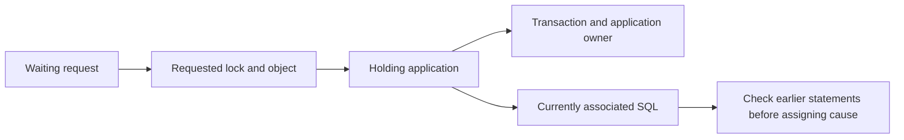

# Find the Db2 Session and SQL Behind a Table Lock Wait

Author: [nawazdhandala](https://www.github.com/nawazdhandala)

Tags: Database, SQL, Troubleshooting

Description: Trace a Db2 lock wait to its object, holding session, and current SQL while handling remote members, idle transactions, and incomplete evidence correctly.

A request against an orders table stops progressing. Finding another session that mentions the same table is not enough to identify the blocker. You need the actual wait relationship: the requested lock, the application holding an incompatible lock, and the transaction that still owns it.

This guide follows that relationship in **Db2 for Linux, UNIX, and Windows 11.5**. All examples inspect state. None terminates a connection or changes a transaction. Run them through an approved monitoring connection to the affected database, with access to the referenced routines and administrative view.

## Start with the live wait relationship

Db2 exposes current lock information without enabling event collection first. IBM's [table-function monitoring guide](https://www.ibm.com/docs/en/db2/11.5.x?topic=monitoring-locking-using-table-functions) distinguishes this live information from historical event capture.

Save this query as `waits.sql`:

```sql
SELECT LOCK_WAIT_START_TIME, LOCK_NAME, LOCK_OBJECT_TYPE,
       LOCK_MODE, LOCK_MODE_REQUESTED, LOCK_STATUS,
       REQ_APPLICATION_HANDLE, REQ_MEMBER,
       HLD_APPLICATION_HANDLE, HLD_MEMBER
FROM TABLE(SYSPROC.MON_GET_APPL_LOCKWAIT(NULL, -2)) AS W
ORDER BY LOCK_WAIT_START_TIME;
```

In a Db2 Command Line Processor session already connected to the database, run:

```bash
db2 -tvf waits.sql
```

The [CLP options](https://www.ibm.com/docs/en/db2/11.5.x?topic=clp-options) support reading semicolon-terminated statements from a file. Keep the output with its collection time and database identity.

`REQ` identifies the requester; `HLD` identifies the holder. The second argument, `-2`, requests all active members. The omitted third argument excludes system applications by default. The [routine interface](https://www.ibm.com/docs/en/db2/11.1.0?topic=mpf-mon-get-appl-lockwait-table-function-get-information-about-locks-which-application-is-waiting) documents these arguments and columns, also used in IBM's [11.5 lock investigation example](https://www.ibm.com/docs/en/db2/11.5.x?topic=mmr-mon-get-locks-table-function-list-all-locks-in-currently-connected-database).

Read a row as a dependency, not an accusation. The holder may be doing expected work. The task is to explain why this requester cannot proceed and whether the duration fits the application's requirements.



If there are no rows, capture again while the request is actually stalled. It might have timed out, completed, or be waiting on something other than a lock. This query does not reconstruct an already-resolved deadlock.

## Decode the object without guessing from SQL text

Copy the exact `LOCK_NAME` from the relevant row. Replace the example value below with that captured value:

```sql
SELECT NAME, VALUE
FROM TABLE(SYSPROC.MON_FORMAT_LOCK_NAME(
  '00030005000000000280000452'
)) AS F;
```

The numeric-looking string is a sample internal lock name, not a reusable identifier for your orders table. Do not derive it from a table name or edit individual bytes.

[`MON_FORMAT_LOCK_NAME`](https://www.ibm.com/docs/en/db2/11.1.0?topic=mpf-mon-format-lock-name-format-internal-lock-name-return-details) returns **rows of name/value pairs**. `TABSCHEMA` and `TABNAME`, when available, are values in the `NAME` column; they are not separate output columns you can select directly.

The returned details depend on the lock type. A table lock can expose its schema and table, while a row or internal lock can expose other identifiers instead. Missing table-name output does not make the wait irrelevant. Preserve the original lock type and identifiers and use the corresponding object investigation, rather than filtering every result to `LOCK_OBJECT_TYPE = 'TABLE'` and losing row-level contention.

This also avoids a common mistake: a query mentioning several tables does not prove which object caused the wait. The lock evidence provides that connection.

## Find a holder that is on another member

An unresolved holder is not equivalent to no blocker. IBM documents special [`HLD_MEMBER` values](https://www.ibm.com/docs/en/db2/11.5.x?topic=reference-h): `-2` can indicate a remote holder, and `1001` can mean the remote lock disappeared while the function was locating its owner.

For a remote holder, use the captured lock name to search all active members:

```sql
SELECT LOCK_NAME, MEMBER, LOCK_STATUS, APPLICATION_HANDLE
FROM TABLE(SYSPROC.MON_GET_LOCKS(
  CLOB('<lock_name>00030005000000000280000452</lock_name>'),
  -2
)) AS L
ORDER BY MEMBER, APPLICATION_HANDLE;
```

Replace the value inside the XML element with the same captured lock name. IBM's [MON_GET_LOCKS example](https://www.ibm.com/docs/en/db2/11.5.x?topic=mmr-mon-get-locks-table-function-list-all-locks-in-currently-connected-database) demonstrates this search.

A `G` row describes a granted lock and its holding application. A `W` or `C` row describes an application waiting or converting its lock. Preserve all matching rows: multiple grants can exist, and the requested mode matters when deciding which relationship is blocking progress.

A zero application handle can represent unfinished recovery or in-doubt work after a crash, rather than a normal connected client. A null handle can mean that the holder could not be found. Do not substitute an arbitrary connection or treat either value as a termination target.

## Retrieve SQL while the wait still exists

For a convenient view of requester and holder text, use `SYSIBMADM.MON_LOCKWAITS`. Replace `12345` with the **requesting** handle, not the holder's handle:

```sql
SELECT LOCK_NAME, REQ_MEMBER, HLD_MEMBER,
       REQ_APPLICATION_HANDLE, HLD_APPLICATION_HANDLE,
       REQ_STMT_TEXT, HLD_CURRENT_STMT_TEXT
FROM SYSIBMADM.MON_LOCKWAITS
WHERE REQ_APPLICATION_HANDLE = BIGINT(12345);
```

This returns the text associated with the wait, including large character-object columns that your SQL client may truncate when displaying them. Use its approved export or full-value display when necessary; keep exported SQL protected.

IBM's [view reference](https://www.ibm.com/docs/en/db2/11.5.x?topic=mv-mon-lockwaits-retrieve-metrics-applications-that-are-waiting-obtain-locks) explicitly warns that `HLD_CURRENT_STMT_TEXT` is not necessarily the statement responsible for the lock. A transaction could update a row, execute another statement, then wait for its client while retaining the earlier lock.

If the view no longer returns the relationship, refresh the live wait query. Separate monitor calls observe changing state. Do not splice a new connection into an old incident solely because a handle happens to match.

## Resolve the holding connection to an owner

After verifying the holder, replace `67890` with its handle:

```sql
SELECT MEMBER, APPLICATION_HANDLE, APPLICATION_ID,
       APPLICATION_NAME, CONNECTION_START_TIME,
       CLIENT_WRKSTNNAME, CLIENT_USERID
FROM TABLE(SYSPROC.MON_GET_CONNECTION(BIGINT(67890), -2)) AS C
ORDER BY MEMBER;
```

The [connection function](https://www.ibm.com/docs/en/db2/11.5.x?topic=functions-mon-get-connection-get-connection-metrics) provides identity and client context. Match these values to the application request or job owner. Client labels are useful clues, not a complete record of transaction intent.

Ask the owner what earlier statements ran in the transaction, whether an external call is delaying completion, and whether the session is unexpectedly idle after a write. When the current SQL cannot explain the lock, use application tracing or a planned locking event capture with activity history. Do not present a package-cache statement or currently displayed SQL as proof of the original lock-acquiring statement.

## Decide on intervention from evidence

A useful incident record contains the wait start, requested object and mode, requester identity, holder identity, and the owner's explanation of the transaction. If the holder is itself waiting, follow that dependency before assuming it is the root of the delay.

Finishing the transaction through its owning application may resolve the wait. A commit in your monitoring session cannot commit somebody else's work. Administrative termination needs an explicit recovery decision because rollback can take time and interrupt business operations.

After the agreed action, verify that the specific wait disappeared and the affected request completed correctly. “The query returned no rows” alone is insufficient if the request merely failed or moved to a different bottleneck.

These examples were checked against IBM's documented interfaces and shell syntax. No Db2 server was available, so live lock capture, SQL execution, remote-member behavior, and transaction recovery were not tested.
