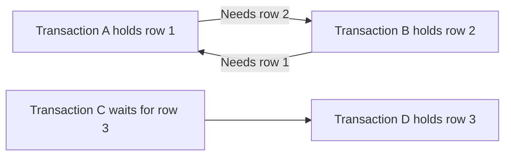

# Distinguish Db2 Deadlocks from Lock Timeouts with SQL0911N

Author: [nawazdhandala](https://www.github.com/nawazdhandala)

Tags: Database, SQL, Troubleshooting

Description: Decode Db2 SQL0911N reason codes, capture locking events, and distinguish a deadlock cycle from a lock timeout before changing application behavior.

An application reports `SQL0911N`, retries, and succeeds. That does not tell you whether two transactions locked each other out or one transaction simply waited too long. Those situations need different fixes, even though both can roll back application work.

Start with the reason code, then collect the event that explains the participants and SQL involved. This guide uses **Db2 for Linux, UNIX, and Windows 11.5** and a short, explicitly managed capture window. It does not assume that a live lock query can reconstruct a deadlock after Db2 has already resolved it.

## Read the reason code before changing a timeout

IBM's [SQL0911N message reference](https://www.ibm.com/docs/en/db2/11.5.x?topic=SSEPGG_11.5.0%2Fcom.ibm.db2.luw.messages.sql.doc%2Fsql0750-sql0999.htm) distinguishes these common cases:

| Reason code | Meaning | First question |
| --- | --- | --- |
| `2` | Transaction rolled back because of a deadlock | Which transactions formed the dependency cycle? |
| `68` | Transaction rolled back because of a lock timeout | Which holder prevented this request from obtaining its lock? |

Keep the complete message, timestamp, database, application identity, and request identifier. Do not classify every `SQL0911N` as one of these two cases: the reference also describes other reason codes involving different resources. A driver exception or application deadline is not automatically a Db2 lock timeout either.

The rollback applies to the transaction, not just the statement that happened to report the error. A retry design must account for earlier work in that transaction and any external effects already performed.

## Understand the dependency shape

A deadlock is a cycle. For example, transaction A holds a lock needed by B while B holds a lock needed by A. Waiting longer does not remove that cycle. Db2 selects a victim so other work can proceed; IBM describes this behavior in its [deadlock diagnosis guide](https://www.ibm.com/docs/en/db2/11.5.x?topic=problems-diagnosing-deadlock-problem).



The second pair shows a one-way wait. D might be doing useful work, waiting on an external call, or sitting idle before commit. If C's lock-wait allowance expires, C can receive reason code 68. IBM's [lock timeout explanation](https://www.ibm.com/docs/en/db2/11.5.x?topic=management-lock-waits-timeouts) describes that outcome.

A timeout proves that a wait expired. It does not, by itself, prove that every participant in a larger workload was free of dependency cycles. Use captured evidence to explain the incident rather than treating a two-row diagram as every possible case.

## Establish a controlled capture window

Use a dedicated administrative session already connected to the affected database. The following examples require permission to create event-monitor tables and manage the monitor. Activation requires SQLADM or DBADM authority. Choose a database and storage location approved for diagnostics; statement text can contain sensitive information.

First inspect existing monitors so you do not accidentally duplicate a capture maintained by another team:

```sql
SELECT EVMONNAME, EVENT_MON_STATE(EVMONNAME) AS ACTIVE
FROM SYSCAT.EVENTMONITORS
ORDER BY EVMONNAME;
```

A state of `1` means active. IBM documents this [catalog inspection pattern](https://www.ibm.com/docs/en/db2/11.5.x?topic=wem-displaying-list-active-event-monitors-in-your-database). Coordinate with the owner if a suitable locking monitor already exists.

Record the original configuration before making changes. In the Db2 command environment, replace `SAMPLE` with the affected database alias:

```bash
db2 get db cfg for SAMPLE show detail
```

Save the output securely. The [configuration command](https://www.ibm.com/docs/en/db2/11.5.x?topic=commands-get-database-configuration) exposes current and delayed values. Record `MON_DEADLOCK` and `MON_LOCKTIMEOUT`, plus any workload-specific collection settings. Restoring your environment later means restoring its recorded settings, not copying generic defaults from a tutorial.

## Create a monitor and enable collection

For a new, single-database lab capture, use an unused monitor name such as `LOCKLAB`. Run these statements in the dedicated session:

```sql
CREATE EVENT MONITOR LOCKLAB FOR LOCKING WRITE TO TABLE;
COMMIT;
SET EVENT MONITOR LOCKLAB STATE 1;
VALUES EVENT_MON_STATE('LOCKLAB');
```

The explicit commit ensures monitor creation is committed before activation. It must not be issued in a session containing unrelated application work. The [activation reference](https://www.ibm.com/docs/en/db2/11.5.x?topic=statements-set-event-monitor-state) documents this requirement. Expect the final expression to return `1`.

`WRITE TO TABLE` creates relational output that you can inspect with SQL. The [locking monitor definition](https://www.ibm.com/docs/en/db2/11.5.x?topic=statements-create-event-monitor-locking) describes the target-table options; check tablespace placement and available capacity before adapting this minimal example to production.

An active monitor still needs the event types enabled. For an approved, database-wide investigation window:

```bash
db2 update db cfg for SAMPLE using mon_deadlock history
db2 update db cfg for SAMPLE using mon_locktimeout history
```

Replace `SAMPLE` consistently. These are configuration changes, not read-only diagnostics. Recheck effective settings before reproducing the problem.

[`MON_DEADLOCK`](https://www.ibm.com/docs/en/db2/11.5.x?topic=parameters-mon-deadlock-monitoring-deadlock) enables deadlock collection across workloads, which matters when participants belong to different workloads. [`MON_LOCKTIMEOUT`](https://www.ibm.com/docs/en/db2/11.5.x?topic=parameters-mon-locktimeout-monitoring-lock-timeout) controls timeout collection and can also interact with workload settings.

`HISTORY` includes recent activities from the current transaction, subject to a bounded history size. It does not promise a complete lifetime trace. `HIST_AND_VALUES` additionally captures supported input values; avoid enabling it merely because it offers more detail. Even ordinary SQL text requires appropriate access control and retention.

## Read the event and its participants together

By default, `LOCKLAB` produces these tables in its target schema:

| Table | Purpose |
| --- | --- |
| `LOCK_LOCKLAB` | Event identity, type, and time |
| `LOCK_PARTICIPANTS_LOCKLAB` | Applications and lock relationships |
| `LOCK_PARTICIPANT_ACTIVITIES_LOCKLAB` | Participant activity information |
| `LOCK_ACTIVITY_VALUES_LOCKLAB` | Captured activity values when enabled |
| `CONTROL_LOCKLAB` | Monitor control information |

IBM lists these [regular-table outputs](https://www.ibm.com/docs/en/db2/11.5.x?topic=monitors-information-written-tables-locking-event-monitor). Confirm the actual target schema before querying; do not assume your later connection uses the creator's schema.

In a session whose current schema is the target schema, inspect recent events:

```sql
SELECT EVENT_TYPE, EVENT_TIMESTAMP
FROM LOCK_LOCKLAB
ORDER BY EVENT_TIMESTAMP DESC
FETCH FIRST 20 ROWS ONLY;
```

The documented [`EVENT_TYPE` values](https://www.ibm.com/docs/en/db2/11.5.x?topic=reference-e) include `DEADLOCK`, `LOCKTIMEOUT`, and `LOCKWAIT`. A wait event is not automatically a timeout event.

For the matching incident, retain the event's complete identity and member context when examining participants and activities. Do not join unrelated records using only a reusable application handle or approximate timestamp. Identify the requested lock, its holder, and the statements executed before the wait. The victim's last statement alone may not explain how the cycle formed.

If there are no records, verify effective collection settings, monitor state, target tables, incident timing, and control messages. An empty capture does not retroactively prove that no deadlock occurred before it was enabled.

## Close the capture and address the cause

When the agreed capture window ends, deactivate only the monitor created for it:

```sql
SET EVENT MONITOR LOCKLAB STATE 0;
```

Restore recorded collection settings with the database owner. Preserve the evidence before applying the approved retention procedure. Lock-event tables are not automatically pruned, and dropping a monitor does not remove its tables.

For a deadlock, compare transaction access order and lock duration across participants. For a timeout, investigate why the holder stayed open and whether the wait allowance fits the workload. Any retry should restart the required transaction safely, use a bounded policy, and account for external side effects. Increasing a timeout is not a substitute for explaining the dependency.

The SQL and options here were reviewed against IBM documentation, and shell syntax was checked. No Db2 server was available: monitor creation, event capture, database queries, and competing transactions were not executed.
