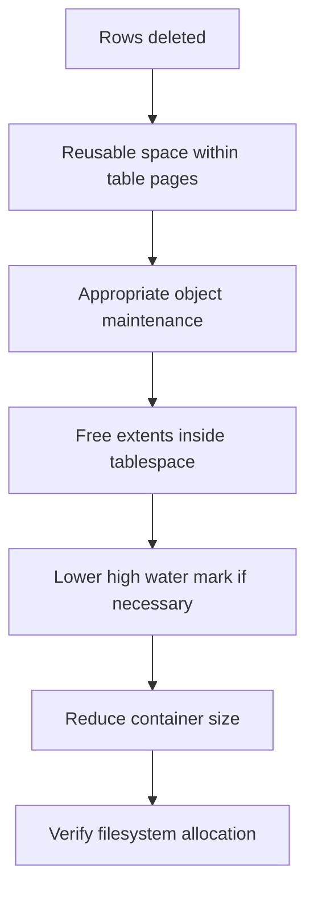

# Why Db2 Disk Space Stays Large After DELETE and REORG

Author: [nawazdhandala](https://www.github.com/nawazdhandala)

Tags: Database, Storage, Troubleshooting

Description: Separate reusable table space from filesystem savings, inspect Db2 reclaimability and high water marks, and choose a measured tablespace reduction.

You delete old rows, complete a reorganization, and check the filesystem. The database files are still large. That does not necessarily mean the maintenance failed. Space can be available for Db2 to reuse while remaining allocated to a tablespace container.

The investigation needs three separate questions: did the table release storage, is that storage free inside the tablespace, and can the containers shrink? This guide uses Db2 LUW 11.5 and focuses its change example on a permanent automatic-storage tablespace with reclaimable storage enabled. It is not a procedure for temporary tablespaces, raw devices, or every legacy database-managed layout.

The commands are documentation-reviewed examples. Replace `APPDATA` with the actual tablespace name and use an authorized Db2 connection. No database shrink or space-saving measurement was performed for this article.

## Follow the allocation layers

A page holds database records. An extent is a group of pages allocated together. A tablespace manages extents across its storage containers, which may be files on a filesystem.

Deleting rows can make space reusable within an object without returning complete extents to the tablespace. Suitable table or index maintenance can release extents for other objects to reuse. Container reduction is another step. IBM illustrates the distinction between object reclamation and tablespace reuse in its [Db2 performance guide](https://public.dhe.ibm.com/ps/products/db2/info/vr115/pdf/en_US/db2_perf_tune_115.pdf).



The high water mark is the upper boundary of allocated pages that prevents simple container truncation. Free extents can exist below it while a used extent near the end keeps the container large. Moving eligible extents lower can make more of the tail removable. See IBM's [reclaimable storage explanation](https://www.ibm.com/docs/en/db2/11.5.x?topic=management-reclaimable-storage).

The useful outcome may be internal reuse rather than a smaller file. If the table will regrow next week, repeatedly shrinking and expanding storage may not be worthwhile. Establish how much capacity must be returned and how much operating headroom should remain.

## Inspect the tablespace before choosing a command

Collect a timestamped baseline:

```sql
SELECT CURRENT TIMESTAMP AS CAPTURED_AT,
       TBSP_NAME, MEMBER, TBSP_TYPE, TBSP_CONTENT_TYPE, TBSP_STATE,
       TBSP_USING_AUTO_STORAGE, RECLAIMABLE_SPACE_ENABLED,
       TBSP_PAGE_SIZE, TBSP_TOTAL_PAGES, TBSP_USED_PAGES,
       TBSP_FREE_PAGES, TBSP_PENDING_FREE_PAGES, TBSP_PAGE_TOP
FROM TABLE(SYSPROC.MON_GET_TABLESPACE('APPDATA', -2)) AS T
ORDER BY MEMBER;
```

The query distinguishes automatic storage from merely being a database-managed (`DMS`) tablespace. Inspect `TBSP_USING_AUTO_STORAGE` rather than deciding from `TBSP_TYPE` alone. `RECLAIMABLE_SPACE_ENABLED` determines whether the extent-movement capability is available. The fields are documented in [MON_GET_TABLESPACE](https://www.ibm.com/docs/en/db2/11.5.x?topic=routines-mon-get-tablespace-get-table-space-metrics).

Page counts are not bytes. Multiply a count by that row's `TBSP_PAGE_SIZE` when comparing capacity, and preserve member identity. Do not add replicated observations from a shared-storage configuration as though each represented independent disk capacity.

Interpret the baseline with the object-maintenance results:

| Finding | Likely next step |
|---|---|
| Table remains allocated despite many deleted rows | Review suitable table or index reclamation |
| Many free pages but a high page-top value | Investigate extent movement and high water mark |
| High water mark fell but containers did not shrink | Check whether only movement was requested |
| Reclaimable storage is disabled | Use the legacy-layout plan; do not force this procedure |
| Pending-free pages or an incompatible state | Resolve the documented condition before retrying |

A tablespace originally created before Db2 9.7 may lack reclaimable storage even when the database now runs a newer version. Converting it to automatic storage does not change that attribute. IBM documents this limitation under [automatic-storage conversion](https://www.ibm.com/docs/en/db2/11.5.x?topic=spaces-converting-table-use-automatic-storage). A planned move into a suitable newer tablespace may be needed; it is not a switch to toggle during an incident.

## Confirm that object maintenance actually finished

If a reorganization ran, verify its outcome and scope. An in-place REORG starts asynchronously, and not every table type supports the same reclamation options. `REORG TABLE ... RECLAIM EXTENTS` applies to specified table organizations such as MDC, ITC, and column-organized tables; it is not a generic replacement for reorganizing any ordinary row table.

Indexes and large objects may also account for retained allocation. Choose the relevant operation after identifying the owning objects, rather than repeating the same REORG until a filesystem chart changes. IBM's [REORG TABLE reference](https://www.ibm.com/docs/en/db2/11.5.x?topic=commands-reorg-table) describes both eligibility and limitations.

Before further maintenance, check available working space, recoverable backups, storage health, and conflicting utility activity. If the filesystem is already critically full, first establish enough safe headroom to perform the chosen operation. Removing Db2-managed files manually is not a reclamation method.

## Choose movement and reduction intentionally

For an eligible automatic-storage tablespace, these options have different effects:

| Clause | Intended effect |
|---|---|
| `REDUCE` without an amount | Try to shrink containers without moving extents |
| `LOWER HIGH WATER MARK` | Move eligible extents lower, without shrinking containers |
| `REDUCE 25 PERCENT` | Attempt to reduce the current tablespace size by one quarter, moving extents if needed |
| `REDUCE MAX` | Attempt the maximum supported reduction, including extent movement |

The percentage means reduction **by** that amount, not setting the tablespace **to** that percentage. A requested amount is not a guaranteed result. Some extents may not be movable. These behaviors are described in [automatic-storage reclamation](https://www.ibm.com/docs/en/db2/11.5.x?topic=aasts-reclaiming-unused-storage-in-automatic-storage-table-spaces).

Suppose the capacity review approved a reduction by 25 percent and confirmed sufficient remaining growth space. During the approved window, the state-changing command would be:

```sql
ALTER TABLESPACE APPDATA REDUCE 25 PERCENT;
```

Use that number only after your own sizing review. For example, a 200 GiB allocation would have a nominal 150 GiB target, but the achievable result depends on the layout and restrictions. These are explanatory numbers, not measured output.

Do not combine this clause with unrelated tablespace changes. The operation's effects are not undone by rolling back the surrounding unit of work. The [ALTER TABLESPACE reference](https://www.ibm.com/docs/en/db2/11.5.x?topic=statements-alter-tablespace) documents those execution semantics.

## Observe progress and verify the outcome

During movement, query the selected tablespace:

```sql
SELECT TBSP_NAME, MEMBER, CURRENT_EXTENT, LAST_EXTENT,
       NUM_EXTENTS_MOVED, NUM_EXTENTS_LEFT, TOTAL_MOVE_TIME
FROM TABLE(SYSPROC.MON_GET_EXTENT_MOVEMENT_STATUS('APPDATA', -2)) AS M
ORDER BY MEMBER;
```

The counters describe extent movement; they are not an exact completion-time forecast. Some values can be unavailable when no movement is active. Check the function's [monitoring definition](https://www.ibm.com/docs/en/db2/11.5.x?topic=mmr-mon-get-extent-movement-status-get-extent-movement-progress), command diagnostics, and the resulting allocation together.

Repeat the baseline query after the operation. Compare total pages, high water mark, tablespace state, and the actual container sizes. Then compare filesystem allocation on the same storage paths. Host-level snapshots or other files can make filesystem consumption differ from the sum of current container sizes, so escalate unresolved differences with the storage owner.

If the operation causes unacceptable impact, an approved operator can stop a reduction in progress:

```sql
ALTER TABLESPACE APPDATA REDUCE STOP;
```

This stops further movement; it does not restore the previous layout or undo completed work. Preserve diagnostics and reassess before resuming.

For a nonautomatic DMS tablespace, lowering the high water mark and reducing explicitly selected containers are separate operations. Use the [DMS reclamation procedure](https://www.ibm.com/docs/en/db2/11.1?topic=spaces-reclaiming-unused-storage-in-dms-table) and its per-container sizing rules instead of copying the automatic-storage example.

Finally, investigate pending-delete restrictions rather than treating every incomplete reduction as failure. Db2 may retain extents for recoverability, including the condition reported by `ADM6008I`. Report the capacity actually returned, the capacity available for internal reuse, and the remaining constraint. Those three values explain the result far better than whether the original file size looked smaller immediately after DELETE.
