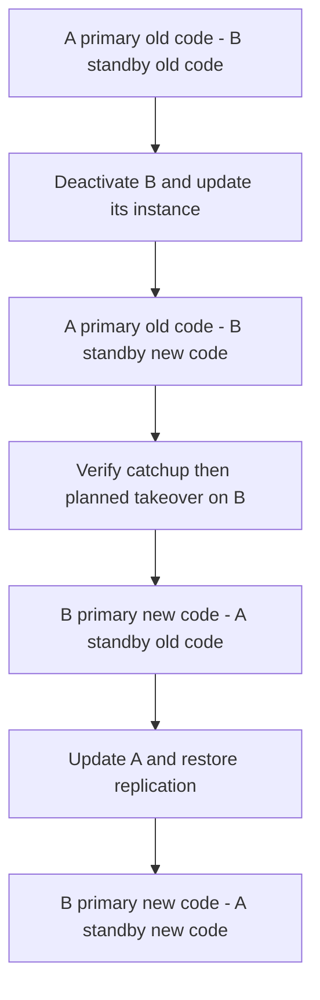

# Apply Db2 Fix Packs with an HADR Rolling Update

Author: [nawazdhandala](https://www.github.com/nawazdhandala)

Tags: Database, High Availability, Maintenance

Description: Update a Db2 HADR pair standby first, verify code levels, switch roles deliberately, and restore replication before declaring the fix pack rollout complete.

An HADR rolling update lets one Db2 host serve applications while you update the other. It does not mean that every stage preserves redundancy. Once the updated standby becomes primary, its older partner cannot necessarily consume the new log records. You must complete the second host's update before treating the pair as protected again.

This guide follows the IBM Db2 LUW 11.5 procedure for a conventional, manually managed, single-partition HADR pair on Linux or UNIX. The installation example assumes a root-installed Db2 copy and one affected instance. Pacemaker, TSA, pureScale, non-root installations, and Windows need their corresponding procedures. The commands are documentation-reviewed examples, not a production-tested upgrade script.

## Separate a fix pack from a major upgrade

Choose the exact source and target builds before scheduling the change. Record the full output below on both hosts as the instance owner:

```bash
db2level
db2pd -db HADRDB -hadr
```

Replace `HADRDB` with the actual database alias. `db2level` identifies the instance's service level; the installation directory name alone is insufficient evidence. See IBM's [service-level identification guidance](https://www.ibm.com/docs/en/db2/11.5.x?topic=tools-db2level).

A move within the 11.5 fix-pack or modification-level family is different from a major-version upgrade. Do not reuse this sequence to cross a major-release boundary. IBM provides a separate [HADR upgrade procedure](https://www.ibm.com/docs/en/db2/11.5.x?topic=udssc-upgrade-db2-high-availability-disaster-recovery-hadr-environments), including eligibility rules for preserving an existing standby.

Use the selected target's release notes and platform requirements to approve that exact transition. This article deliberately uses `SOURCE` and `TARGET` path placeholders rather than implying that any arbitrary pair of builds is supported.

## Plan the periods with reduced protection

Call the original primary host A and its standby host B. The role and software transitions should look like this:



While B is offline, A has no second copy receiving its new log data in this two-host example. After promotion, B remains exposed until A has the compatible target code and reconnects. Schedule enough time for both intervals and identify who can authorize continuing or aborting.

IBM permits a newer standby with an older primary briefly during rolling maintenance. The reverse direction does not support the pair reconnecting. That compatibility rule comes from the [HADR system requirements](https://www.ibm.com/docs/en/db2/11.5.x?topic=support-system-requirements); it is not a firewall problem to solve by repeatedly restarting the hosts.

Before the window, rehearse the change against representative data and workload. Retain verified recovery backups, required archive logs, configuration records, installation media, and access to the previous build. Check free space for the target installation and for log accumulation while the standby is unavailable. A second copy of the software is not a database backup.

Also inventory every database and instance sharing the installation. If the hosts serve primaries for different databases, moving one standby offline can affect more than the pair you intended to maintain. Consolidate roles only through an approved capacity and maintenance plan.

## Update the standby first

Start with a healthy pair. For `SYNC`, `NEARSYNC`, and `ASYNC`, require `PEER`; for `SUPERASYNC`, assess catchup progress and keep the gap small. Follow the manual rolling-update guidance only when a cluster manager is not controlling these operations. IBM explicitly separates automated-cluster and pureScale procedures from its [base rolling-update workflow](https://www.ibm.com/docs/en/db2/11.5.x?topic=maintenance-applying-rolling-updates-db2-hadr-environment).

On B, after confirming that it is the standby and that the affected instance contains no overlooked active workloads:

```bash
# Run as the instance owner on host B.
db2 deactivate database HADRDB
db2stop
```

Check each result before proceeding. If the instance cannot stop, investigate the remaining activity rather than adding a force option. Deactivating this planned-maintenance standby is different from improvising shutdown of an old primary after a failed takeover.

For the root-installed, non-pureScale example, IBM documents installing into a separate directory and then updating the instance. Replace all paths and the instance name before running this as root on B:

```bash
# SOURCE is the existing copy; TARGET is the approved target copy.
# /srv/db2-fixpack/TARGET contains the extracted, verified target media.
/srv/db2-fixpack/TARGET/installFixPack \
  -b /opt/ibm/db2/SOURCE \
  -p /opt/ibm/db2/TARGET

# Run only after the installation completes successfully.
/opt/ibm/db2/TARGET/instance/db2iupdt db2inst1
```

Here `db2inst1` is the existing instance owner, not an account to create blindly. A normal server-instance update does not need `-u`; that option can change the fenced user used for external routines. See the [instance-update reference](https://www.ibm.com/docs/en/db2/11.5.x?topic=commands-db2iupdt-update-instances). The `-b` path identifies the installed copy; `-p` selects the new destination. The instance update must use the target copy's utility. Follow the [offline fix-pack installation instructions](https://www.ibm.com/docs/en/db2/11.5.x?topic=ifplu-installing-offline-fix-pack-updates-existing-db2-database-products) for product images, prerequisites, and installation type.

Do not bypass installer checks with force flags. Different products, language packs, or installed cluster components can require additional handling; the [installFixPack reference](https://www.ibm.com/docs/en/db2/11.5.x?topic=commands-installfixpack-update-installed-db2-database-products) explains those options.

Open a fresh instance-owner environment on B, then check and restart:

```bash
db2level
db2start
db2 activate database HADRDB
db2pd -db HADRDB -hadr
```

Require the intended target build and a successful return to the eligible replication state. Activation success alone does not prove that log shipping and replay have recovered. Compare both hosts' observations and inspect diagnostics if the pair does not reconnect.

## Switch roles, then update the original primary

Drain application writers through the maintenance controls, allowing important transactions to complete. On the updated standby B, issue the planned takeover locally:

```bash
db2 takeover hadr on database HADRDB
```

Do not add `BY FORCE`. Verify the new roles on both hosts using `db2pd`; a lost command response does not establish that nothing changed. The [TAKEOVER documentation](https://www.ibm.com/docs/en/db2/11.5.x?topic=commands-takeover-hadr) describes possible partial-failure states.

Confirm that application connections reach B. Permit a controlled test operation, verify its result, and then resume normal traffic according to the maintenance plan. Keep the temporary loss of HADR protection visible to the incident or change owner.

A is now the standby running the older code. Apply the same approved installation and instance-update sequence there, starting with role verification. After A restarts on the target build, require successful pairing and catchup. Do not interpret the expected mixed-code disconnection as permission to reinitialize A immediately.

## Complete database-level follow-up separately

Updating the executable files and updating database catalogs are distinct steps. When required by the target's post-installation plan, run the following with `SYSADM` authority on the **current primary only**, after establishing the intended software state:

```bash
db2updv115 -d HADRDB
```

This utility updates system catalog definitions for Db2 11.5.1 and later. It is not a command to run independently on both HADR copies. Check its output and the required package rebind or restart work. Do not add `-a` routinely: that option forces updates and can reset privileges on system objects. Review the [db2updv115 reference](https://www.ibm.com/docs/en/db2/11.5.x?topic=sc-db2updv115-update-database-version-115-mod-pack-fix-pack-command).

Keep protocol and topology changes separate from this rollout. For example, enabling TLS 1.3-only HADR transport while a partner still needs TLS 1.2 can break reconnection. The rolling-update documentation specifically discusses this compatibility boundary.

## Define completion and the retreat path

Completion requires matching approved code levels, correct roles, healthy replication, successful application checks, and completed post-installation tasks. Leave roles reversed if that is acceptable; returning A to primary is an optional later planned switch.

If problems appear before promotion, keep A authoritative and diagnose B. After promotion, do not assume that pointing an instance back at the old binaries reverses the change. Catalog updates, packages, privileges, and log compatibility also matter. IBM's [fix-pack reversion procedure](https://www.ibm.com/docs/en/db2/11.5.x?topic=ifplu-revert-existing-db2-database-products-previous-fix-pack-level) includes work beyond reinstalling software. Decide the supported retreat path during rehearsal, while preserving a recoverable copy of the data.
