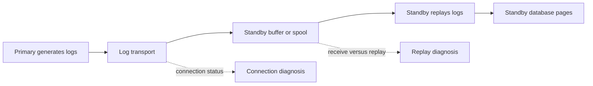

# Diagnose Db2 HADR Stuck in REMOTE_CATCHUP or DISCONNECTED

Author: [nawazdhandala](https://www.github.com/nawazdhandala)

Tags: Database, SQL, Troubleshooting

Description: Use Db2 HADR snapshots to separate connection failures, log shipping delays, and slow replay before changing configuration or rebuilding a standby.

A standby has displayed `REMOTE_CATCHUP` for an hour. Is replication broken? Perhaps, but that state alone does not answer the question. A disaster recovery standby using `SUPERASYNC` can remain in remote catchup while receiving logs normally. A different standby might be connected but unable to replay the logs it already received.

This guide uses the IBM Db2 LUW 11.5 monitoring interfaces to investigate those cases without restarting either database. The examples assume a conventional primary and standby pair. Replace `HADRDB` with your database alias and run commands from an authorized Db2 environment. They are documentation-verified examples, not results from a live incident.

## Establish what healthy means for this standby

High availability disaster recovery, or HADR, sends the primary's transaction log to a standby. The standby receives that log and replays it to reproduce database changes. Sending, receiving, and replaying are separate activities.



First identify the standby's intended role and synchronization mode. `SUPERASYNC` does not enter `PEER`, and auxiliary standbys use that mode. A rule that alerts whenever every standby is outside `PEER` will therefore misclassify valid configurations. In multiple-standby monitoring, `STANDBY_ID = 1` identifies the principal; auxiliary IDs are greater than one. See IBM's [synchronization modes](https://www.ibm.com/docs/en/db2/11.5.x?topic=dcp-hadr-syncmode-hadr-synchronization-mode-log-writes-in-peer-state) and [standby state guidance](https://www.ibm.com/docs/en/db2/11.5.x?topic=management-determining-hadr-standby-database-state).

Also separate `HADR_STATE` from `HADR_CONNECT_STATUS`. The former describes replication state; the latter describes the connection. Record both rather than reducing the incident to a single dashboard label. IBM documents these as distinct [HADR monitor elements](https://www.ibm.com/docs/en/db2/11.5.x?topic=reference-h).

## Capture the same channel twice

Save this query as `hadr-snapshot.sql` on the administration host:

```sql
SELECT CURRENT TIMESTAMP AS CAPTURED_AT,
       HADR_ROLE, STANDBY_ID, LOG_STREAM_ID,
       PRIMARY_MEMBER_HOST, PRIMARY_INSTANCE, PRIMARY_MEMBER,
       STANDBY_MEMBER_HOST, STANDBY_INSTANCE, STANDBY_MEMBER,
       HADR_SYNCMODE, HADR_STATE,
       HADR_CONNECT_STATUS, HADR_CONNECT_STATUS_TIME,
       PRIMARY_LOG_POS, STANDBY_LOG_POS, STANDBY_REPLAY_LOG_POS,
       HADR_LOG_GAP, STANDBY_RECV_REPLAY_GAP,
       STANDBY_REPLAY_DELAY, HADR_FLAGS
FROM TABLE(SYSPROC.MON_GET_HADR(-2)) AS H
ORDER BY STANDBY_ID, LOG_STREAM_ID, PRIMARY_MEMBER, STANDBY_MEMBER;
```

Connect to the primary and collect two observations into new files:

```bash
db2 connect to HADRDB
db2 -tvf hadr-snapshot.sql > hadr-before.txt
# Repeat after an observation interval appropriate to your incident.
db2 -tvf hadr-snapshot.sql > hadr-after.txt
```

The second invocation belongs after that interval, not immediately after the first. Use unique filenames for subsequent captures. Expected output is one or more channel rows with timestamps and log positions. Check the command output for SQL errors; an empty file or error is not evidence of a healthy standby.

The `-2` argument requests all active members. Match the same endpoints, standby, and log stream between samples. Do not compare one auxiliary standby with another or combine different pureScale channels. Endpoint details can be unavailable before a connection is established. The columns and authorization requirements are listed in [MON_GET_HADR](https://www.ibm.com/docs/en/db2/11.5.x?topic=mmr-mon-get-hadr-get-high-availability-disaster-recovery-hadr-monitoring-information).

On each database host, collect a local view too:

```bash
db2pd -db HADRDB -hadr
```

This read-only command avoids requiring an SQL connection to the standby. The SQL function on a standby requires reads on standby to be enabled; do not enable that feature just to investigate an incident. IBM describes these access differences in its [HADR monitoring guide](https://www.ibm.com/docs/en/db2/11.5.x?topic=outage-high-availability-disaster-recovery-hadr-monitoring).

## Follow the log through three positions

Use the paired observations to answer three questions: is the primary generating log data, is the standby receiving it, and is replay advancing?

| Observation across the same interval | First investigation |
|---|---|
| All positions unchanged, no new primary workload | Confirm the database is idle before declaring a stall |
| Primary advances, standby receive does not | Connection, log availability, or blocked standby receipt |
| Receive advances, replay does not | Intentional replay delay, replay workload, or standby resources |
| All advance, but the receive gap grows | Sustained shipping capacity is below log generation |
| All advance and gaps shrink | Catchup is making progress; measure whether recovery objectives remain achievable |

`HADR_LOG_GAP` describes the recent average gap between primary and standby receive positions. `STANDBY_RECV_REPLAY_GAP` describes the recent average gap between receipt and replay. Both measure bytes, not transactions or elapsed seconds. A small transport gap can coexist with a substantial replay backlog. IBM's [standby monitor definitions](https://www.ibm.com/docs/en/db2/11.5.x?topic=reference-s) and [log spooling explanation](https://www.ibm.com/docs/en/db2/11.5.x?topic=hadr-log-spooling) distinguish these measurements.

For an illustrative interval, suppose the primary position advances by 300 MB while receipt advances by 100 MB. Replication is moving, but the transport backlog is increasing. If receipt advances by 300 MB and replay by 20 MB, investigate the standby's replay path instead. These are explanatory numbers, not measured results.

Compare timestamps and host-local observations before calculating rates. Information about the remote database can be stale, especially around a disconnection. Discard comparisons across a role change or incompatible stream identity. IBM's [HADR performance guide](https://ibm.github.io/db2-hadr-wiki/hadrPerf.html) explains position-based rates and remote observation delays. Byte differences alone cannot establish a precise data-loss window or completion time.

## When the connection is down

Use `HADR_CONNECT_STATUS_TIME` to correlate the transition with diagnostic messages on both hosts. Record whether there was maintenance, a firewall change, a certificate change, a hostname change, or an instance restart at that time.

Inspect the database configuration on both hosts:

```bash
db2 get db cfg for HADRDB
```

Compare the local and remote HADR endpoints, service ports, remote instance, and target lists with the approved topology. The output may contain operationally sensitive configuration, so keep it in the incident record rather than a public ticket. IBM documents this inspection through [GET DATABASE CONFIGURATION](https://www.ibm.com/docs/en/db2/11.5.x?topic=commands-get-database-configuration).

Then check endpoint resolution and permitted traffic through your normal network tooling. A successful TCP connection proves only that something accepts traffic at that address; it does not prove that the correct Db2 database can establish HADR. Correlate network findings with Db2 diagnostics and the actual database roles.

If diagnostics identify an unavailable log, verify its stream, archive chain, and availability before considering standby reinitialization. Preserve evidence and existing archives. Rebuilding immediately can discard a recoverable standby and hide the original failure.

## When receipt works but replay falls behind

First check whether delay is intentional. `STANDBY_REPLAY_DELAY` reports the configured replay delay in milliseconds through `MON_GET_HADR`; the database configuration displays seconds. A value of 60000 in the function corresponds to a configured 60 seconds, not 60000 seconds.

Delayed replay deliberately keeps a standby behind the primary and is supported with `SUPERASYNC`. Do not remove it merely to make a lag chart green: it may provide protection against accidental changes. Clock synchronization also matters to this feature. Review IBM's [delayed replay behavior](https://www.ibm.com/docs/en/db2/11.5.x?topic=solution-hadr-delayed-replay) before changing that policy.

Without intentional delay, correlate replay progress with standby CPU, storage latency, and competing workloads. Examine HADR flags and spool capacity. A full receive buffer does not by itself prove receipt is blocked when usable spool space remains. `STANDBY_RECV_BLOCKED` and `STANDBY_LOG_DEVICE_FULL` narrow the investigation; they are not instructions to delete logs. The flag meanings appear in the [db2pd reference](https://www.ibm.com/docs/en/db2/11.5.x?topic=commands-db2pd-monitor-troubleshoot-db2-engine-activities).

For a read-enabled standby, include reader activity and replay-only windows in the investigation. Collect evidence before disrupting queries. Increasing spool capacity can absorb a temporary burst, but it does not repair a sustained replay bottleneck and can leave more work to finish during takeover.

## Close the incident with observed recovery

After an approved correction, repeat the same snapshots. Require the intended connection status, advancing positions under known workload, and gaps that stabilize within your recovery objectives. Require `PEER` only where the role and mode support it.

Keep the before-and-after rows, local diagnostics, configuration differences, and change timestamps together. If progress remains absent, escalate that evidence with the exact Db2 level and topology. Neither a forced takeover nor a blanket timeout increase is a diagnostic substitute for locating where logs stopped moving.
