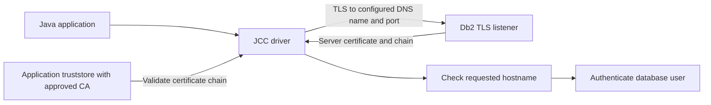

# Configure Db2 JDBC TLS and Diagnose Certificate Failures

Author: [nawazdhandala](https://www.github.com/nawazdhandala)

Tags: Database, Java, TLS, Troubleshooting

Description: Configure encrypted Db2 JDBC connections with explicit certificate trust and hostname checks, then separate truststore, endpoint, protocol, and login failures.

A Java application can reach Db2 and still fail during the encrypted connection setup. The server might present an incomplete certificate chain, the application might load a different truststore than expected, or the connection might use a name that the certificate does not cover.

Treat these as separate checks. Transport Layer Security, or TLS, encrypts the connection and authenticates the server. Certificate trust asks whether an approved authority signed the server's certificate. Hostname verification asks whether that certificate belongs to the server name you requested. Database authentication happens after the transport is established.

This guide uses Db2 LUW 11.5, JDBC type 4 connectivity, and Java 17 syntax. The concrete driver baseline is IBM JCC 4.33.31, which IBM identifies with Db2 11.5.9 in its [driver installation guidance](https://www.ibm.com/support/pages/download-and-install-ibm-data-studio-42x). This is an example baseline, not a claim that it is the newest driver or that every application server supports that combination. Verify your own supported runtime and driver patch level.

## Establish the endpoint and trust agreement

Obtain the TLS listener's DNS name and port from the database administrator. Do not assume that the ordinary database port also accepts TLS. IBM explicitly requires a configured TLS listener for [JDBC TLS connections](https://www.ibm.com/docs/en/db2/11.5.x?topic=ctsijdc-configuring-connections-under-data-server-driver-jdbc-sqlj-use-tls).

For this example, replace `db2.example.internal`, port `50001`, and database `APPDB` with your approved values. Obtain the issuing certificate authority's certificate through your organization's trusted distribution channel. A certificate authority, or CA, is the issuer whose signing key establishes the trust relationship.

The server certificate should cover the actual connection name in its Subject Alternative Name, or SAN, extension. If applications connect through an alias, include that alias in the certificate plan. Connecting by IP address introduces an IP identity requirement; changing DNS resolution does not change the name the application supplied.



## Build an application truststore deliberately

A truststore contains certificates that the client trusts. It is different from a server keystore holding a private key. Ordinary server-authenticated JDBC TLS does not require copying the database server's private key to the application.

Use the Java 17 `keytool` utility in a controlled working directory. The following names are placeholders for a CA certificate supplied by your administrator and a new application-specific store:

```bash
keytool -printcert -file approved-db2-ca.pem

keytool -importcert \
  -alias db2-issuing-ca \
  -file approved-db2-ca.pem \
  -keystore db2-trust.jks \
  -storetype JKS

keytool -list -v -keystore db2-trust.jks -storetype JKS
```

Check the displayed fingerprint against the independently supplied value before accepting the import. The commands prompt for the store password rather than putting it into shell history. Start with a new store path; do not casually modify the Java installation's shared `cacerts` file. The final listing should show the intended trusted certificate entry, its validity dates, and its fingerprint. These options are documented in the [Java 17 keytool reference](https://docs.oracle.com/en/java/javase/17/docs/specs/man/keytool.html).

Deploy the resulting store to a read-only application configuration location. Its path must exist inside the application's actual container or host. Importing the CA into a developer laptop does not configure the running service. The server should supply the required intermediate certificates, and the chosen trust anchor should follow your PKI policy.

## Set the connection properties explicitly

Save this small diagnostic program as `Db2TlsCheck.java`. It opens one connection and reads the server timestamp without changing application data:

```java
import java.sql.Connection;
import java.sql.DriverManager;
import java.sql.ResultSet;
import java.sql.Statement;
import java.util.Properties;

public final class Db2TlsCheck {
    private static String required(String name) {
        String value = System.getenv(name);
        if (value == null || value.isBlank()) {
            throw new IllegalArgumentException("Missing setting: " + name);
        }
        return value;
    }

    public static void main(String[] args) throws Exception {
        Properties properties = new Properties();
        properties.setProperty("user", required("DB2_USER"));
        properties.setProperty("password", required("DB2_PASSWORD"));
        properties.setProperty("sslConnection", "true");
        properties.setProperty("sslClientHostnameValidation", "BASIC");
        properties.setProperty("sslTrustStoreLocation", required("DB2_TRUSTSTORE"));
        properties.setProperty("sslTrustStorePassword", required("DB2_TRUSTSTORE_PASSWORD"));
        properties.setProperty("sslVersion", "TLSv1.2");
        DriverManager.setLoginTimeout(15);
        try (Connection connection = DriverManager.getConnection(
                "jdbc:db2://db2.example.internal:50001/APPDB", properties);
             Statement statement = connection.createStatement()) {
            statement.setQueryTimeout(15);
            try (ResultSet result = statement.executeQuery("VALUES CURRENT TIMESTAMP")) {
                if (!result.next()) {
                    throw new IllegalStateException("No timestamp returned");
                }
                System.out.println("Connected; server timestamp: " + result.getTimestamp(1));
            }
        }
    }
}
```

Supply the four environment settings through your controlled test environment or secret manager. `DB2_TRUSTSTORE` is the absolute deployed JKS path. Do not print the properties object, since it includes credentials. The example chooses TLS 1.2 for an endpoint approved to accept that protocol; it is not a universal protocol policy. IBM documents that value in its [JDBC protocol troubleshooting example](https://www.ibm.com/docs/en/masv-and-l/maximo-manage/cd?topic=troubleshooting-database-connection-failure-due-ssl-tsl-error).

Compile and run on a Unix-like host with the approved driver at the placeholder path:

```bash
javac --release 17 Db2TlsCheck.java
java -cp '.:/opt/db2-driver/db2jcc4.jar' Db2TlsCheck
```

Compilation checks the Java code, not the driver properties or network handshake. At runtime, the expected successful result is one timestamp line. The driver JAR must actually be on the runtime classpath; an application server may load another copy from its shared libraries.

Hostname checking is explicit because encryption alone does not establish that setting. IBM documents `BASIC` and the client-version requirement in [hostname validation configuration](https://www.ibm.com/docs/en/db2/11.5.x?topic=validation-configuring-db2-clients). Keep it enabled when troubleshooting.

## Check configuration precedence before changing certificates

An application-specific truststore can override Java's `javax.net.ssl.trustStore` setting. Also, when both `sslCertLocation` and `sslTrustStoreLocation` are configured, IBM gives the certificate-file setting precedence. Importing a CA into an ignored store will not fix the connection. Review the [JDBC SSL configuration rules](https://www.ibm.com/docs/en/db2/11.5.x?topic=dsdjsss-configuring-connections-under-data-server-driver-jdbc-sqlj-use-ssl).

Inspect application-server data-source properties and JCC configuration overrides as well as source code. IBM's [driver configuration reference](https://www.ibm.com/docs/en/db2/11.5.x?topic=information-data-server-driver-jdbc-sqlj-configuration-properties) distinguishes defaults from `db2.jcc.override` properties. Record effective configuration without recording passwords.

## Diagnose the failing layer

| Symptom | Check next |
|---|---|
| Connection refused or timeout | DNS, routing, listener port, and firewall policy |
| Truststore cannot be opened | Deployed path, permissions, actual file format, and password |
| Certificate path cannot be built | Correct trust anchor, intermediate chain, and effective truststore |
| Certificate validity failure | Certificate dates and client/server clocks |
| Hostname mismatch | Requested DNS name and certificate SANs |
| Protocol or cipher negotiation failure | Driver, Java security policy, and server protocol overlap |
| Database login rejected after TLS | User authentication and database access policy |

Exception text varies by driver and Java provider. Preserve the nested cause and SQL state; a top-level connection exception can hide the useful detail. For a short controlled diagnostic run, enable Java's TLS handshake trace:

```bash
java -Djavax.net.debug=ssl:handshake \
  -cp '.:/opt/db2-driver/db2jcc4.jar' Db2TlsCheck
```

The [JSSE reference](https://docs.oracle.com/en/java/javase/17/security/java-secure-socket-extension-jsse-reference-guide.html) explains this tracing. Protect the output, which can expose certificate and endpoint details, and remove the option after diagnosis. Do not enable plaintext tracing or weaken algorithm restrictions to make a failing test pass.

## Test renewal before the old certificate expires

Rehearse the renewed certificate with the same driver, Java build, hostname, and deployed truststore. For a CA change, distribute the approved new trust anchor before switching the server and retain the old anchor through the agreed overlap. Remove obsolete trust only after every dependent endpoint has migrated.

Test new physical connections, not only an already-open connection pool. Include alternate database endpoints used during failover. Verify that correct identities succeed and a deliberately wrong test hostname fails. This article's local checks cover Java compilation and certificate-store tooling; actual Db2 authentication, hostname rejection, and renewal behavior still require that staging test.
