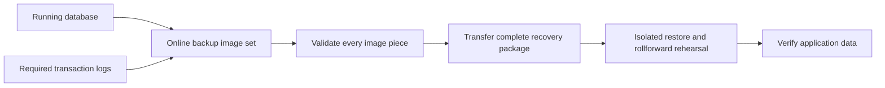

# Take and Validate an Online Db2 Backup with INCLUDE LOGS

Author: [nawazdhandala](https://www.github.com/nawazdhandala)

Tags: Database, SQL, Backup

Description: Create an online Db2 backup with recovery logs, validate every image piece with db2ckbkp, and distinguish image checks from a proven recovery rehearsal.

A backup command can finish successfully while your recovery procedure remains untested. The image might be copied incompletely, its encryption keys might be unavailable at the recovery site, or a later recovery target might require logs that were never retained.

Build the backup procedure around evidence: a completed backup operation, its complete image set, successful image validation, and a separate restore rehearsal. This guide covers a **full, conventional disk backup of a single-partition Db2 LUW 11.5 database** while applications remain connected. Snapshot, incremental, vendor-managed, and multi-partition backups need their own procedures.

## Define the recovery point first

An online backup is created while the database changes. Recovery must apply transaction logs to make the restored image consistent. Including logs packages the required recovery range with the image; it does not turn the backup into a database that can be opened immediately without recovery.

IBM's [archive logging documentation](https://www.ibm.com/docs/en/db2/11.5.x?topic=logging-archive) explains that an online backup must be rolled forward at least to the end of the backup operation. If the business needs recovery to a later time, retain the additional log chain needed to reach that target.



Write down the intended recovery target, acceptable data loss, and recovery time before selecting retention periods. “We have last night's image” is not an answer to whether you can recover a transaction committed this morning.

## Confirm the database is ready for online backup

Use a dedicated Db2 command environment on the database server and an account authorized for backup. The [BACKUP DATABASE reference](https://www.ibm.com/docs/en/db2/11.5.x?topic=commands-backup-database) lists SYSADM, SYSCTRL, or SYSMAINT authority for the command. Do not embed account passwords in examples or shell history.

Replace `SAMPLE` with your database alias:

```bash
db2 get db cfg for SAMPLE show detail
```

Review effective logging settings, archive destinations, and the backup-pending indicator. The [configuration command](https://www.ibm.com/docs/en/db2/11.5.x?topic=commands-get-database-configuration) can show current and delayed values, so a newly requested setting is not necessarily the effective operating state.

Online backups require archive logging. If the database still uses circular logging, plan the transition separately. IBM documents that [enabling archival logging can put the database into backup-pending state](https://www.ibm.com/docs/en/db2/11.5.x?topic=parameters-backup-pending-backup-pending-indicator). Do not add a logging-mode change to an otherwise routine production backup job.

Confirm that archives are healthy and the destination filesystem has capacity for the image and its included logs. Use a new directory for each run, owned and protected according to the database backup policy. The path is on the Db2 server, not simply a directory on the administrator's laptop.

## Run a full online backup with explicit log inclusion

For this example, an administrator has already created an empty, writable server directory at `/srv/db2-backups/sample/run-20261120-01`. Replace that path and the alias before execution:

```bash
db2 backup db SAMPLE online \
  to /srv/db2-backups/sample/run-20261120-01 \
  include logs without prompting
```

This creates a full online database backup using the documented command options. `WITHOUT PROMPTING` makes an action requiring interaction return an error instead of leaving an unattended job waiting for input. Preserve command output and inspect the completion status and any warnings before starting transfer or retention cleanup.

Record the returned backup timestamp. It identifies the backup operation; a folder date is not a substitute. Keep the database, instance, source service level, partition scope, and storage path in the run record as well.

Explicit `INCLUDE LOGS` makes the intended recovery packaging clear. IBM documents a [registry setting that can permit some implicit log-inclusion failures to complete with a warning](https://www.ibm.com/docs/en/db2/11.5.x?topic=variables-miscellaneous). Its documented behavior applies when neither inclusion nor exclusion is explicitly specified. Do not interpret a generic success message as permission to ignore log-related warnings.

Online backup is not cost-free. Schedule and observe its effect on storage and application latency, and use your tested operational limits. Avoid adding arbitrary buffer, parallelism, or compression settings merely to make the command look more sophisticated.

## Match the operation to its image files

Inspect the recovery history:

```bash
db2 list history backup all for SAMPLE
```

The [history command](https://www.ibm.com/docs/en/db2/11.5.x?topic=commands-list-history) reports backup and recovery records. Match the timestamp, database, operation type, and location to the files actually produced. History is evidence of an operation, not proof that every file still exists or that the off-host copy is intact.

A backup can have multiple image pieces. Keep every piece from the same operation. Do not combine yesterday's first piece with today's second piece, and do not use a broad wildcard that passes unrelated backups to a single validation command.

For a partitioned database, the simple command earlier does not automatically back up every partition. Use a reviewed partition-aware procedure and inventory each partition's images. This article's single-partition scope avoids presenting one successful local operation as a complete distributed backup.

## Validate the complete image set

Use `db2ckbkp` from an appropriate Db2 installation with access to the files. The following paths are **placeholders for actual image filenames**, not Db2 naming templates. Replace them with the exact files from your completed backup, listing sequence `.001` first:

```bash
db2ckbkp \
  /srv/db2-backups/sample/run-20261120-01/ACTUAL_IMAGE_NAME.001 \
  /srv/db2-backups/sample/run-20261120-01/ACTUAL_IMAGE_NAME.002
```

Remove the second argument if the backup has only one piece; add every remaining piece if it has more. IBM's [db2ckbkp reference](https://www.ibm.com/docs/en/db2/11.5.x?topic=commands-db2ckbkp-check-backup) requires all files for that backup and the first sequence file first. It validates one backup at a time, and a partitioned backup is checked one database partition at a time.

Retain the utility's complete result and error status. A failed validation blocks promotion of this run to an accepted recovery copy. Investigate the original image and transfer path instead of deleting the last known-good backup.

Be careful with similarly named options. Uppercase `-H` reads only the initial media header and **does not validate the image**. Lowercase `-h` displays header information while validating. Extended `-v` performs additional checks on DMS and automatic-storage data pages; it is not automatically enabled by `-a`. None of these checks substitutes for restoring and recovering the database.

Encrypted images and images using special libraries need their documented dependencies. Arrange approved key access separately; do not paste keystore passwords into a command line or assume that copying an image also copies its keys.

## Transfer and rehearse the recovery package

Transfer only after the backup operation has completed and the image set has been identified. Verify the destination copy using the organization's integrity procedure, and run image validation there when the recovery environment supports it. Record exactly which files and validation results belong to the run.

Included logs are extracted during restore using `LOGTARGET`, as described in IBM's [log inclusion guide](https://www.ibm.com/docs/en/db2/11.5.x?topic=management-including-log-files-backup-image). That guide also warns that rollforward can still attempt to retrieve archives. A disconnected recovery environment therefore needs a tested plan for locating the required logs, not just a copied image.

Rehearse on an isolated destination with approved storage paths, compatible Db2 service level, required libraries, and independently recoverable keys. Advanced Log Space Management introduces [release-specific backup compatibility considerations](https://www.ibm.com/docs/en/db2/11.5.x?topic=logging-advanced-log-space-management); confirm compatibility with the actual source and target releases.

Accept the backup as a demonstrated recovery point only after restore, rollforward, and application checks succeed. Record elapsed recovery time and any dependencies the rehearsal exposed. The commands here were source-reviewed and shell-syntax checked; no Db2 backup, image validation, transfer, or restore was executed for this article.
