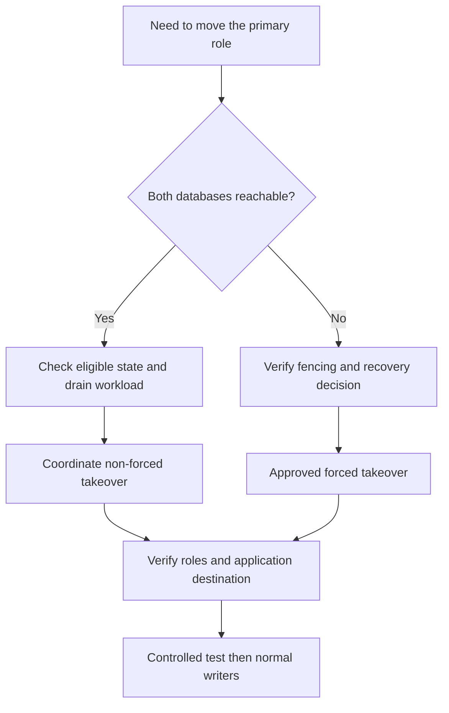

# Planned Db2 HADR Takeover vs BY FORCE: Avoiding Split-Brain

Author: [nawazdhandala](https://www.github.com/nawazdhandala)

Tags: Database, High Availability, Troubleshooting

Description: Choose the correct Db2 HADR takeover path, verify database roles, fence an unavailable primary, and restore application traffic without creating dual primaries.

A planned maintenance window and a failed primary can both end with the standby becoming primary. They should not start with the same command. In Db2 high availability disaster recovery (HADR), a normal takeover coordinates a role exchange. Adding `BY FORCE` allows the standby to promote itself without confirming that the original primary has stopped.

That distinction matters most during a network partition: a host can be unreachable from its standby while still serving application traffic. Promoting another writable copy creates split-brain, where the two databases accept independent changes.

This walkthrough targets a conventional two-host Db2 LUW 11.5 HADR pair. Examples use the placeholder database alias `HADRDB`. They are source-reviewed procedures, not a report of an executed failover. For a cluster-managed installation, use the cluster's approved maintenance and failover workflow rather than running competing manual actions.

## Choose the operation before touching the databases

| Situation | Appropriate path | What must be established |
|---|---|---|
| Both hosts available for maintenance | Non-forced takeover | Healthy connection and an eligible replication state |
| Original primary unavailable | Incident-controlled forced takeover | Old primary cannot accept writes; data-loss risk assessed |
| Automation uses a configured peer window | Conditional forced takeover | Supported mode, valid window, synchronized clocks, and timely fencing |
| Takeover command returned an error | Diagnose actual roles first | Command failure does not establish which roles remain |

A successful non-forced takeover exchanges primary and standby roles. A forced takeover changes the selected standby to primary; it does not convert the old primary into a standby. The old host therefore needs separate recovery handling. IBM explains these semantics in its [HADR command overview](https://www.ibm.com/docs/en/db2/11.5.x?topic=management-hadr-commands).



Fencing means preventing the former primary from continuing to serve writes or automatically returning as a writer. Your infrastructure may provide that through a cluster-controlled power or host isolation mechanism. A failed ping, a closed application connection, or changing a DNS record is not equivalent evidence.

## Prepare a planned role switch

Record host names, instance names, database aliases, current roles, and the selected standby. Confirm that your administration session reaches the intended physical server.

Run this locally on each host using the correct Db2 instance environment:

```bash
db2pd -db HADRDB -hadr
```

Expect opposite roles and the intended endpoints. For a conventional `SYNC`, `NEARSYNC`, or `ASYNC` pair, check for a connected `PEER` state before a planned switch. `SUPERASYNC` is an exception: it can perform a non-forced takeover from `REMOTE_CATCHUP`. Check its backlog carefully because the remaining logs must be transferred and replayed. IBM's [synchronization guide](https://ibm.github.io/db2-hadr-wiki/hadrSyncMode.html) explains why that mode never reaches `PEER`.

Also inspect the standby's replay backlog and configured replay delay. Delayed replay is a deliberate protection feature, and a nonzero delay prevents takeover. Removing that protection requires its own planned change; do not treat it as an incidental flag to clear. The [delayed replay documentation](https://www.ibm.com/docs/en/db2/11.5.x?topic=solution-hadr-delayed-replay) describes the required lifecycle.

Before switching, pause scheduled jobs and drain application writers through the application's maintenance controls. Let important transactions finish where possible. Notify owners that existing connections can be interrupted and unfinished transactions rolled back. Do not promise that a database role switch is invisible to every client.

Confirm the application connection strategy too. Automatic client reroute, or ACR, requires an alternate server configuration. It does not obtain the SQL connection destination from `hadr_remote_host` or the HADR replication port. Verify the actual client endpoint and driver behavior using IBM's [ACR setup guidance](https://www.ibm.com/docs/en/db2/11.5.x?topic=hadr-configuring-automatic-client-reroute).

## Execute the planned switch on the standby

After those checks, run the following **locally on the intended standby host** with an account holding `SYSADM`, `SYSCTRL`, or `SYSMAINT` authority:

```bash
db2 takeover hadr on database HADRDB
```

This is a state-changing operation. It requests a coordinated role switch, including shipping remaining logs and completing replay. Do not append `BY FORCE` as a retry policy if it fails.

Use local `db2pd` observations on both hosts to verify that the old standby is now primary and the old primary is now standby. During the transition, SQL connections might be unavailable, which makes local monitoring especially useful. Save the command response and diagnostic timestamps.

A lost command response can occur after the switch has completed. Conversely, a partial failure can leave both databases as standbys. Inspect both roles before deciding what to do next. IBM documents this failure handling, including the special two-standby recovery case, in the [TAKEOVER reference](https://www.ibm.com/docs/en/db2/11.5.x?topic=commands-takeover-hadr). That documented recovery case is not justification for forcing every unsuccessful maintenance command.

## Treat BY FORCE as an incident decision

When the primary really has failed, first establish the authoritative fencing result through your infrastructure's control plane. Prevent automatic restart from undoing it. Preserve the old primary's storage and logs for diagnosis and possible reconciliation.

Record the latest available receive and replay positions, their timestamps, and whether the observations predate a disconnection. Identify which acknowledged application operations may be absent from the candidate. A stale zero-gap observation is not proof that every later commit arrived.

Only after the failover decision and fencing checks would an authorized operator run this locally on the selected active standby:

```bash
# Incident operation: use only after the documented failover gates.
db2 takeover hadr on database HADRDB by force
```

If the standby can contact the primary, it attempts to disable it. That message is not reliable fencing during a network failure. Forced promotion can lose transactions that never reached the standby, and replaying the available log still takes time. The distinction between receiving a log and replaying it is described in IBM's [log spooling documentation](https://www.ibm.com/docs/en/db2/11.5.x?topic=hadr-log-spooling).

Do not restart the old host as primary to see whether it works. HADR roles persist across restarts; recovery must explicitly account for the new authoritative primary.

## Understand the limit of PEER WINDOW ONLY

A peer window is a configured period during which the primary's behavior after losing its standby helps protect consistency. A conditional command has this form:

```bash
# Conditional failover, not a general replacement for fencing.
db2 takeover hadr on database HADRDB by force peer window only
```

This requires `SYNC` or `NEARSYNC`, a configured peer window, and the appropriate peer or disconnected-peer state. It is not available for `ASYNC` or `SUPERASYNC`; nonzero peer windows are not supported in Db2 pureScale. Clocks must remain synchronized closely enough for the mechanism, with IBM specifying within five seconds.

Crucially, the former primary must be brought down before the window expires. Do not remove `PEER WINDOW ONLY` automatically when the conditional operation is rejected: that changes the recovery guarantees. Likewise, stopping HADR to unblock writes on the old primary can undermine consistency. Review the [peer-window configuration](https://www.ibm.com/docs/en/db2/11.5.x?topic=parameters-hadr-peer-window-hadr-peer-window) and the takeover restrictions with the failover automation owner.

## Verify service before reopening normal traffic

Verify the new primary locally, then check the application's real connection destination. Allow a small, approved test transaction using a uniquely identifiable application operation. Confirm its outcome and replication where a standby is available, then resume normal writers gradually.

When a client loses a connection around commit, determine whether the transaction committed before retrying it. Use application request identifiers or other established reconciliation mechanisms to avoid duplicating business operations. A successful reconnect alone does not settle the previous transaction's outcome.

After forced failover, restore redundancy separately. Reintegration is possible only when the old primary's log stream has not diverged. Otherwise, rebuilding it from the new primary may be necessary. IBM specifically warns that `DEACTIVATE DATABASE` or `DB2STOP FORCE` on a still-running old primary before reintegration can modify its log stream. Follow the [reintegration procedure](https://www.ibm.com/docs/en/db2/11.5.x?topic=outages-reintegrating-database-after-takeover-operation) with the host recovery owner rather than improvising shutdown commands.

Close the change only when one authoritative writer is established, clients reach it, and redundancy is either restored or explicitly tracked as degraded. Returning the original host to the primary role is a later planned switch after the pair is healthy again.
