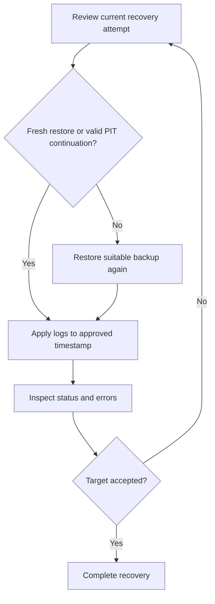

# Db2 Point-in-Time Recovery: When to Restart from the Backup

Author: [nawazdhandala](https://www.github.com/nawazdhandala)

Tags: Database, SQL, Backup

Description: Choose a valid Db2 recovery timestamp, inspect rollforward progress before completion, and recognize target changes that require restoring the backup again.

A mistaken update committed at 14:05, and the recovery team wants the database as it stood just before that change. The task sounds like choosing a timestamp. In practice, the choice also depends on the backup's recovery boundary, available logs, the time zone, and what has already happened in the current restore attempt.

Rollforward is not a time slider that can move backward. Once logs have been applied, choosing an earlier target means rebuilding from an appropriate backup. Finalizing recovery is another important boundary: it ends the current recovery operation rather than pausing it.

This guide uses **whole-database point-in-time recovery in Db2 LUW 11.5**, on an isolated single-partition destination. Point-in-time recovery is abbreviated PIT. Table-space-only and distributed recovery have additional coordination requirements.

## Choose an image that can reach the requested point

Start with the business event, including the transaction's commit time and the evidence establishing it. An application's error timestamp may be later than the unwanted commit. Clock differences between systems can also mislead an investigation.

An online backup must be recovered through its consistency boundary. If the unwanted transaction committed while that backup was still being taken, that image may be too recent for the desired pre-incident recovery point. Select an earlier suitable image and the continuous log chain needed to reach the target.

IBM's [archive logging guide](https://www.ibm.com/docs/en/db2/11.5.x?topic=logging-archive) explains the end-of-backup requirement. Do not assume that an image whose filename begins before the incident can necessarily recover to every moment during its creation.

Keep the source image and logs immutable under the recovery policy. Restore to an unused isolated destination with verified storage paths and no application traffic. The examples below assume that this restore has already succeeded and the target database, `RECOV`, is awaiting rollforward.

## Make time-zone interpretation explicit

The example target is **20 November 2026 at 14:04:59 UTC**. It is a placeholder, not a recommended offset from every incident. Replace it with the approved target derived from your own evidence.

The [ROLLFORWARD reference](https://www.ibm.com/docs/en/db2/11.5.x?topic=commands-rollforward-database) documents the timestamp format and distinguishes UTC from server-local time. A backup's timestamp is based on its local start time; it is not automatically a UTC recovery target.

Record both the human-readable target and the exact command string in the recovery plan. If local time is used, it is the database server's local time, which may differ from the operator's laptop. Daylight-saving transitions are another reason to use an explicitly verified UTC target.

Recovery includes transactions committed at the specified target. If an unwanted transaction committed exactly at that time, it is not excluded merely because the command stops there. Choose the boundary according to transaction evidence and the precision available.

## Inspect the current attempt before applying logs

On the isolated recovery host:

```bash
db2 rollforward db RECOV query status
```

Replace `RECOV` with the actual recovery database alias. Save the output with the restore image identifier and the commands already issued. A status display without that history can conceal an important fact, such as an earlier attempt to recover to the end of logs.

Use this decision table before continuing:

| Current situation | Next decision |
| --- | --- |
| Fresh restore, no logs applied | Start the reviewed PIT operation |
| PIT operation unfinished and a later target is now required | Review whether continuation to the greater timestamp is appropriate |
| An earlier target is required after progress | Restore again from a suitable image |
| `TO END OF LOGS` was attempted and PIT is now required | Restore again before starting PIT |
| Recovery was completed with `STOP` or `COMPLETE` | Use a fresh restore for a different recovery target |

IBM explicitly states that an attempted end-of-logs operation cannot be switched into PIT in place. Leaving off `STOP` does not remove that restriction. The same reference requires subsequent PIT timestamps to increase.



The review loop is a decision loop, not permission to retry commands blindly. A lower target follows the fresh-restore path.

## Apply logs without immediately finalizing

Assume the complete approved logs are staged under `/srv/recovery/pit-logs` with the required partition and stream structure. Replace that path and the timestamp:

```bash
db2 "rollforward db RECOV \
  to 2026-11-20-14.04.59 using utc time \
  overflow log path (/srv/recovery/pit-logs) \
  noretrieve"
```

Quoting protects the parentheses from the shell. The [overflow-path documentation](https://www.ibm.com/docs/en/db2/11.5.x?topic=parameters-overflowlogpath-overflow-log-path) describes the directory structure and the relationship between the command option and configured overflow storage.

`NORETRIEVE` prevents archive retrieval during this operation. Use it only when the staged inputs are intended to be sufficient. It does not fill gaps or relax integrity requirements. If the recovery plan instead relies on archive retrieval, configure and verify that access deliberately.

Do not combine this step with `AND STOP` during an investigation. Keeping application of logs separate from completion gives the team an opportunity to assess the result before accepting it.

## Interpret success and missing-log messages carefully

Query status again after the command returns. Review the actual result, processed logs, next required log, and last committed transaction time. The last commit need not equal the requested timestamp: there may have been no transaction at that exact second.

Db2's documented PIT success rules can require a transaction timestamp later than the requested target in the available logs. Consequently, files containing only transactions up to the target may not be enough to establish that the target has been crossed. Do not assemble the log package by guessing from filesystem modification times.

If a required log is missing or damaged, preserve the named file and diagnostic context. IBM's [archive-log validation procedure](https://www.ibm.com/docs/en/db2/11.5.x?topic=tools-db2cklog) describes checking closed logs and locating a valid alternative copy. A valid filename does not prove that its contents belong to the correct chain.

If the approved target cannot be reached, the owner must decide whether another valid point is acceptable. Do not issue `STOP` merely to clear a pending state. An error followed by an open database is not evidence that the requested recovery objective was met.

## Finalize only an accepted recovery point

Before completion, review inherited archive destinations and external dependencies on the recovery host. IBM's [post-restore guidance](https://www.ibm.com/docs/en/db2/11.5.x?topic=restore-restoring-data) calls out paths and replication settings that may still describe the source. Keep production sinks isolated; disabling archive retrieval is not the same as preventing archive writes.

Once the recovery result is accepted:

```bash
db2 rollforward db RECOV stop
db2 rollforward db RECOV query status
```

Completion resolves incomplete work and ends the recovery operation. `CANCEL` is not a rewind alternative: it can leave the database in restore-pending state. Preserve the original image so another attempt remains possible.

Do not apply this whole-database workflow unchanged to a subset of tablespaces. IBM's [tablespace recovery guidance](https://www.ibm.com/docs/en/db2/11.5.x?topic=data-rolling-forward-changes-in-table-space) describes minimum recovery times and related tablespaces that must remain synchronized.

Keep writers disabled while checking the recovered business state. Confirm that the unwanted committed change is absent and expected earlier work is present. If the selected target was wrong, retain the evidence and create a fresh recovery attempt rather than trying to move this completed database backward. Enable controlled test traffic before any decision to resume normal writers.

The commands and state transitions were documentation-reviewed and shell-syntax checked. No Db2 server was available, so PIT replay, recovery errors, completion, and business-data checks were not executed for this article.
