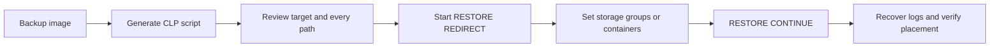

# Redirect a Db2 Restore to New Paths with a Generated CLP Script

Author: [nawazdhandala](https://www.github.com/nawazdhandala)

Tags: Database, SQL, Backup

Description: Generate and review a Db2 redirected-restore script, map storage groups and containers to new paths, and verify placement before accepting recovery.

A Db2 backup remembers where its database stored data. On a replacement host, those directories may not exist, or they may belong to a different database. Restoring under a new alias does not automatically make every recorded storage path appropriate.

A redirected restore separates the beginning of restore from the point where Db2 restores the data into its containers. Between those steps, you can supply new storage definitions. Generating a Command Line Processor, or CLP, script makes those definitions available for review before execution.

This guide targets **Db2 LUW 11.5**, a full database backup, and a single-partition recovery instance. Use an isolated destination with exclusive storage, a compatible Db2 release, validated image files, and any required encryption keys. Incremental, partitioned, and table-space-only restores need additional planning.

## Understand the three stages

IBM's [redirected-restore procedure](https://www.ibm.com/docs/en/db2/11.5.x?topic=restore-performing-redirected-operation) separates initialization, storage redefinition, and continuation:



The redirection commands must run in the same CLP session as the restore operation. A script is useful because it preserves this sequence, but its generated defaults still need review.

The database may contain two different storage arrangements. Automatic-storage tablespaces obtain containers from a storage group's paths. Non-automatic-storage tablespaces have explicit container definitions. You must identify which arrangement each tablespace uses before editing it.

## Generate a script from the selected image

Replace `SAMPLE`, the image directory, and `20261120010000` with the source alias, complete backup location, and exact timestamp. Choose a new output filename in a protected working directory:

```bash
db2 "restore db SAMPLE \
  from /srv/recovery/images/run01 \
  taken at 20261120010000 \
  redirect generate script restore-run01.clp"
```

This follows IBM's [generated-script workflow](https://www.ibm.com/docs/en/db2/11.5.x?topic=operation-performing-redirected-restore-using-automatically-generated-script). The next step is to open and edit the file, not to assume the database has already been recovered.

The file is created on the **client** running the command. Backup locations and database storage paths refer to the **server**. Those may be the same machine, but do not assume they are.

The [restore command reference](https://www.ibm.com/docs/en/db2/11.5.x?topic=commands-restore-database) warns that an existing script filename is overwritten. Use a fresh name so regeneration cannot silently discard a reviewed version. Keep both the original and edited copies under the recovery record.

If the selected database already exists, script generation can require a connection to it; unresolved recovery or upgrade state can prevent generation. Do not bypass an unexpected error by choosing an unrelated database or enabling replacement options.

## Review destination identity before storage edits

Inspect the generated initialization command and final continuation command together. Confirm the image timestamp and source alias, intended target alias, database control-file path, active-log path, and any log-extraction target.

The database path holds control information; it is not a synonym for all tablespace storage. IBM's [restore storage-path explanation](https://www.ibm.com/docs/en/db2/11.5.x?topic=databases-implications-restoring) distinguishes `DBPATH ON`, automatic-storage paths, and storage-group-specific redirection.

Build a small review table from the actual image:

| Component | Recorded location | Approved destination |
| --- | --- | --- |
| Database control files | Source database path | Dedicated recovery database path |
| Storage group `IBMSTOGROUP` | Source storage roots | Recovery data filesystem |
| Manual tablespace containers | Each recorded container | Individual recovery container paths |
| Active logs | Source log path | Dedicated recovery log filesystem |

These labels are illustrative; use the names and IDs in your generated file. Check mounts, ownership, capacity, and exclusivity. A directory's existence does not prove that it points to the intended filesystem.

Leave replacement options disabled unless replacing that exact destination is explicitly part of the recovery plan. Avoid putting passwords into the script; use the established authenticated administrative environment.

## Redirect automatic-storage groups

For a storage group named `IBMSTOGROUP` in the backup, this is an example replacement command **inside the generated script**, between restore initialization and continuation:

```sql
SET STOGROUP PATHS FOR IBMSTOGROUP
ON '/srv/recovery/data1', '/srv/recovery/data2';
```

Replace the group name and paths with the reviewed mapping. The directories must already exist and be accessible. IBM's [SET STOGROUP PATHS reference](https://www.ibm.com/docs/en/db2/11.5.x?topic=commands-set-stogroup-paths) limits this command to a database redirected restore and requires SYSADM or SYSCTRL authority.

Use the storage-group name from the image, even if the source database renamed it after the backup. This operation changes paths for an existing group; it does not create a new group or move a tablespace to a newly invented group.

Review every group. A single `RESTORE ... ON` path list can apply the same new paths to all groups, which may collapse an intentional separation between fast and slow storage. Group-specific commands retain control over that mapping.

Also account for recovery behavior: redefining a group's paths prevents subsequent rollforward from replaying changes to that group's storage paths or media attributes. Record the intended resulting layout, not just the initial path substitution.

## Preserve complete manual-container definitions

For non-automatic-storage tablespaces, edit the generated `SET TABLESPACE CONTAINERS` definitions. Preserve the correct tablespace ID and the complete container list, including its sizing information. Replacing only the one container that happened to be inaccessible can accidentally omit the others.

The generated file identifies the containers belonging to each tablespace. Treat those definitions as evidence from this backup, not as a place to paste a tablespace ID from another system.

Do not use manual-container redirection to assign filenames to automatic-storage containers. IBM explicitly distinguishes these cases in its [storage implications guide](https://www.ibm.com/docs/en/db2/11.5.x?topic=databases-implications-restoring). For an ordinary relocation, keep the storage model unchanged unless a separate conversion has been designed and reviewed.

Device containers need additional attention: the redirected-restore procedure does not automatically create the underlying devices. Confirm their provisioning and ownership before continuing.

## Execute once, with errors stopping the sequence

After review, run the edited script from the intended recovery session:

```bash
db2 -stvf restore-run01.clp
```

Here `-t` uses statement terminators, `-v` echoes commands, and `-f` reads the file. `-s` stops execution on a command error. IBM's [CLP return-code reference](https://www.ibm.com/docs/en/db2/11.5.x?topic=clp-return-codes) explains why execution can otherwise continue after an SQL error.

Review generated command-option statements too: retain their stop-on-error behavior and choose an output-log filename that will not overwrite another recovery record. Warnings still need interpretation; stopping on errors does not certify every warning as harmless.

If execution fails, record the failing command and database state before deciding how to resume. Do not rerun the whole script blindly or manually issue `CONTINUE` after a failed storage definition. Use the documented recovery procedure for the current stage.

## Verify the resulting paths and recovery state

Storage-group container paths may still appear unchanged before `RESTORE CONTINUE`; IBM documents that the new paths take effect after continuation. Verify actual placement at the appropriate stage rather than treating an intermediate display as proof that redirection failed.

After restore, complete the required log recovery for an online image. Inspect final tablespace state and storage placement, then run the agreed application checks on the isolated database. Confirm that no unintended source paths were used before allowing writers.

The generation and execution options were checked against official documentation, and shell syntax was checked locally. No Db2 runtime or backup image was available, so no script was generated by Db2, no restore was executed, and no storage placement was tested for this article.
