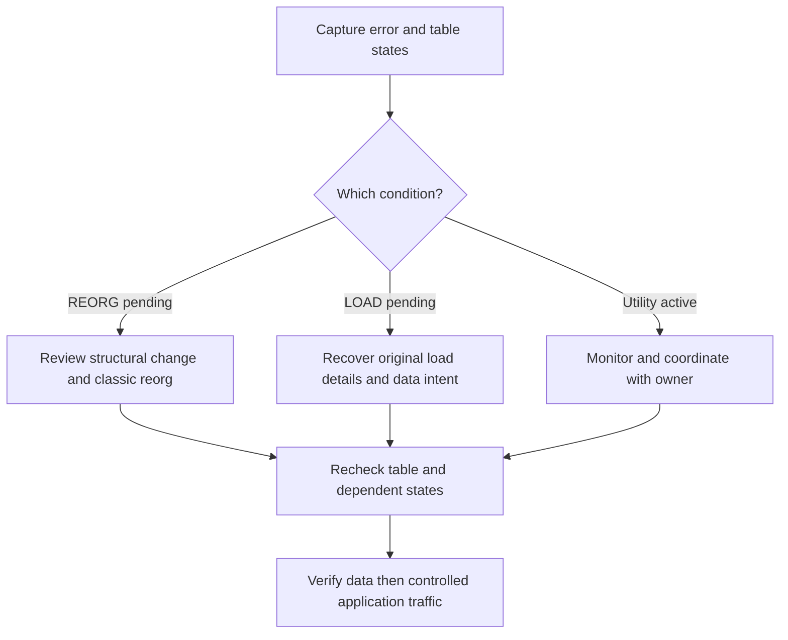

# Recover Db2 REORG-Pending and LOAD-Pending Tables Safely

Author: [nawazdhandala](https://www.github.com/nawazdhandala)

Tags: Database, Troubleshooting, Recovery

Description: Identify the exact Db2 table state, distinguish required reorganization from interrupted loads, and choose recovery without accidentally replacing data.

An application reports that a table cannot be accessed. Someone suggests running REORG; someone else suggests terminating a load. Neither action is justified until you know which state the table is in and how it got there.

REORG-pending usually points to a structural change that needs a classic reorganization. LOAD-pending points to an interrupted data-loading operation. Set-integrity-pending is different again: required integrity processing has not finished. Clearing one condition does not necessarily clear the others.

This guide uses IBM Db2 LUW 11.5. The examples assume a conventional single-partition database and use `APPDB` and `APP.ORDERS` as placeholders. Read-only diagnosis comes first. State-changing examples require the relevant authority, a recovery plan, and an agreed application maintenance window. No live Db2 recovery was performed for this article.

## Save the complete error and current state

Record the SQL code, reason code, schema-qualified table name, operation, and timestamp. For example, `SQL0668N` covers several restricted-access conditions; the reason code matters. Do not treat every occurrence as the same reorganization problem. IBM lists the reason-specific responses in its [SQL message reference](https://www.ibm.com/docs/en/db2/11.5.x?topic=messages-sql0000-0999).

From a separate administration command-line session connected to the same database, inspect the table:

```bash
db2 connect to APPDB
db2 load query table APP.ORDERS
```

Despite its name, `LOAD QUERY TABLE` can report table state when no load is running. When a load is active, it also reports progress. In a partitioned database environment it reports the current database partition, so a single response is not a complete distributed incident assessment. See the [LOAD QUERY reference](https://www.ibm.com/docs/en/db2/11.5.x?topic=commands-load-query).

Next, obtain explicit state fields:

```sql
SELECT TABSCHEMA, TABNAME, DBPARTITIONNUM, DATA_PARTITION_ID,
       REORG_PENDING, INPLACE_REORG_STATUS,
       LOAD_STATUS, NO_LOAD_RESTART,
       READ_ACCESS_ONLY, INDEXES_REQUIRE_REBUILD
FROM TABLE(SYSPROC.ADMIN_GET_TAB_INFO('APP', 'ORDERS')) AS T;
```

Save every returned row. A table can have separate data partitions, and several conditions can coexist. In particular, `READ_ACCESS_ONLY = 'N'` does not prove that full access is allowed. It can also mean that a load-pending table is inaccessible. IBM defines these fields in [ADMIN_GET_TAB_INFO](https://www.ibm.com/docs/en/db2/11.5.x?topic=aracp-admin-get-tab-info-retrieve-table-size-state-information).

## Classify the condition before changing it

| Evidence | Interpretation | Next action |
|---|---|---|
| `REORG_PENDING = 'Y'` | A qualifying table alteration requires classic reorganization | Review DDL history and plan that operation |
| `INPLACE_REORG_STATUS = 'PAUSED'` | An existing in-place operation was paused | Investigate its original command and state |
| `LOAD_STATUS = 'IN_PROGRESS'` | Loading is active | Observe progress and coordinate with its owner |
| `LOAD_STATUS = 'PENDING'` | A load failed or was interrupted | Recover that exact load operation |
| `NO_LOAD_RESTART = 'Y'` | Restart is not allowed for this partially loaded state | Choose another approved recovery path |
| Set-integrity-pending reported | Required constraint or dependent-object processing remains | Plan integrity processing after utility recovery |

A paused in-place reorganization is not the same condition as REORG-pending after an alteration. Likewise, a running load should not be terminated merely because the application cannot write during its chosen access mode.



## Recover a genuinely REORG-pending table

Find the preceding schema change and ensure that it is the intended definition. Confirm backups, working space, table organization, and access restrictions before proceeding. For the ordinary nonpartitioned row table used here, an authorized maintenance action is:

```bash
# Run only for the confirmed table and approved outage.
db2 reorg table APP.ORDERS classic allow no access
```

This rebuilds the table using the classic method. It is not an online repair, and an in-place reorganization is not the substitute for a table requiring classic reorganization. Other table organizations and partition/index combinations need their own eligibility checks. Follow the [REORG TABLE documentation](https://www.ibm.com/docs/en/db2/11.5.x?topic=commands-reorg-table).

Check the command's outcome, then rerun the state query. If the operation failed, preserve diagnostics and temporary files rather than deleting them to make the next attempt look clean. If other pending states remain, diagnose them separately. Refresh appropriate statistics after successful physical maintenance, but do not expect RUNSTATS to clear REORG-pending by itself.

## Recover the original load, not an imagined replacement

For LOAD-pending, recover the exact original command from the job record. Preserve its input data, message files, temporary files, column mapping, modifiers, copy options, and access mode. Establish whether it was `INSERT` or `REPLACE` before choosing any recovery action.

Fix the underlying failure first: for example, missing input, exhausted storage, or an inaccessible load-copy destination. Retrying with the same unresolved condition simply repeats the interruption. IBM's [interrupted-load guidance](https://www.ibm.com/docs/en/db2/11.5.x?topic=loads-restarting-interrupted-load-operation) explicitly warns against modifying the utility's temporary files.

The crucial data distinction is:

| Recovery decision | Data consequence to assess |
|---|---|
| Terminate an interrupted `LOAD INSERT` | Original pre-load records are retained |
| Terminate an interrupted `LOAD REPLACE` | The table is left empty; old contents are not restored |
| Start a new `LOAD REPLACE` | Existing contents are replaced with the supplied input |
| Restart an eligible interrupted load | Continuation depends on original parameters and retained state |

These are not interchangeable ways to clear a flag. In particular, do not paste a generic `LOAD ... TERMINATE` command with an empty input source into an incident ticket. Build the exact recovery command from the preserved job and the owner's approved data outcome.

Version matters here. IBM deprecated `LOAD RESTART` starting with Db2 11.5.8 and directs users toward termination followed by a new load. That advice still requires understanding the `INSERT` versus `REPLACE` consequences. Restart also has table-type restrictions, including column-organized tables and certain random-distribution tables. Check the installed level and the [LOAD command reference](https://www.ibm.com/docs/en/db2/11.5.x?topic=commands-load) before following an older runbook.

For an older supported restart workflow, IBM requires the original parameters to be retained, with documented exceptions, so the utility can find its saved state. `NO_LOAD_RESTART = 'Y'` can arise after restore or rollforward circumstances; it is not a permission error to bypass.

## Resolve remaining integrity and backup conditions

After load recovery, use `LOAD QUERY TABLE` again. If the table is now set-integrity-pending, investigate its constraints and dependent tables. For a confirmed simple case whose dependencies have been reviewed, the checked operation is:

```sql
SET INTEGRITY FOR APP.ORDERS IMMEDIATE CHECKED;
```

This performs required integrity processing. It can fail when data violates constraints, and related tables may need coordinated processing. Do not replace it with `IMMEDIATE UNCHECKED` merely to restore access: that bypasses checks and can allow incorrect query results. IBM explains these effects in [SET INTEGRITY](https://www.ibm.com/docs/en/db2/11.5.x?topic=statements-set-integrity).

Also inspect tablespace recovery requirements. Terminating a load does not remove a backup-pending condition. Complete the backup or recovery work required by the original load's recoverability choices; do not declare the incident resolved solely because a SELECT succeeds.

## Prove the intended data survived

Once access is restored, compare the result with the job's intended dataset. Check business keys, expected totals, rejected-row records, and load messages. For a replacement load, explicitly confirm that the full replacement dataset is present. For an insert load, confirm both original data and the approved new batch, without duplicates from job retries.

Permit a small controlled application check before normal writers resume. Save the final state query, recovery command, utility output, and validation results. The successful outcome is the intended data in a usable and recoverable table, not simply the disappearance of a pending-state message.
