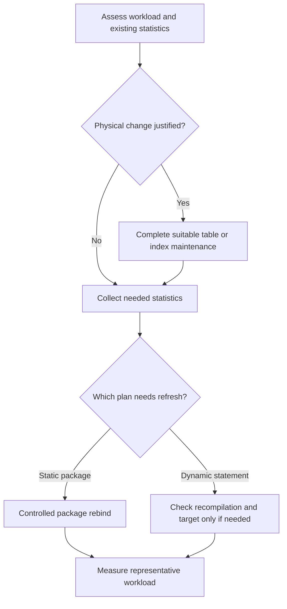

# Order Db2 REORG, RUNSTATS, REBIND, and Cache Maintenance

Author: [nawazdhandala](https://www.github.com/nawazdhandala)

Tags: Database, Performance, Maintenance

Description: Choose Db2 maintenance by its purpose, finish physical changes before final statistics, and refresh only the plans that need attention.

A maintenance script that always runs REORG, RUNSTATS, REBIND, and a package-cache flush can do unnecessary work while obscuring which change helped. These operations solve different problems. Their useful order depends on whether the problem is physical layout, optimizer information, a static package, or a cached dynamic statement.

For a table that actually needs physical reorganization, the usual sequence is to complete that work, collect final statistics, and then refresh the relevant plans. For stale statistics alone, skip the physical rewrite. A full dynamic cache flush is not a mandatory final step.

This guide uses Db2 LUW 11.5 examples for a conventional nonpartitioned, row-organized table. `APPDB`, `APP.ORDERS`, and package identifiers are placeholders. Maintenance commands require appropriate Db2 authority and an approved workload window. The examples were checked against official documentation, not executed on a Db2 server.

## Start with the purpose of each operation

| Operation | What it changes | What it does not establish |
|---|---|---|
| REORG TABLE | Physical row organization and, for classic reorganization, rebuilt indexes | That the optimizer has the desired final statistics |
| RUNSTATS | Catalog statistics used during optimization | That every running execution switches plans immediately |
| REBIND | A stored package and its compiled statements | That every unrelated dynamic statement should be invalidated |
| FLUSH PACKAGE CACHE DYNAMIC | Validity of cached dynamic SQL entries | That data layout or catalog statistics improve |

A statistics problem does not automatically justify copying an entire table. An index-space problem does not automatically justify reorganizing every table object. IBM's [reorganization decision guidance](https://www.ibm.com/docs/en/db2/11.5.x?topic=organization-determining-when-reorganize-tables-indexes) explicitly calls for weighing the expected benefit against the cost.

Before making changes, preserve the affected workload's latency, waits, reads, and existing plan. Define success in those terms. “All four commands finished” is an execution record, not a performance result.

## Use current statistics carefully during assessment

Inspect one table rather than starting with every user table:

```bash
db2 connect to APPDB
db2 reorgchk current statistics on table APP.ORDERS
```

`CURRENT STATISTICS` uses existing catalog information. It does not refresh stale statistics. `UPDATE STATISTICS` invokes RUNSTATS before producing recommendations and therefore has a different cost and side effect. Review the [REORGCHK reference](https://www.ibm.com/docs/en/db2/11.5.x?topic=commands-reorgchk) before choosing between them.

If the statistics are old or missing, collect suitable statistics first and reassess. This is one legitimate reason to run RUNSTATS before deciding on REORG. It is different from the final collection after a physical change.

A recommendation marker is evidence to investigate, not an unconditional instruction. A table can still receive a recommendation after reorganization. Ask whether the relevant queries suffer from the indicated layout, whether the table is naturally small or unusual, and whether expected savings justify the maintenance impact.

If you already have a custom statistics profile, preserve it. A generic statistics refresh used during assessment must not silently replace the intended coverage for important columns or indexes.

## Complete physical work before measuring the final layout

The following is a deliberately restrictive example for a suitable table whose outage has been approved:

```bash
# State-changing operation: applications must not use this table here.
db2 reorg table APP.ORDERS classic allow no access
```

Classic reorganization creates a replacement copy and rebuilds indexes. Budget the required working space and review the table's storage characteristics before starting. `ALLOW NO ACCESS` makes the access restriction explicit; it is not a suggestion to use this mode for a table that must remain continuously available. IBM documents available modes and table restrictions in [REORG TABLE](https://www.ibm.com/docs/en/db2/11.5.x?topic=commands-reorg-table).

If an eligible in-place reorganization better suits the maintenance plan, remember that it runs asynchronously. Command acceptance is not completion. Do not chain final RUNSTATS immediately after a successful start response. Observe its state locally:

```bash
db2pd -db APPDB -reorgs
```

Interpret status with the command diagnostics and your maintenance record, rather than assuming that an absent or changed row proves success. The relevant fields are documented in [db2pd](https://www.ibm.com/docs/en/db2/11.5.x?topic=commands-db2pd-monitor-troubleshoot-db2-engine-activities).

Index cleanup or reorganization can be a narrower alternative when the problem is confined to indexes. Its supported access modes depend on the table and index type. Choose that operation using the [index reorganization reference](https://www.ibm.com/docs/en/db2/11.5.x?topic=commands-reorg-indexindexes), instead of mechanically adding an index rebuild after every table maintenance command.

If physical maintenance fails, stop the sequence and diagnose its state. Do not delete temporary reorganization files to make room; Db2 may need them for recovery. Running the remaining steps does not repair the failed physical operation.

## Collect the statistics the final plans should use

Once the physical work has completed successfully, refresh statistics with the approved collection policy. If an appropriate profile already exists and has been reviewed:

```bash
db2 runstats on table APP.ORDERS use profile
```

This example depends on a suitable saved profile; do not assume one exists. Inspect `STATISTICS_PROFILE` in `SYSCAT.TABLES` and establish the collection options before the window if necessary. Profiles store the intended RUNSTATS options for repeat use, as explained in [statistics-profile collection](https://www.ibm.com/docs/en/db2/11.5.x?topic=collection-collecting-statistics-using-statistics-profile).

Check command warnings, statistics timestamps, and the expected table, column, and index coverage. Updating a timestamp does not prove that the collection includes distributions or column groups needed by a particular query. The [RUNSTATS reference](https://www.ibm.com/docs/en/db2/11.5.x?topic=commands-runstats) describes those choices.



## Rebind static packages deliberately

For static SQL affected by the change, identify the package and version used by the application. A targeted example is:

```bash
# Replace the package and version with the verified application values.
db2 rebind package APP.BILLING version V1
```

The version matters: omitting it selects the empty-string version, not whichever version happens to be newest. Review existing bind options and access-plan reuse settings before deciding what to change. Preserve the old plan so that a regression can be investigated.

A rebind can wait for another user's unit of work to release the package. Coordinate with the application owner; do not turn a planned maintenance action into an unexplained production stall. When command-line autocommit is disabled, explicitly commit the successful operation in the same session. These behaviors are described in the [REBIND reference](https://www.ibm.com/docs/en/db2/11.5.x?topic=commands-rebind).

## Make dynamic invalidation a separate decision

RUNSTATS can invalidate dependent dynamic statements so later compilation uses new information. Check the next relevant compilation and its plan before deciding that extra cache work is needed. IBM includes RUNSTATS among its [recompilation methods](https://www.ibm.com/docs/en/db2/11.1?topic=parameters-recompiling-query-after-configuration-changes).

If explicit invalidation is justified, the `FOR EXECUTABLE ID` form of `FLUSH PACKAGE CACHE DYNAMIC` can select a verified dynamic section. A database-wide flush reaches unrelated cached statements and can shift compilation work onto many subsequent requests. Neither form improves stale statistics by itself.

Without hard invalidation, a statement already in use may continue while a new user triggers compilation. With hard invalidation, the command can wait for use to finish. Treat that difference as an operational choice, not an interchangeable spelling. Consult [FLUSH PACKAGE CACHE](https://www.ibm.com/docs/en/db2/11.5.x?topic=statements-flush-package-cache) for the scope and required authority.

## End with workload evidence

Allow controlled representative traffic, confirm results and plan identities, and compare resource use with the baseline before restoring the full workload where it was paused. Test parameter values that represent both common and unusual cases.

Record which physical operation completed, which statistics policy ran, which packages or dynamic entries changed, and which checks demonstrated the intended result. On the next maintenance cycle, use that record to decide what is necessary. The correct sequence is the smallest justified set of operations that leaves the final plans based on the final data layout and statistics.
