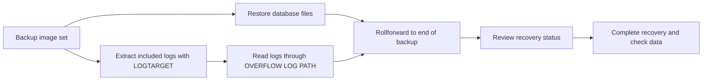

# Restore a Db2 Online Backup with LOGTARGET and an Overflow Log Path

Author: [nawazdhandala](https://www.github.com/nawazdhandala)

Tags: Database, SQL, Backup

Description: Extract included Db2 backup logs, point rollforward at the right directory, verify recovery progress, and finalize only after reaching the intended target.

Restoring an online Db2 backup involves two different operations. Restore reconstructs the database files. Rollforward then applies transaction logs to reach a consistent recovery point. A successful restore message is therefore not the point at which an application should reconnect.

The confusing part is often the paths. `LOGTARGET` tells restore where to extract included logs. `OVERFLOW LOG PATH` tells rollforward where to look for logs. Neither should be confused with the restored database's permanent active-log path.

This guide uses **Db2 LUW 11.5**, a full conventional online backup with included logs, and a single-partition isolated recovery host. The target is the **end of that backup**, not an arbitrary later timestamp.

## Establish an isolated destination

Use a recovery instance with no production database mounts and no application traffic. Verify the intended target database name is unused. This example calls it `RECOV`, while the source image belongs to `SAMPLE`.

The example assumes that storage paths recorded in the image are valid, writable, and exclusively allocated on this isolated host. A different target name alone does not redirect every tablespace container or storage path. If those paths need changing, complete a reviewed redirected-restore plan first rather than applying this example unchanged.

Have the complete validated backup image set, its exact backup timestamp, a compatible Db2 service level, any required libraries, and approved access to encryption keys. Recovery must not depend on retrieving credentials from the failed database itself.

Use an authorized recovery account. IBM's [restore reference](https://www.ibm.com/docs/en/db2/11.5.x?topic=commands-restore-database) documents destination and log-path behavior. Inspect existing database and filesystem assignments before executing a restore; this is a state-changing operation, not an inspection command.

## Give each path one purpose

Create and permission the directories through your normal recovery-host provisioning process. All paths below are server-side examples to replace:

| Example path | Role |
| --- | --- |
| `/srv/recovery/images/run01` | Complete backup image set |
| `/srv/recovery/extracted/run01` | Empty root for logs extracted by restore |
| `/srv/recovery/active/recov` | Dedicated permanent active-log location |

The extraction directory must already exist and be writable. Keep it separate from other restore attempts so identically named logs from different databases or log chains cannot be confused.



IBM's [log inclusion guide](https://www.ibm.com/docs/en/db2/11.5.x?topic=management-including-log-files-backup-image) explains that included logs are copied out only when the restore requests an appropriate log target. Keeping an image on disk does not itself make its embedded logs available to rollforward.

## Restore the image and extract its logs

Replace `20261120010000` with the exact timestamp reported for the selected backup. Replace both database names and all three paths as needed. Run this only on the isolated destination described above:

```bash
db2 "restore db SAMPLE \
  from /srv/recovery/images/run01 \
  taken at 20261120010000 \
  into RECOV \
  logtarget /srv/recovery/extracted/run01 \
  newlogpath /srv/recovery/active/recov"
```

`SAMPLE` identifies the source backup, while `INTO RECOV` selects the recovery database name. `NEWLOGPATH` assigns its permanent log location; it is different from the directory holding extracted recovery input.

Review any prompt against the planned target. An unexpected overwrite warning is a reason to stop and check the destination, not to add an unattended option. Retain the restore output and resolve errors before proceeding.

The restore command automatically appends partition and log-stream directories beneath `LOGTARGET`. For this single-partition example, expect a layout such as `NODE0000/LOGSTREAM0000` beneath the extraction root. Inspect the actual resulting layout instead of moving logs into a flat directory to match an assumption.

When Advanced Log Space Management is involved, extraction-log handling has additional rules: database restore can put those files in the active-log directory. Review the [ALSM recovery considerations](https://www.ibm.com/docs/en/db2/11.5.x?topic=logging-advanced-log-space-management) for your source and target service levels. Do not assume that every recovery-related file belongs under `LOGTARGET`.

## Check state before applying logs

After restore completes, inspect recovery status:

```bash
db2 rollforward db RECOV query status
```

The [rollforward command reference](https://www.ibm.com/docs/en/db2/11.5.x?topic=commands-rollforward-database) describes the status, processed logs, next required log, and last committed transaction timestamp. Save the output as evidence for this restore attempt.

A database restored from an online backup requires rollforward. A pending state at this point is expected; it is not an instruction to disable archival logging or force the database open.

Confirm the selected recovery target with the owner. If the target is a later time, obtain the additional log chain and revise the procedure before finalizing recovery. The logs embedded in this image are intended to make the backup recoverable, not to include changes made after it finished.

## Roll forward using the extraction root

For recovery to the end of this backup, use:

```bash
db2 "rollforward db RECOV to end of backup \
  overflow log path (/srv/recovery/extracted/run01) \
  noretrieve"
```

The outer quotes protect the parentheses from the shell. Pass the extraction root with its Db2-created directory structure beneath it. IBM documents the [overflow path's partition and stream layout](https://www.ibm.com/docs/en/db2/11.5.x?topic=parameters-overflowlogpath-overflow-log-path); the command option applies to this operation and overrides a configured overflow path.

`NORETRIEVE` prevents retrieval from archive storage. It does not ignore a missing required log or repair a damaged one. IBM specifically recommends it when rolling forward to the end of backup using extracted logs, avoiding unnecessary archive retrieval and possible log-chain conflicts.

Do not add `AND STOP` yet. Query the status again and compare the result with the intended backup and the command outcome. This separates applying logs from accepting the final recovery point.

## Diagnose a missing-log or wrong-chain error

Use the named missing file, database partition, and log stream from the diagnostic output. Check the extracted directory structure, file accessibility, and whether the image actually included the required logs. Confirm that every backup image piece came from the same operation.

If additional archives are needed, obtain files from the correct database history and log chain through the recovery process. A matching filename alone is insufficient. Do not rename an unrelated log or mix files from another restore attempt to silence a missing-file error.

IBM's [ADM1601E diagnostic guidance](https://www.ibm.com/docs/en/db2/11.5.x?topic=SSEPGG_11.5.0%2Fcom.ibm.db2.luw.messages.adm.doc%2Fadm0000-adm5999.htm) identifies the missing log and recovery context. Preserve that evidence. Reissuing completion does not make an incomplete log sequence safe.

## Complete recovery only after reviewing the result

Once rollforward has successfully reached the agreed end-of-backup target and its status has been reviewed, finalize this isolated recovery:

```bash
db2 rollforward db RECOV stop
db2 rollforward db RECOV query status
```

`STOP` completes recovery; it is not a pause button for loading more logs later. IBM recommends separating progress from completion so missing or damaged logs can be investigated first. A different recovery target after finalization may require starting again from the backup.

Keep application traffic disabled while checking database availability and required tablespaces. Run the agreed read-only business checks, compare expected records at the recovery point, and record the result. Only then decide whether this recovered database should accept controlled test traffic or normal writers.

The snippets were reviewed against official documentation and checked for shell syntax. No Db2 instance was available, so restore, log extraction, rollforward, and application recovery were not executed for this article.
