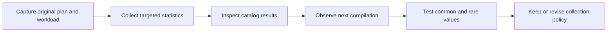

# Db2 RUNSTATS for Skewed Columns and Safer Plan Refreshes

Author: [nawazdhandala](https://www.github.com/nawazdhandala)

Tags: Database, SQL, Performance

Description: Collect targeted Db2 distribution statistics, verify frequent values and quantiles, and refresh affected access plans without a routine database-wide cache flush.

Suppose an orders table contains a million rows, but almost all have status `COMPLETE`. A query for `PENDING` might benefit from a very different access path than a query for `COMPLETE`. Knowing only the table size and the number of distinct status values does not describe that imbalance.

Db2 calls this kind of uneven distribution skew. Distribution statistics give the optimizer more information about common values and ranges. They can improve estimates, but they do not guarantee a faster plan, particularly when the optimizer cannot see the parameter values that an application will supply.

This guide targets Db2 LUW 11.5. It uses an illustrative row-organized table, `APP.ORDERS`, with `STATUS` and `CREATED_AT` columns. Replace those names and obtain the required authority before running maintenance commands. The snippets are documentation-reviewed, not results from a live Db2 test.

## Preserve the evidence before collecting statistics

Record the slow statement, its parameters, current cached plan, and runtime measurements. Include both common and rare values. A plan change that improves a rare status but makes the dominant workload much slower is not an unqualified improvement.

Inspect the table's current statistics and any saved collection policy:

```sql
SELECT TABSCHEMA, TABNAME, CARD, STATS_TIME, STATISTICS_PROFILE
FROM SYSCAT.TABLES
WHERE TABSCHEMA = 'APP' AND TABNAME = 'ORDERS';
```

`CARD` is the catalog's row-count statistic, not a live `COUNT(*)`. `STATS_TIME` helps identify when statistics were collected. `STATISTICS_PROFILE` contains saved RUNSTATS options when a profile exists. Preserve that profile before changing it; IBM describes its use in [statistics-profile collection](https://www.ibm.com/docs/en/db2/11.5.x?topic=collection-collecting-statistics-using-statistics-profile).

Do not run a large `GROUP BY` against a busy production table merely to prove skew. Start with application knowledge, existing distributions, and bounded analysis on a suitable copy. If you need a full distribution measurement, treat its read load as a deliberate investigation step.

## Choose the statistics that answer the question

Frequent-value statistics describe the most common individual values. Quantile statistics describe cumulative points across an ordered range. For this example, frequent values help characterize status predicates, while quantiles help describe date ranges. IBM explains both types in its [distribution statistics guide](https://www.ibm.com/docs/en/db2/11.5.x?topic=statistics-distribution).

| Predicate pattern | Useful evidence | Important limitation |
|---|---|---|
| `STATUS = 'PENDING'` | Frequent-value distribution | Values outside the retained list still require estimation |
| `CREATED_AT` within a date range | Quantiles and column bounds | Coarse buckets can hide a highly concentrated interval |
| Related predicates on multiple columns | Correlation evidence and appropriate column-group statistics | Separate single-column distributions do not fully describe correlation |
| `STATUS = ?` | Statistics plus actual driver/package optimization behavior | A parameter value may be unknown at compilation |

Do not request the maximum statistics precision everywhere. More retained values consume collection resources and catalog space. Select limits based on the observed predicates and the amount of skew, then verify whether the result is useful.

## Collect broad basic statistics and targeted distributions

Connect to the intended database through the Db2 command line processor. During an approved low-activity window, run:

```bash
db2 "RUNSTATS ON TABLE APP.ORDERS
  ON ALL COLUMNS
  WITH DISTRIBUTION ON COLUMNS (
    STATUS NUM_FREQVALUES 20 NUM_QUANTILES 0,
    CREATED_AT NUM_FREQVALUES 0 NUM_QUANTILES 40
  )
  AND INDEXES ALL
  ALLOW WRITE ACCESS"
```

The example collects basic statistics across eligible columns, distribution details on two selected columns, and index statistics. The `STATUS` settings request up to 20 frequent values without quantiles. The date settings request up to 40 quantiles without frequent-value entries. Those are illustrative starting limits, not a recommended universal standard or a promise that exactly that many rows will appear in the catalog.

`ON ALL COLUMNS` and the distribution column list serve different purposes. Restricting basic collection to a small subset can reset statistics on other columns in some command combinations. Review the full existing profile before replacing a broader maintenance policy. IBM documents these details in the [RUNSTATS reference](https://www.ibm.com/docs/en/db2/11.5.x?topic=commands-runstats) and its [column-specific distribution examples](https://www.ibm.com/docs/en/db2/11.5.x?topic=statistics-collecting-distribution-specific-columns).

`ALLOW WRITE ACCESS` permits concurrent changes; it does not make the operation free of resource impact or ensure a perfectly consistent picture under heavy churn. Table and index collection occur at different times. Prefer a period with fewer inserts, updates, and deletes, as explained in the [ADMIN_CMD RUNSTATS documentation](https://www.ibm.com/docs/en/db2/11.5.x?topic=commands-runstats-using-admin-cmd).

This command does not explicitly sample table rows. On a large table, evaluate sampling and its effect on rare-value estimates in rehearsal before choosing a cheaper collection policy. Do not silently add a small sample percentage and assume the distributions remain equally representative.

## Inspect what was actually stored

Check the command result and new table statistics timestamp, then inspect the distribution rows:

```sql
SELECT COLNAME, TYPE, SEQNO, COLVALUE, VALCOUNT, DISTCOUNT
FROM SYSCAT.COLDIST
WHERE TABSCHEMA = 'APP'
  AND TABNAME = 'ORDERS'
  AND COLNAME IN ('STATUS', 'CREATED_AT')
ORDER BY COLNAME, TYPE, SEQNO;
```

For type `F`, `VALCOUNT` is the frequency of the stored value. For type `Q`, it is cumulative through that value. These counts are generally estimates, and `COLVALUE` is a catalog representation rather than a value to paste blindly into application SQL. See [SYSCAT.COLDIST](https://www.ibm.com/docs/en/db2/11.5.x?topic=views-syscatcoldist).

An empty distribution result needs investigation: verify the table, column eligibility, options, command messages, and whether Db2 found sufficient nonuniformity to retain distribution statistics. It does not by itself prove that the workload's estimates are correct.

## Refresh the affected plan deliberately



RUNSTATS can invalidate dependent dynamic statements, allowing later compilation to use the refreshed statistics. Do not automatically follow it with a database-wide `FLUSH PACKAGE CACHE DYNAMIC`. IBM lists table-specific RUNSTATS among the ways to trigger recompilation in its [query recompilation guidance](https://www.ibm.com/docs/en/db2/11.1?topic=parameters-recompiling-query-after-configuration-changes).

First check whether the relevant statement has already recompiled and capture the resulting plan. If a specific dynamic entry still requires explicit invalidation under your change plan, obtain its current executable ID, verify its statement and section type, and use the targeted form:

```sql
-- Replace the placeholder with the verified dynamic executable ID.
FLUSH PACKAGE CACHE DYNAMIC
  FOR EXECUTABLE ID X'REPLACE_WITH_CAPTURED_HEX';
```

The placeholder is intentionally invalid until replaced. This is a state-changing SQL statement requiring `SQLADM` or `DBADM`. It invalidates the selected dynamic section; it is not a way to rebind static SQL. A current user may continue using the existing entry while a later user causes compilation. The `USING HARD INVALIDATION` variant waits for active use to finish, so it is deliberately absent here. IBM documents these distinctions in [FLUSH PACKAGE CACHE](https://www.ibm.com/docs/en/db2/11.5.x?topic=statements-flush-package-cache).

For static SQL, schedule the relevant package rebind and validate its version and bind options. Rebinding can wait on package use and affect more than one statement. The [REBIND reference](https://www.ibm.com/docs/en/db2/11.5.x?topic=commands-rebind) describes those implications.

## Test parameter behavior before declaring success

A literal test query and an application's parameterized statement are not necessarily optimized the same way. For CLI/ODBC applications, `REOPT ONCE` optimizes using the first execution's values, while `REOPT ALWAYS` optimizes at each execution. The latter adds compilation work; the former can favor an unrepresentative first value. Review the actual driver and package settings using IBM's [REOPT guidance](https://www.ibm.com/docs/en/db2/11.5.x?topic=keywords-reopt), rather than applying one setting to every client.

Compare latency, CPU, reads, and plan estimates for representative common and rare inputs through the real application path. Preserve the before-and-after plan identities. A lower optimizer cost is not a measured latency improvement.

Once the policy works, coordinate a saved statistics profile with the owner of automatic maintenance. `SET PROFILE` saves options and collects; `SET PROFILE ONLY` saves without collecting; `USE PROFILE` applies an existing policy. Review the old profile before replacement. Finish with a repeatable collection policy and a measured workload result, rather than a one-time cache flush that masks the next recurrence.
