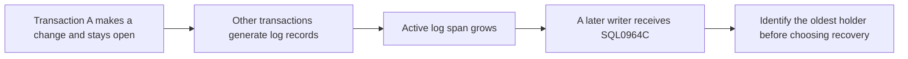

# Diagnose Db2 SQL0964C by Finding the Oldest Log-Holding Transaction

Author: [nawazdhandala](https://www.github.com/nawazdhandala)

Tags: Database, SQL, Troubleshooting

Description: Find the transaction retaining Db2 active log space, correlate its handle with connection and unit-of-work details, and plan recovery without guessing.

`SQL0964C` means Db2 cannot provide the active transaction-log space needed for the operation. The immediate temptation is to find the application that wrote the most data or increase the log allocation. Either can miss the transaction preventing older log space from being released.

A small transaction can make one change, remain open, and retain the active-log span while other applications generate much more log data. The application reporting the error may simply be the next writer that needed space.

This guide targets **Db2 for Linux, UNIX, and Windows 11.5**, not Db2 for z/OS. Its commands collect evidence; recovery choices depend on transaction ownership, application consistency, and the database's logging configuration.

## Understand what the oldest transaction holds

Active logging must retain information needed by unfinished work. The relevant span can include changes produced by other applications since the oldest unfinished transaction began. That is why sorting transactions by their own log-byte count is not sufficient to identify the holder.

IBM's [SQL0964C troubleshooting guide](https://www.ibm.com/docs/en/db2/11.5.x?topic=servers-troubleshooting-full-transaction-log-error) describes both large transactions and long-lived transactions as causes. Use the oldest-holder identity and its lifecycle as your starting point, then investigate the workload generating the pressure around it.



## Capture the member and diagnostic message

Keep the database name, timestamp, and member or partition associated with the failure. Look for `ADM1823E` in the administration notification log and `db2diag.log`. Its application handle is especially useful when captured at the time of the incident. IBM's [support note](https://www.ibm.com/support/pages/db2-how-solve-transaction-log-databases-full-sql0964c) shows the relationship between that message and the log-full error.

A handle is not a permanent application identity. Before acting on an older diagnostic message, verify that the current connection still represents the same work. In a multi-member system, preserve the member context instead of pasting a handle into an unrelated connection investigation.

Use an approved monitoring account with permission to execute the relevant routines. Do not assume every application user has those privileges. If SQL diagnostics cannot run, use the instance's approved `db2pd` diagnostic access as described below.

## Snapshot active-log use across members

Save this as `log-snapshot.sql`:

```sql
SELECT MEMBER, TOTAL_LOG_USED, TOTAL_LOG_AVAILABLE,
       CURRENT_ACTIVE_LOG, APPLID_HOLDING_OLDEST_XACT
FROM TABLE(SYSPROC.MON_GET_TRANSACTION_LOG(-2)) AS L
ORDER BY MEMBER;
```

Run it from a Db2 Command Line Processor session already connected to the affected database:

```bash
db2 -tvf log-snapshot.sql
```

The [CLP options](https://www.ibm.com/docs/en/db2/11.5.x?topic=clp-options) explain file execution and statement termination. The [MON_GET_TRANSACTION_LOG interface](https://www.ibm.com/docs/en/db2/11.1.0?topic=mpf-mon-get-transaction-log-table-function-get-log-information) documents the routine's member argument and returned columns; `-2` requests all active members. The interface is also used by IBM's 11.5 troubleshooting guidance.

Expect one row per member. `APPLID_HOLDING_OLDEST_XACT` is an application handle despite its name, while `CURRENT_ACTIVE_LOG` identifies the current active log file. Preserve each row rather than treating a cluster-wide sum as proof that every member has adequate space.

`TOTAL_LOG_USED` and `TOTAL_LOG_AVAILABLE` are byte values. IBM's [monitor-element reference](https://www.ibm.com/docs/en/db2/11.5.x?topic=reference-t) notes special handling when infinite logging is configured. Do not blindly convert a special availability value into a normal capacity percentage.

Take another timestamped snapshot after a short, meaningful interval. A persistent holder with increasing used space tells a different story from a holder that changes normally as transactions finish. Monitoring output is changing state, not a transactionally frozen incident report.

## Resolve the holder to its connection and work

Replace **both occurrences of 12345** below with the verified handle from the affected member's snapshot. Save the result as `holder.sql`:

```sql
SELECT MEMBER, APPLICATION_HANDLE, APPLICATION_ID,
       APPLICATION_NAME, CLIENT_WRKSTNNAME, CLIENT_USERID
FROM TABLE(SYSPROC.MON_GET_CONNECTION(BIGINT(12345), -2)) AS C
ORDER BY MEMBER;

SELECT MEMBER, APPLICATION_HANDLE, UOW_ID,
       UOW_START_TIME, UOW_LOG_SPACE_USED
FROM TABLE(SYSPROC.MON_GET_UNIT_OF_WORK(BIGINT(12345), -2)) AS U
ORDER BY MEMBER;
```

Execute it in the same connected database:

```bash
db2 -tvf holder.sql
```

The first query provides connection identity and client context using [MON_GET_CONNECTION](https://www.ibm.com/docs/en/db2/11.5.x?topic=routines-mon-get-connection-get-connection-metrics). The second uses [MON_GET_UNIT_OF_WORK](https://www.ibm.com/docs/en/db2/11.5.x?topic=mmr-mon-get-unit-work-get-unit-work-metrics) to examine the current unit of work, or transaction.

Compare the member, application ID, client identity, and unit-of-work start time with the incident. Client-supplied names help locate an owner but are not proof of business purpose. Confirm the transaction with the application team or job scheduler.

`UOW_LOG_SPACE_USED` measures the current unit of work's own log usage. Its value need not equal the active-log span it is retaining. The [unit-of-work monitor elements](https://www.ibm.com/docs/en/db2/11.5.x?topic=reference-u) define that distinction and the start-time field.

If no row appears, refresh the holder snapshot. The transaction may have ended, the connection may have disappeared, or the reported work may need a different diagnostic path. Do not choose another busy connection merely because the original handle no longer resolves.

## Corroborate with db2pd when needed

On the appropriate database host, using authorized diagnostic access:

```bash
db2pd -db SAMPLE -transactions -logs
```

Replace `SAMPLE` with the **database name**, which may differ from a client catalog alias. The [db2pd command reference](https://www.ibm.com/docs/en/db2/11.5.x?topic=commands-db2pd-monitor-troubleshoot-db2-engine-activities) makes that distinction.

Transaction output includes handles, first and last log sequence information, used log space, and reserved space. Log output provides current-file and archive-status context. IBM's [db2pd examples](https://www.ibm.com/docs/en/db2/11.5.x?topic=tools-db2pd) explain those fields. Match the same application and member; a large log-space value alone still does not establish oldest-holder status.

Check filesystem capacity and archive failures alongside transaction evidence. A log-space incident can have operational contributors beyond one long transaction. Preserve the diagnostics before making a configuration change that obscures the original conditions.

## Choose recovery with the transaction owner

If the owner can safely finish the transaction, it must commit or roll back through the session that owns that work. Issuing a commit in your separate monitoring connection does not complete another application's transaction.

Administrative termination is a business-impacting recovery action, not an automatic follow-up to finding a handle. Verify identity and intended outcome before using the organization's approved procedure. A large rollback can take time, and the log-full condition may remain while it progresses; IBM's troubleshooting guidance explicitly warns against expecting immediate recovery.

If the diagnostic message has no meaningful application handle, investigate an in-doubt transaction through the database's distributed-transaction recovery procedure. Do not substitute a force-all operation or manually delete active log files.

Additional log space may provide breathing room, but review disk capacity, archive behavior, recovery requirements, and the actual configuration before changing it. Retain the evidence that explains why the oldest work stayed open.

## Prevent the same retention pattern

Review transaction boundaries, idle sessions after writes, and unexpectedly long jobs. A sensible batch size is an application-consistency decision, not simply the largest transaction that fits today's log allocation.

Db2's [NUM_LOG_SPAN policy](https://www.ibm.com/docs/en/db2/11.5.x?topic=parameters-num-log-span-number-log-span) can limit a transaction's span but can disconnect and roll back work; test policy changes with the workload owner. [Advanced Log Space Management](https://www.ibm.com/docs/en/db2/11.5.x?topic=logging-advanced-log-space-management) is available from 11.5.4 and needs a release-aware assessment rather than a generic emergency toggle.

Recovery is demonstrated by restored log headroom and successful normal transactions, with the original holder resolved as intended. The SQL columns and routine parameters here were checked against IBM documentation, and shell syntax was checked. No Db2 server, SQL execution, forced application, rollback, or log-full reproduction was tested for this article.
