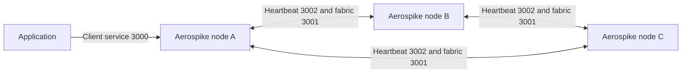

# Debug Aerospike Cluster Formation: Mesh, Heartbeats, and Firewalls

Author: [nawazdhandala](https://www.github.com/nawazdhandala)

Tags: Aerospike, Networking, Troubleshooting, Database

Description: Diagnose Aerospike nodes that stay separate by checking cluster names, mesh seed ports, interface binding, and bidirectional heartbeat and fabric connectivity.

Three Aerospike processes are running, but each reports a one-node cluster. A client can connect to port 3000 on every host. That proves the client service is reachable; it does not prove the database nodes can communicate with each other.

Troubleshoot cluster formation as a node-to-node problem. Establish which nodes are intended to join, compare their running configuration, then test the precise network paths used for membership and data movement. Change one cause at a time so a temporary improvement does not conceal the real fault.

## Separate the network roles

Aerospike uses different connections for different jobs. In the example here, client traffic uses port 3000, fabric traffic uses 3001, and mesh heartbeats use 3002. These are example configured ports, not values to assume in every deployment.

Fabric carries internal database communication, including replica writes and migrations. Heartbeats tell nodes which peers are present. Mesh heartbeat uses TCP point-to-point connections. A mesh seed is an initial discovery address; it is not a proxy that relays all later traffic. Aerospike's [network guide](https://aerospike.com/docs/database/manage/network/) explains these roles.



The diagram shows the required pairwise reachability, not a firewall command to apply. Your actual ports, interfaces, TLS settings, and allowed source addresses belong in an explicit connection matrix.

## Capture the state from every intended node

Before changing a live cluster, record the node names, IP addresses, server versions, expected cluster name, and current membership. Confirm that these nodes really should share data. Do not connect two existing production clusters merely because their names look similar.

With Aerospike tools installed and appropriate access, run these read-only commands against each node's client endpoint. Replace the example address:

```bash
asinfo -h 10.20.0.11 -p 3000 -v 'node'
asinfo -h 10.20.0.11 -p 3000 -v 'statistics' -l
asinfo -h 10.20.0.11 -p 3000 -v 'get-config:context=service' -l
asinfo -h 10.20.0.11 -p 3000 -v 'get-config:context=network' -l
```

Add your approved authentication and TLS options when required. Save each node's output with its name and timestamp. Compare node identity, cluster membership statistics, cluster name, heartbeat mode, seed entries, and network bindings. The [info-command reference](https://aerospike.com/docs/database/reference/info/) documents these inspection commands.

Inspect the running configuration as well as the file on disk. A changed file may not have been loaded, and a runtime change may not survive a restart. Confirm which configuration path the service actually uses. Review startup logs for rejected configuration, failed binding, incompatible peers, or feature restrictions before investigating packet loss.

## Check cluster names before chasing timeouts

All intended members must use the same `cluster-name`. It is mandatory in Aerospike Database 7.0 and later, and a node cannot join a differently named cluster. See the [configuration reference](https://aerospike.com/docs/database/reference/config/#cluster-name).

Compare the exact values, including accidental environment suffixes. A restored configuration that still says `payments-staging` will not join `payments-production`. Do not change a name merely to suppress a mismatch message: first verify node ownership, namespace configuration, edition, and the intended data topology.

Also confirm that your image or feature key permits the planned deployment. A single-node evaluation entitlement is not evidence that a multi-node installation is supported. Keep version and edition checks separate from network troubleshooting so a successful TCP connection is not mistaken for compatibility.

## Compare mesh seeds and interface binding

This **Aerospike Database 8.2.0.1** fragment illustrates node A on an existing three-node lab network. Replace the addresses with interfaces actually assigned to your nodes. Merge the settings into the appropriate contexts of your complete configuration; this fragment omits namespaces, logging, storage, and security.

```text
service {
    cluster-name mesh-rehearsal
}
network {
    service {
        address 10.20.0.11
        port 3000
    }
    fabric {
        address 10.20.0.11
        port 3001
    }
    heartbeat {
        mode mesh
        port 3002
        mesh-seed-address-port 10.20.0.11 3002
        mesh-seed-address-port 10.20.0.12 3002
        mesh-seed-address-port 10.20.0.13 3002
        interval 150
        timeout 10
    }
}
```

For node B and node C, change the local service and fabric addresses to their own addresses. Keep the intended cluster name and seed list consistent. The seed port is the peer's **heartbeat** port, not its client service port.

In Database 8.1 and later, an omitted heartbeat address inherits the fabric address. Older versions do not have that behavior; explicitly set the heartbeat address to the intended interface when following the older-version guidance. The [heartbeat configuration guide](https://aerospike.com/docs/database/manage/network/heartbeat/) explains this version boundary and recommends keeping heartbeat and fabric on the same network interface.

For Docker, use addresses reachable between database containers. Publishing client port 3000 on the host does not establish heartbeat or fabric reachability between separate hosts. For hosts with several network interfaces, compare the selected address with routing and firewall rules on that interface.

## Test every direction, not just the seed

Build a matrix with each node as a source and every other node as a destination. Test both heartbeat and fabric ports. A successful connection from an administrator's laptop cannot substitute for this matrix.

The following Python 3.13 example makes a TCP connection and immediately closes it. Save it as `check-peer-ports.py`, replace the destinations, and run it from each database node's network environment. It performs no database command or configuration change, though connection attempts may appear in server logs.

```python
import socket


def reachable(host, port):
    try:
        with socket.create_connection((host, port), timeout=2):
            return "TCP connected"
    except OSError as error:
        return f"FAILED: {type(error).__name__}"


if __name__ == "__main__":
    peers = ["10.20.0.11", "10.20.0.12", "10.20.0.13"]
    for peer in peers:
        for port in (3001, 3002):
            print(f"{peer}:{port} {reachable(peer, port)}")
```

Python documents connection and timeout behavior in [socket.create_connection](https://docs.python.org/3.13/library/socket.html#socket.create_connection). This probe establishes only TCP reachability. It does not validate the Aerospike protocol, TLS trust, membership, or healthy fabric traffic. A DNS lookup can also take longer than the socket timeout; the sample uses numeric addresses to keep that distinction visible.

A refusal often means no listener or an active rejection. A timeout calls for checking routes and filtering, but does not identify a particular firewall by itself. Compare both ends' logs and network observations. Permit only the intended peer sources and configured ports, following your network change process; do not disable the firewall globally.

## Interpret the result before changing timers

| Observation | Next investigation |
| --- | --- |
| Client service works, heartbeat connections fail | Heartbeat bind address, mesh port, routing, and peer rules |
| Heartbeat connects, fabric fails | Fabric interface and port reachability |
| TCP works everywhere, nodes remain separate | Cluster name, loaded configuration, compatibility, TLS, and startup logs |
| Membership repeatedly grows and shrinks | Packet loss, host pauses, resource pressure, and heartbeat logs |
| Cluster forms but application cannot reach peers | Client-advertised addresses, a separate discovery problem |

The example heartbeat interval and timeout correspond to a nominal missing-peer detection window of 1.5 seconds. They are not a guarantee about application recovery time. Increasing the timeout can make membership appear calmer while delaying detection of real failures. Establish why heartbeats are missing before changing detection policy.

## Finish with a stable membership check

After the approved correction, inspect all nodes again. They should agree on the intended membership, and that membership should remain stable beyond the immediate startup period. Check migration progress and namespace health separately; joining a cluster does not mean data movement has finished.

For a disposable staging cluster, rehearse one controlled node restart and confirm it rejoins through the retained seed configuration. For production, use the maintenance procedure appropriate to your consistency mode and capacity. Do not use roster changes, forced recovery, or data deletion as a generic cluster-formation fix.

Keep the before-and-after configuration, per-node observations, and connection matrix with the incident record. That evidence distinguishes a durable repair from a cluster that happened to form after a restart.
