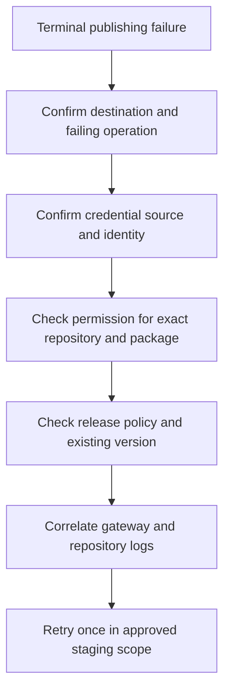

# Debug Artifact Publishing 401 and 403 Errors Across Package Tools

Author: [nawazdhandala](https://www.github.com/nawazdhandala)

Tags: Artifact Management, Security, Maven, npm, Docker

Description: Diagnose publishing authentication and permission failures by checking endpoints, credential selection, package ownership, and repository policy.

An install succeeds, but publishing fails with 403. A developer can upload locally, but the same release job receives 401. These symptoms do not automatically mean the password is wrong. The client may select different credentials, target a read-only endpoint, or request a permission the identity does not have.

Start with the actual failing request and work outward. Preserve the artifact you intended to publish; do not rebuild it repeatedly while changing authentication settings.

One terminology correction helps: **pip installs Python packages; it does not publish them**. Python uploads commonly use Twine or another publishing client. A pip download credential and a Twine upload credential can be configured independently.

## Interpret the status in context

[HTTP semantics](https://www.rfc-editor.org/rfc/rfc9110.html) distinguish an authentication challenge, normally 401, from a request the server refuses, 403. But gateways, repository products, and policies can affect the response you observe. A status code is a clue, not a complete diagnosis.

For Docker registries, an initial 401 can be part of the normal [Bearer-token exchange](https://docs.docker.com/reference/api/registry/auth/). The client receives a challenge, obtains a token, and retries. Diagnose a terminal failure or repeated challenge loop rather than treating every 401 in a proxy log as an incident.

Record the time, client version, destination host, repository, HTTP method, artifact coordinate, and request or correlation ID. Keep tokens, passwords, cookies, and signed URLs out of the report.



## Confirm the write endpoint first

A URL that supports downloads is not necessarily the upload endpoint. Group, virtual, and proxy repositories may route writes differently or reject them. Check the repository product's documented deployment target rather than deriving it from a working download URL.

| Client | Inspect first | Common mismatch |
|---|---|---|
| Maven | Distribution management and matching server ID | Download mirror credentials selected for an unrelated deployment ID |
| npm | Registry, scope, and `publishConfig` | Token scoped to a different repository path |
| Twine | Upload repository selection | Using a pip `/simple/` index endpoint for uploads |
| Docker | Registry authority and full image repository | Login succeeds but the requested repository is outside token scope |

A reverse proxy adds another boundary. Confirm that the request reaches the intended service and that its method and authorization information are handled correctly. An HTML login page or gateway-branded error can indicate failure before the repository receives the request.

## Maven: match the deployment ID to the credential entry

The [Maven Deploy Plugin documentation](https://maven.apache.org/plugins/maven-deploy-plugin/usage.html) explains that repository IDs in `distributionManagement` select matching server entries in `settings.xml`. A mirror used to resolve dependencies does not replace that deployment configuration.

For example, this POM fragment identifies the release destination:

```xml
<distributionManagement>
  <repository>
    <id>internal-releases</id>
    <url>https://packages.example.internal/repository/maven-releases/</url>
  </repository>
</distributionManagement>
```

The protected settings file must contain a server entry with the exact ID `internal-releases`. Supply credentials through your approved mechanism. Check which settings file the CI job actually uses and whether a command-line alternate deployment repository changes the selected ID or URL.

Also distinguish snapshots from releases. A valid identity can be denied when the version belongs in a different repository or when an existing release cannot be redeployed. Confirm the repository's policy before changing permissions.

## npm: inspect host and path scoping

npm requires authentication settings to be scoped to a registry. Its [.npmrc documentation](https://docs.npmjs.com/cli/v11/configuring-npm/npmrc/) describes host and path scoping and environment-variable substitution.

For npm 11, an illustrative configuration is:

```ini
@acme:registry=https://packages.example.internal/repository/npm-private/
//packages.example.internal/repository/npm-private/:_authToken=${NPM_TOKEN}
```

Replace the scope and endpoint; inject `NPM_TOKEN` through the CI secret system without printing it. This syntax assumes the repository accepts npm Bearer-token authentication. Follow the vendor's configuration if it expects a different supported mechanism.

Check whether the package's [`publishConfig`](https://docs.npmjs.com/cli/v11/configuring-npm/package-json/#publishconfig) selects another registry during publication. Compare project, user, global, and environment configuration in the failing execution context. A successful browser login does not show what the command-line client sends.

Once authentication is established, verify permission to publish the exact package or scope. A token with read access can install dependencies while correctly being denied publication. Check required policy controls and existing-version restrictions without granting broad administrator rights as a diagnostic shortcut.

## Python: inspect the upload client separately

[Twine](https://twine.readthedocs.io/en/stable/) uploads already-built distributions. Its repository selection can come from command options, environment settings, or a [`.pypirc` configuration](https://packaging.python.org/en/latest/specifications/pypirc/). These are not the same settings as pip's package index configuration.

Confirm the upload URL supplied by your repository administrator. The `/simple/` endpoint used for Python package discovery is not a universal upload endpoint. Check the authentication mechanism supported by that server; do not assume a PyPI-specific token convention applies to every internal repository.

Inspect whether the failure concerns identity, project ownership, a version that already exists, or a disallowed distribution. Keep the built wheel and source archive unchanged while diagnosing. A fresh package build introduces another variable and can overwrite useful evidence about the failed attempt.

## Docker: distinguish login from repository authorization

Docker's [login documentation](https://docs.docker.com/reference/cli/docker/login/) describes credential stores and helpers. CI may use a different Docker configuration or lack the helper available on a developer workstation. Check the registry host and port, the execution user, and the configured credential source without dumping the credential file.

A login success does not grant every repository action. Compare the full image path with the repository scope in the authentication exchange. A principal allowed to pull one project may not push to another, and blob uploads and final manifest publication can fail at different stages.

A read-only, unauthenticated challenge inspection can help locate the endpoint. With curl 8.7.1, set `REGISTRY_ORIGIN` to the approved HTTPS origin, without a trailing slash, and run in a private diagnostic directory:

```bash
set -euo pipefail
: "${REGISTRY_ORIGIN:?Set the approved HTTPS registry origin}"
umask 077
curl -q --silent --show-error \
  --connect-timeout 10 --max-time 30 \
  --dump-header registry-headers.txt \
  --output registry-response.txt \
  --write-out 'HTTP %{http_code}\n' \
  "$REGISTRY_ORIGIN/v2/"
```

Here `-q` disables the default curl configuration, so the probe does not inherit stored curl credentials. The command intentionally keeps HTTP error responses for inspection and does not follow redirects. A returned 401 is expected for many private registries; a 200 also does not prove push access. Review any challenge realm before investigating it further, and redact response data before sharing. These options are documented in the [curl manual](https://curl.se/docs/manpage.html).

## Verify the narrow fix

Correlate client timing with gateway and repository logs. Confirm which identity was recognized and the exact policy that denied the operation. If evidence shows an expired credential, replace it through the normal secret-management flow; if it shows insufficient scope, grant only the intended publication permission.

Use an approved staging repository and a unique disposable version for the final write test. Do not keep retrying a production release or delete an existing version to make a test succeed. Record the correction and verify normal CI publication with the unchanged approved artifact.

The local checks covered XML syntax and the curl probe against temporary HTTP fixtures returning 200, 401, and 403. No real publication, credential exchange, Maven deployment, npm upload, Twine upload, or Docker push was performed.
