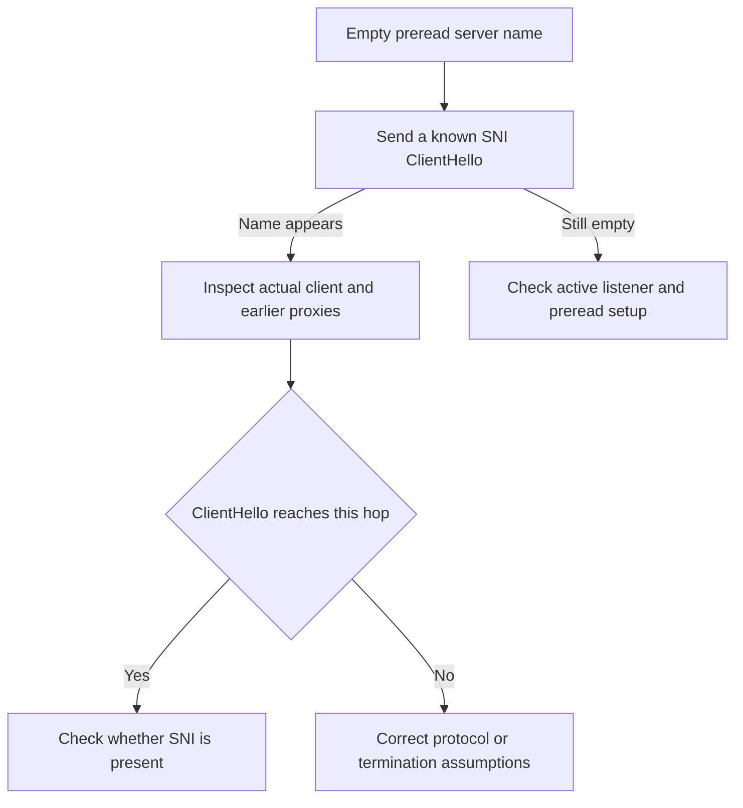

# Debug Empty ssl_preread_server_name in NGINX Stream Routing

Author: [nawazdhandala](https://www.github.com/nawazdhandala)

Tags: Nginx, TLS, Troubleshooting

Description: Diagnose empty NGINX preread SNI values by comparing known ClientHello inputs, stream logs, listener configuration, and the actual traffic path.

A stream-routing map keeps selecting its default backend because `$ssl_preread_server_name` is empty. Changing the map's hostname entries will not help until you know why NGINX did not extract a name.

The empty value has several possible explanations: the client omitted SNI, the connection is not TLS, an earlier proxy terminated TLS, or the expected preread configuration is not active. Start by proving what bytes reach the listener and what NGINX can extract from a known test handshake.

This guide uses NGINX 1.30.7. A local fixture compared a ClientHello with SNI, one without SNI, and a plaintext HTTP request. It tested preread parsing and logs, not completion of a TLS handshake.

## Understand what the variable contains

Server Name Indication, or SNI, is a TLS extension carrying the server name requested by the client. It is separate from the destination IP address and from an HTTP Host header sent later. [RFC 6066](https://www.rfc-editor.org/rfc/rfc6066.html#section-3) defines the server-name extension and its hostname form.

The stream preread module extracts information from ClientHello without decrypting application traffic. Its server-name variable is not populated by reverse DNS, the upstream name, or an encrypted HTTP header. The [module reference](https://nginx.org/en/docs/stream/ngx_stream_ssl_preread_module.html) lists the available SNI, ALPN, and protocol variables.



Do not use SNI as an authenticated identity. It is routing information supplied before the backend completes its TLS authentication.

## Observe several fields together

Add a temporary diagnostic format inside the top-level `stream` block. Choose a writable log path and keep access restricted because hostnames and client addresses can reveal internal service usage.

```nginx
log_format preread_diag escape=json
    '{"client":"$remote_addr",'
    '"sni":"$ssl_preread_server_name",'
    '"tls_offer":"$ssl_preread_protocol",'
    '"alpn":"$ssl_preread_alpn_protocols",'
    '"upstream":"$upstream_addr",'
    '"status":"$status"}';

access_log /var/log/nginx/preread-diagnostic.log preread_diag;
```

JSON escaping keeps unusual values from breaking the log structure. Stream access logs describe sessions, so close the test connection before expecting its final record. The [stream log module](https://nginx.org/en/docs/stream/ngx_stream_log_module.html) documents the format and logging behavior.

The protocol variable reports the highest TLS version supported in the parsed client offer. It is not the final negotiated version. A nonempty TLS offer with an empty name suggests a different situation from all preread fields being empty. Neither observation alone proves why the real client's request failed.

Also inspect the error log for parsing, timeout, or buffer problems. A stream status of 200 is not an HTTP response code and does not prove the backend completed a successful TLS application session.

## Confirm the listener actually performs preread

Inspect the deployed build and effective configuration:

```bash
nginx -V
nginx -T
```

The first reports build options; the second tests and prints the configuration. Run them in the same deployment context as the service, with its configuration path and prefix if nondefault. Treat the printed configuration as sensitive and do not paste it into a public issue. The options are documented in [NGINX's command-line reference](https://nginx.org/en/docs/switches.html).

Check that the relevant stream listener has `ssl_preread on`. Confirm stream and preread module support, including packaged dynamic-module loading where applicable. For TLS passthrough, the listener should not terminate TLS with `listen ... ssl`.

Trace the address and port through load balancers and port mappings. A successful connection to some NGINX listener does not prove that the edited server block handled it. Record the local listener, the selected upstream, and the connection path used by the test client.

## Compare an explicit SNI offer with an absent one

Use an authorized staging endpoint with a known certificate and trust root. This command explicitly sends SNI while also verifying the backend's hostname:

```bash
openssl s_client -connect 127.0.0.1:9443 \
  -servername api.internal.example \
  -verify_hostname api.internal.example -verify_return_error \
  -CAfile /path/to/test-root.pem </dev/null
```

Replace the port, hostname, and CA path. The name should appear in the preread log even though the TCP destination is an IP address. Keep certificate verification enabled when assessing the full connection.

For the comparison, replace `-servername api.internal.example` with `-noservername`, retaining the verification options. That asks OpenSSL to omit SNI while still checking the expected certificate identity. The connection might fail if your default route rejects nameless clients, which is useful evidence about policy rather than proof that parsing is broken. Both options are described in [OpenSSL s_client](https://docs.openssl.org/3.6/man1/openssl-s_client/).

Do not infer client behavior from the URL alone. Tools differ in how they populate SNI, especially when connecting to literal IP addresses. An explicit test removes that ambiguity.

## Interpret the controlled results

The local fixture sent three inputs through the same NGINX 1.30.7 stream listener to a disposable byte sink:

| Input | SNI log field | TLS offer field |
| --- | --- | --- |
| ClientHello naming `api.internal.example` | That hostname | TLSv1.3 |
| ClientHello without server_name | Empty | TLSv1.3 |
| Plain HTTP with a Host header | Empty | Empty |

The plaintext Host header did not populate the SNI variable. The sink intentionally stopped after receiving bytes, so these results establish extraction behavior only. They do not show backend certificate verification or successful HTTP handling.

This gives a useful troubleshooting split. If the explicit SNI test works, compare the actual client's ClientHello and any earlier proxy's behavior. If it fails too, investigate the listener and preread path before changing individual map rules.

## Check protocol boundaries and resource limits

A TLS-terminating load balancer may forward plaintext HTTP to this hop. A protocol that upgrades to TLS only after an initial plaintext exchange is also different from immediate TLS. NGINX cannot extract a ClientHello that has not arrived at the preread stage.

If a trusted upstream sends the PROXY protocol before TLS, configure the listener consistently with that wire format. Do not enable PROXY protocol indiscriminately on a public listener: receiving and trusting metadata is a separate deployment decision.

For large or slow handshakes, inspect evidence before increasing limits. The [stream core documentation](https://nginx.org/en/docs/stream/ngx_stream_core_module.html#preread_buffer_size) defines preread buffer size and timeout. Raising them without understanding the input can increase per-connection resource use while leaving a protocol mismatch untouched.

The local test did not cover encrypted ClientHello, PROXY protocol, TLS termination at an earlier hop, or fragmented and oversized messages. Assess those features against the exact clients and proxy builds you operate. Finish by documenting the intentional default route for missing or unknown names; an empty SNI value should trigger a deliberate policy, not an unexplained backend choice.
