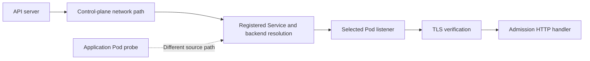

# Debug Failed Webhook Calls Through Endpoints, Routing, and Timeouts

Author: [nawazdhandala](https://www.github.com/nawazdhandala)

Tags: Kubernetes, Networking, Troubleshooting

Description: Locate failed webhook calls across Service selection, backend ports, NetworkPolicy, control-plane routing, TLS, and handler latency using scoped diagnostic checks.

`failed calling webhook` describes a failed admission dependency, not one specific network fault. The API server might have no eligible backend, reach the wrong port, fail a TLS handshake, or wait too long for a handler that did receive the request.

Start by retaining the complete error, including the webhook name, destination, and nested cause. A generic deadline message needs more evidence than a precise certificate or connection-refused error.

This walkthrough uses Kubernetes **v1.35.0 API shapes** as its example. The checks are diagnostic; they do not remove policies, change admission failure behavior, or require interrupting production workloads.

## Trace the path from the caller

The caller is the API server. It is not your laptop, an application Pod, or the node running the webhook.



This diagram groups the boundaries to inspect. Actual Service resolution and traffic forwarding depend on the control-plane and cluster network implementation.

Use the nested error to prioritize:

| Evidence | First investigation |
|---|---|
| No endpoints available | Service selection and backend readiness |
| Connection refused | Destination port, listener, or an explicit network rejection |
| Dial timeout | Routing, dropped traffic, firewall or policy enforcement |
| X.509 verification error | Served certificate identity and configured CA trust |
| Request received, response late | Handler latency, resource pressure, downstream calls |
| Only some requests fail | Replica, node, zone, or rollout differences |

These are hypotheses, not proofs. A deadline can cover more than one stage, and one successful backend does not clear the others. The cert-manager project's [webhook debugging guide](https://cert-manager.io/docs/troubleshooting/webhook/) illustrates why similar-looking errors require different network evidence.

## Confirm the registration and Service agree

Replace the example names with the failing webhook's actual resources:

```bash
kubectl get mutatingwebhookconfiguration platform-hooks -o yaml
kubectl -n platform-system get service injector -o yaml
kubectl -n platform-system get endpointslices \
  -l kubernetes.io/service-name=injector -o yaml
kubectl -n platform-system get pods -o wide --show-labels
```

Find the named entry in `webhooks`, then compare its `clientConfig.service` namespace, name, port, and path with the Service and server. Inspect the matching backend Pods rather than assuming every Pod in the namespace belongs to that Service.

For example, this Service maps client port 443 to the selected Pods' named port `https`:

```yaml
apiVersion: v1
kind: Service
metadata:
  name: injector
  namespace: platform-system
spec:
  selector:
    app.kubernetes.io/name: injector
  ports:
    - name: https
      port: 443
      targetPort: https
      protocol: TCP
```

This is a reference example, not a replacement manifest to apply during diagnosis. If the selected Pod declares `name: https` with `containerPort: 9443`, the application must actually listen on 9443. A container-port declaration does not start a listener. Likewise, the Service selector must match the Pod labels, not just labels on the Deployment object. See [Service port mapping](https://kubernetes.io/docs/concepts/services-networking/service/#defining-a-service).

Review the EndpointSlice ports, addresses, target references, and conditions. Empty slices suggest missing selected backends; unexpected addresses suggest a selection problem. Multiple slices can exist, so inspect all returned items. Kubernetes' [Service debugging guide](https://kubernetes.io/docs/tasks/debug/debug-application/debug-service/) walks through selector and target-port checks.

Readiness needs context. EndpointSlices expose `ready`, `serving`, and `terminating`; `publishNotReadyAddresses` changes the meaning of the ready flag. A nominally ready endpoint is not proof that its admission route and certificate are working. See [EndpointSlice conditions](https://kubernetes.io/docs/concepts/services-networking/endpoint-slices/#conditions).

## Test one boundary without claiming the whole path works

If an approved diagnostic environment already has Python 3.11, save this as `tcp_probe.py`. Run it from a location whose network identity you can describe. It opens and closes a TCP connection without submitting an admission request.

```python
import socket
import sys

if len(sys.argv) != 3:
    raise SystemExit("Usage: python3 tcp_probe.py HOST PORT")
host = sys.argv[1]
port = int(sys.argv[2])
try:
    with socket.create_connection((host, port), timeout=3):
        print("TCP connected; TLS and admission behavior were not tested")
except OSError as error:
    print(f"TCP probe failed: {type(error).__name__}: {error}", file=sys.stderr)
    raise SystemExit(1)
```

From an approved in-cluster diagnostic shell, an example invocation is:

```bash
python3 tcp_probe.py injector.platform-system.svc 443
```

A success establishes connectivity from **that source** to the selected destination at that moment. The Python [socket documentation](https://docs.python.org/3.11/library/socket.html#socket.create_connection) describes the connection helper. Its socket timeout is not a strict total deadline for DNS resolution and all possible address attempts.

If you have an approved route to individual backend addresses, repeat against each EndpointSlice address and its backend port. This can distinguish a Service-path issue from a particular listener failure. Record the source location and destination with each result.

A successful port-forward or application-Pod probe does not reproduce the API server's path. Use it to narrow the investigation, then confirm recovery through a scoped API request that actually triggers admission.

## Inspect NetworkPolicy and infrastructure rules separately

Read the policies selecting the webhook Pods:

```bash
kubectl -n platform-system get networkpolicy -o yaml
```

Check whether ingress isolation applies and whether permitted sources include the API-server traffic as your network implementation presents it. A rule allowing application Pods by namespace label does not necessarily allow a managed control plane.

NetworkPolicy enforcement depends on the installed network plugin. Address translation can change which source or destination an IP-based policy sees, and Kubernetes does not define one universal ordering between translation and policy processing. Consult the provider and plugin behavior before writing an `ipBlock` exception. See [NetworkPolicy traffic behavior](https://kubernetes.io/docs/concepts/services-networking/network-policies/).

Also inspect cloud firewall rules, security groups, routing, and any control-plane connectivity agent. These are separate controls; a permissive Kubernetes policy cannot override an infrastructure firewall drop.

One concrete example is GKE's documented control-plane firewall behavior: permitted ports concern the destination node or Pod port. A Service on 443 that forwards to a listener on 9443 can still require a rule allowing 9443 from the control plane. This is a GKE-specific example, not a portable instruction to open that port everywhere. See [GKE network isolation troubleshooting](https://docs.cloud.google.com/kubernetes-engine/docs/troubleshooting/network-isolation).

Change only the verified source, destination, and port relationship through the network owner. Avoid deleting all policies or exposing the webhook publicly as a diagnostic shortcut.

## Separate TLS failures from handler timeouts

Once connectivity is established, check the certificate actually served by every replica against the registration's CA bundle and Service DNS identity. A healthy TCP probe does not verify TLS, and an updated certificate Secret does not prove the server reloaded it.

If the handler receives the admission request, correlate its request UID with start time, response time, status, and patch outcome. Investigate slow DNS or network calls made by the handler, exhausted worker pools, CPU throttling, and synchronous dependencies on other services. Keep complete resource payloads and credentials out of routine diagnostic logs.

Kubernetes allows `timeoutSeconds` from 1 through 30, with a default of 10. Increasing it cannot fix an unreachable port and may make API operations wait longer during an outage. The [webhook timeout documentation](https://kubernetes.io/docs/reference/access-authn-authz/extensible-admission-controllers/#timeouts) describes how timeout failures interact with `failurePolicy`.

## Verify recovery from the API-server side

After the specific fix, use a representative canary request in the intended webhook scope. A server-side dry run is useful when the webhook accurately supports it; confirm the request reaches the handler and returns the intended decision without persisting the workload.

Repeat enough to cover all replicas, and review error and latency signals over the same window. If failures correlate with one node or zone, retain that placement evidence rather than declaring success after one passing call.

The recovery record should state which boundary failed and what proved it repaired: corrected Service selection, a working backend listener, an observed control-plane route, verified TLS, or a timely handler response. That evidence is more useful than a blanket restart and makes the next incident substantially easier to diagnose.
