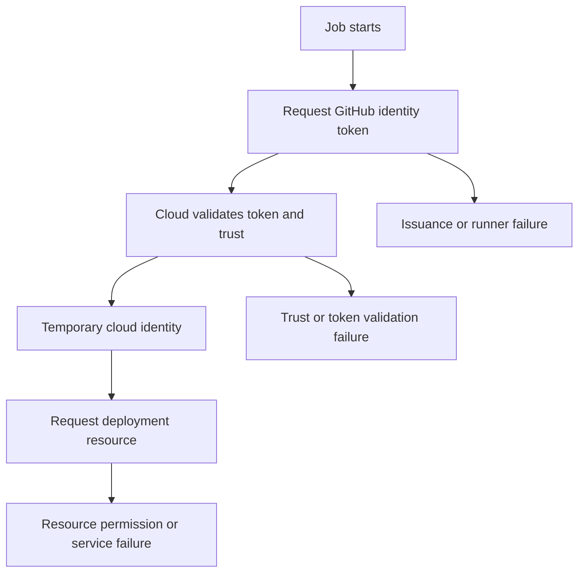

# Debug GitHub OIDC Cloud Login: Audience, Subject, and Workflow Claims

Author: [nawazdhandala](https://www.github.com/nawazdhandala)

Tags: GitHub Action, OIDC, Troubleshooting

Description: Diagnose GitHub OIDC login failures by inspecting selected claims safely and comparing audience, subject, environment, and reusable-workflow trust rules.

A deployment worked yesterday, then stopped authenticating after someone added a GitHub environment or moved the deployment into a reusable workflow. The cloud role still exists. Its resource permissions have not changed. Why does login fail?

Often the job is presenting a different identity from the one the cloud trusts. OpenID Connect (OIDC) sends identity information as claims inside a signed JSON Web Token (JWT). Before broadening permissions, compare the actual job's claims with the exact cloud trust configuration.

This procedure separates token issuance, token exchange, and resource authorization. It targets GitHub.com; enterprise installations can have different issuer and subject behavior.

## Locate the failing boundary

Keep the run URL, job name, attempt number, workflow commit, action version, cloud target identity, error code, and provider request ID. A timestamp without the run attempt can lead you to compare two different executions.



If the job never starts because environment approval is pending, there is no cloud login attempt yet. If token exchange succeeds but a resource operation returns a permission error, changing the subject rule is unlikely to help.

For AWS, distinguish errors from `AssumeRoleWithWebIdentity` from errors issued by the deployment API. STS documents expired tokens, invalid identity tokens, and identity-provider communication errors separately. Treat an error category as a starting point, not proof of one specific cause. [AWS STS error reference](https://docs.aws.amazon.com/STS/latest/APIReference/API_AssumeRoleWithWebIdentity.html).

## Inspect the failing job, not a different diagnostic job

Put a temporary diagnostic step immediately before login in the same job. Keep its trigger, environment, reusable-workflow context, and requested audience unchanged. A standalone workflow on `main` may produce different claims from the failing pull-request job.

The job needs `id-token: write`. Reusable workflows cannot repair permissions that the caller has withheld. GitHub exposes a token-request URL and bearer credential to an authorized runner; the following script uses those environment variables without putting either credential in command-line arguments. [GitHub's token-request interface](https://docs.github.com/en/actions/reference/security/oidc#methods-for-requesting-the-oidc-token).

Save this as `inspect_oidc_claims.py` in a reviewed checkout. It uses Python 3.11's standard library. It prints only selected claim fields, never the encoded token, request credential, or full HTTP response. It refuses redirects so the request credential is not forwarded to a new URL.

```python
import base64
import json
import os
import urllib.parse
import urllib.request

FIELDS = (
    'iss', 'aud', 'sub', 'repository_id', 'repository_owner_id',
    'ref', 'environment', 'event_name', 'job_workflow_ref',
    'job_workflow_sha', 'iat', 'nbf', 'exp',
)

class NoRedirect(urllib.request.HTTPRedirectHandler):
    def redirect_request(self, req, fp, code, msg, headers, newurl):
        return None

def request_url(url, audience):
    parts = urllib.parse.urlsplit(url)
    if parts.scheme != 'https' or not parts.hostname or parts.username:
        raise ValueError('Expected the runner-provided HTTPS endpoint')
    if not audience:
        raise ValueError('Set the audience used by the failing login action')
    query = [(k, v) for k, v in urllib.parse.parse_qsl(
        parts.query, keep_blank_values=True) if k != 'audience']
    query.append(('audience', audience))
    return urllib.parse.urlunsplit(parts._replace(
        query=urllib.parse.urlencode(query)))

def selected_claims(token):
    parts = token.split('.')
    if len(parts) != 3:
        raise ValueError('Expected a three-part JWT')
    payload = parts[1] + '=' * (-len(parts[1]) % 4)
    claims = json.loads(base64.urlsafe_b64decode(payload))
    if not isinstance(claims, dict):
        raise ValueError('Expected a JSON claims object')
    return {key: claims[key] for key in FIELDS if key in claims}

def main():
    url = request_url(os.environ['ACTIONS_ID_TOKEN_REQUEST_URL'],
                      os.environ['OIDC_AUDIENCE'])
    request = urllib.request.Request(url, headers={
        'Authorization': 'bearer ' + os.environ['ACTIONS_ID_TOKEN_REQUEST_TOKEN']
    })
    opener = urllib.request.build_opener(NoRedirect())
    with opener.open(request, timeout=15) as response:
        token = json.load(response)['value']
    print(json.dumps(selected_claims(token), indent=2))

if __name__ == '__main__':
    try:
        main()
    except Exception:
        raise SystemExit('Claim inspection failed; token and response withheld')
```

The script uses Python's documented [HTTPS request handlers](https://docs.python.org/3.11/library/urllib.request.html) and [URL-safe Base64 decoding](https://docs.python.org/3.11/library/base64.html). Decoding is **not signature verification**. These fields are troubleshooting evidence; only the cloud's verification establishes whether the token is acceptable.

After a trusted checkout, add this step to the existing job. It illustrates the AWS commercial-cloud audience; use the failing action's actual audience for another provider.

```yaml
- name: Inspect selected OIDC claims
  env:
    OIDC_AUDIENCE: sts.amazonaws.com
  run: python3 inspect_oidc_claims.py
```

Expect a JSON object containing `iss`, `aud`, `sub`, and whichever optional fields are present. An absent `environment` is useful evidence. Do not paste the JWT into a public decoder, enable shell tracing around token requests, or upload raw responses as artifacts. Selected fields can still reveal internal repository names; keep diagnostic logs within the intended audience and remove the step after investigation.

## Compare audience and target identity

The audience says who should receive the token. It is not the repository identity. Match the audience actually requested by the login action to what the target provider accepts:

| Login path | Typical public-cloud audience | Also verify |
|---|---|---|
| AWS credentials action | `sts.amazonaws.com` | Role account, provider registration, role trust |
| Azure login | `api://AzureADTokenExchange` | Tenant, application client ID, federated credential |
| Google auth action | Its full workload identity provider identifier by default | Project number, pool, provider, impersonated service account |

Check the action's explicit `audience` input before assuming its default. Audience defaults come from the provider actions, not one universal GitHub setting. See the pinned examples in [AWS credentials 5.1.0](https://github.com/aws-actions/configure-aws-credentials/tree/v5.1.0), [Azure login 2.3.0](https://github.com/Azure/login/tree/v2.3.0), and [Google auth 3.0.0](https://github.com/google-github-actions/auth/tree/v3.0.0).

A correct subject in the wrong Azure application or AWS account is still the wrong trust record. Compare full identifiers before editing a policy with a similar display name.

## Explain why the subject changed

Read `sub` as an exact string, including case and escaped punctuation. In the traditional default format, adding `environment: production` changes a branch-shaped subject into an environment-shaped one. A pull-request job without an environment has a different subject again. Environment names containing a colon use `%3A` in that portion of the subject. [GitHub's subject examples](https://docs.github.com/en/actions/reference/security/oidc#example-subject-claims) document the precedence.

For example, an old trust rule for `repo:example/payments:ref:refs/heads/main` does not match `repo:example/payments:environment:production`. If the environment-based identity is intended, update its exact trust and enforce release-branch restrictions through the environment. Do not fix it by trusting every subject in the repository.

Also check repository history. GitHub's immutable subject rollout includes owner and repository IDs for newer repositories and certain rename or transfer events. An apparently unchanged branch can therefore present a different prefix. Microsoft's [immutable-subject migration guide](https://learn.microsoft.com/en-us/entra/workload-id/workload-identities-github-immutable-subjects) explains the resulting federated-credential migration. Match the observed configured format; do not manufacture a subject from a remembered example.

An organization subject template adds another possibility. Confirm that the repository opted into the expected template and that the cloud policy expects the entire resulting subject. Changing only one side creates a predictable outage.

## Separate the caller from the reusable workflow

A reusable deployment workflow introduces two identities worth inspecting. The ordinary repository and ref claims describe the caller. `job_workflow_ref` identifies the called workflow; `job_workflow_sha` records its commit when supplied. A workflow referenced by a branch and one pinned to a commit can therefore differ from the trust rule you copied.

Do not replace the caller repository with the central automation repository everywhere. Decide whether trust should constrain the caller, the called workflow, or both. Clouds differ in which claims their trust mechanisms can evaluate. For mechanisms limited to audience and subject, GitHub supports composing relevant claims into a customized subject; that requires coordinating GitHub configuration with cloud trust. [GitHub's reusable-workflow OIDC guide](https://docs.github.com/en/actions/how-tos/secure-your-work/security-harden-deployments/oidc-with-reusable-workflows).

Inspect claims inside the called job. A diagnostic step in a separate caller job cannot demonstrate that the called job received the intended identity.

## Repair narrowly and verify both acceptance and rejection

Save the previous trust record, then change one mismatch at a time. Request a fresh token on each retry. Do not reuse an expired token to evaluate a corrected policy.

Azure federated-credential changes can take time to propagate; a short bounded retry after a verified update is reasonable, but repeated failures with a mismatched subject are not a propagation problem. [Microsoft's federation considerations](https://learn.microsoft.com/en-us/entra/workload-id/workload-identity-federation-considerations).

For Google Cloud, check mapped attributes, the provider condition, and service-account impersonation permission separately. A condition rejection occurs before resource authorization; a service-account permission denial belongs to another stage. Google's [federation troubleshooting guide](https://docs.cloud.google.com/iam/docs/troubleshooting-workload-identity-federation) also covers token and mapping failures.

Finish with an authorized run and a controlled negative test for a different branch, environment, or caller. Record whether GitHub prevented execution or the cloud rejected exchange. Keep the permission boundary narrow, remove the diagnostic step, and preserve the sanitized comparison alongside the change record.

The Python helper passed twelve local checks, including mocked HTTP retrieval, selective output, malformed tokens, audience replacement, and redirect rejection. No GitHub token was requested and no cloud login was attempted during validation.
